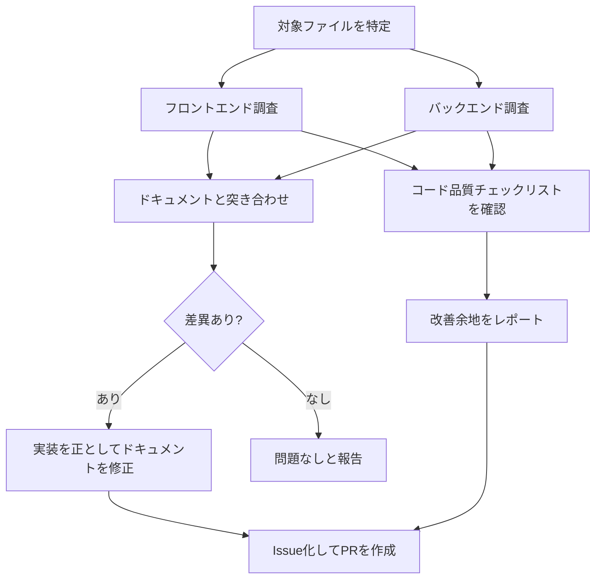

# 品質レビュー(quality-review)

このプロジェクトの実装品質とドキュメント整合性を、決まった観点で定期的にチェックするためのスキル。「品質チェックして」「実装とドキュメントが合っているか確認して」のような依頼を受けたら、このチェックリストに沿ってレビューする。

## レビューの流れ

## レビュー対象

- フロントエンド: `frontend/src/`（`pages/`・`components/`・`hooks/`・`api/`・`auth/`・`utils/`）、`frontend/.oxlintrc.json`、`frontend/package.json`
- バックエンド: `backend/src/main/java/com/example/snstimeline/`（`config/`・`controller/`・`service/`・`repository/`・`entity/`・`dto/`）、`backend/build.gradle`、`backend/src/test/`
- インフラ: `infra/*.tf`
- ドキュメント: `要件定義書.md`・`機能一覧.md`・`設計書.md`・`技術スタック.md`・`インフラ構成図.md`・`機能定義書/*.md`・`README.md`

## チェックリスト

詳しい観点・確認方法・なぜそれをチェックするのかの説明は[品質チェックリスト.md](../../../品質チェックリスト.md)を参照（人が読んで学ぶための詳細版）。このスキルはその要約版として、実行時に参照するチェック項目IDだけを一覧にしている。

### フロントエンド（FE-1〜FE-10）

- [ ] FE-1: Lintツール（`oxlint`）が導入されているか
- [ ] FE-2: Lintルールが主要な観点（hooksルール等）をカバーしているか
- [ ] FE-3: テストフレームワーク（Vitest/React Testing Library等）が導入されているか
- [ ] FE-4: コンポーネントの責務が1ファイル1役割に分かれているか（`pages/`と`components/`の役割分担）
- [ ] FE-5: 状態管理が一元化されているか（ログイン状態は`AuthContext`、一覧は各カスタムフック）
- [ ] FE-6: `dangerouslySetInnerHTML`等、XSSリスクのあるレンダリングが無いか（投稿・コメント・自己紹介）
- [ ] FE-7: 未使用のデッドコードが残っていないか
- [ ] FE-8: APIエラーハンドリングが一貫しているか（`http.js`での401処理、楽観的更新の失敗時の巻き戻し）
- [ ] FE-9: 環境変数・機密情報の管理が適切か（`.env`のgit管理状況、JWTの扱い）
- [ ] FE-10: ファイル構成・命名規則に一貫性があるか

### バックエンド（BE-1〜BE-14）

- [ ] BE-1: レイヤ構成（`controller` → `service` → `repository`の分離）があるか
- [ ] BE-2: 共通例外ハンドラ（`@RestControllerAdvice`）があり、400/401/403/404/409/413のエラーレスポンスの形が一貫しているか
- [ ] BE-3: バリデーション（`@Valid`・Bean Validationアノテーション）が[要件定義書 8-1](../../../要件定義書.md#8-1-数値の一覧変更するときはここを基準に各ドキュメントを修正する)の数値と一致しているか
- [ ] BE-4: エンティティをレスポンスにそのまま返していないか（特に`User`の`passwordHash`が漏れていないか）
- [ ] BE-5: Lint・静的解析ツール（Checkstyle/Spotless/PMD等）が導入されているか
- [ ] BE-6: CI（`.github/workflows`）でLint・テストが自動実行されているか
- [ ] BE-7: テストカバレッジ（正常系・異常系、ログイン済み／未ログインのテストがあるか）
- [ ] BE-8: DB接続情報・JWT署名キー・AWS認証情報がハードコード・コミットされていないか
- [ ] BE-9: 検索・絞り込みがDBクエリで行われているか（LIKEのエスケープ含む）
- [ ] BE-10: 複数更新をまたぐ処理（投稿＋画像保存など）にトランザクション管理（`@Transactional`）の考慮があるか
- [ ] BE-11: 認可（本人チェック）がサーバー側で行われているか（投稿・コメント削除、プロフィール更新）
- [ ] BE-12: 一覧取得でN+1問題が起きていないか（いいね数・コメント数・画像のまとめ取得）
- [ ] BE-13: ログにパスワード・JWT・メールアドレス・本文・検索キーワードを出していないか
- [ ] BE-14: ログのレベル（ERROR は要対応だけ）と `event.action` が設計書 8章どおりか

### ドキュメント整合性（DOC-1〜DOC-5）

- [ ] DOC-1: `要件定義書.md`・`機能一覧.md`の機能・画面仕様・ユースケースが、実際の画面・操作と一致しているか
- [ ] DOC-2: `設計書.md`のER図・テーブル定義・API一覧が、実際のエンティティ・エンドポイント・レスポンスと一致しているか
- [ ] DOC-3: `機能定義書/*.md`が、対応するコンポーネント・API・関連ファイルの現状と一致しているか
- [ ] DOC-4: README.mdのドキュメント一覧・主な機能・開発フェーズの状態が現状と一致しているか
- [ ] DOC-5: ドキュメント間の相互リンクが切れていないか
- [ ] 差異が見つかった場合は、実装を正としてドキュメント側を修正する（CLAUDE.mdの運用ルールに従い、Issue作成→ブランチ作成→修正→PR作成の流れで行う）

## 実施記録の付け方

レビューを実施したら、見つけた内容を判定（✅/⚠️/❌）とともに[品質チェック記録.md](../../../品質チェック記録.md)に日付見出しで追記する。過去の記録は書き換えず、状況が変わったら新しい日付で追記していく（このファイル自体には実施記録を書かない）。
