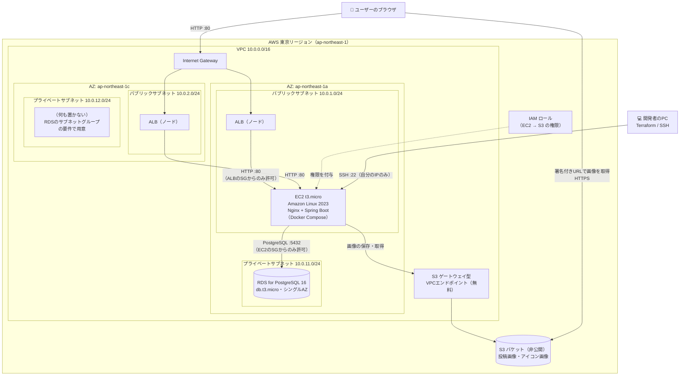
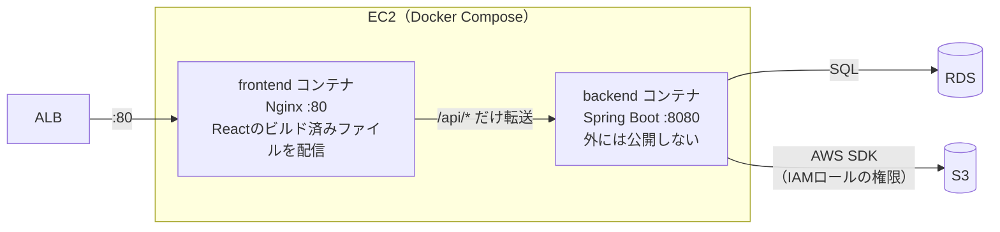
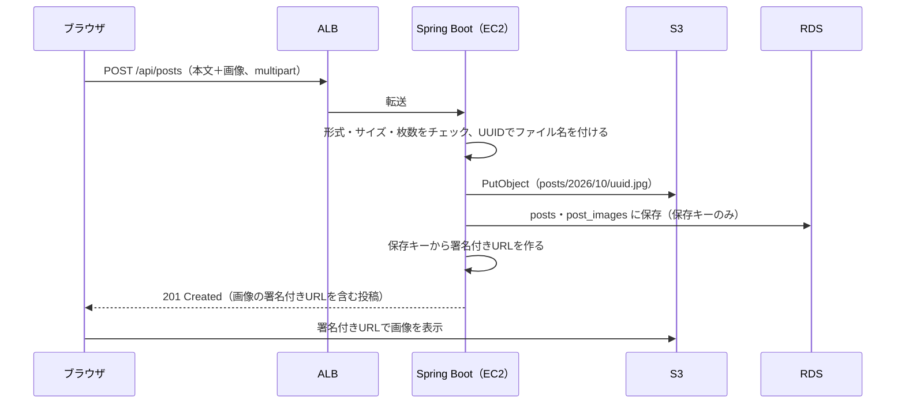
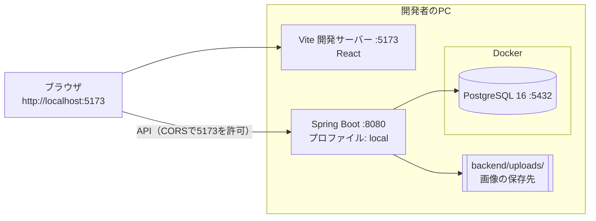

# インフラ構成図

作成日: 2026-10-02
関連ドキュメント: [要件定義書](./要件定義書.md)／[技術スタック](./技術スタック.md)／[設計書](./設計書.md)

AWSでサーバーを構築するかはまだ確定していないが、構築する場合は **EC2 + ALB + RDS + S3** の構成にする前提で、構成図を先に作っておく。前回の課題（Trello風アプリ、[kuroda1995/github-demo](https://github.com/kuroda1995/github-demo)）の「AWSデプロイ手順書.md」と同じく、すべて Terraform で作成し、**無料利用枠に収めることを最優先**にする。

## 1. 構成のポイント（前回の課題からの変更点）

| 項目 | 前回の課題 | 今回 | 変更する理由 |
|------|-----------|------|--------------|
| 入口 | EC2に直接アクセス（EC2のパブリックIP） | **ALB** 経由でアクセス | ALBの使い方を学ぶため。将来EC2を2台に増やしても、入口のURLが変わらない |
| ネットワーク | Default VPC を間借り | **自分で VPC を設計** | ALBは2つ以上のAZ（データセンター）のサブネットが必要。DBを置くプライベートサブネットも自分で作る |
| EC2の場所 | パブリックサブネット（80番を全世界に公開） | パブリックサブネット（**ALBからの通信だけ**許可） | プライベートサブネットに置くと NAT Gateway（有料）が必要になるため。代わりにセキュリティグループで ALB 以外からの通信を遮断する |
| DB | RDS（Default VPC内） | RDS（**プライベートサブネット**） | インターネットから完全に到達できない場所に置く |
| 画像 | なし | **S3**（非公開バケット） | 画像をEC2のディスクに置くと、EC2を作り直したときに消えてしまうため |
| S3への権限 | なし | **IAMロール** | EC2にアクセスキーを置かずに、S3を操作する権限を与えるため |

## 2. 全体構成図



### 図の読み方

- **ALB** は1つのリソースだが、実体は2つのAZのパブリックサブネットにそれぞれ置かれる（AWSが自動で配置する）。片方のAZが止まっても、もう片方で受け付けられる
- **EC2** は1台だけ（無料枠に収めるため）。ALBはこの1台に通信を流す
- **RDS** はシングルAZ。AZ-c のプライベートサブネットは、RDSの「サブネットグループは2つ以上のAZが必要」という決まりのためだけに作る（中身は空）
- **画像の表示**は、ブラウザがS3から直接取得する。S3は非公開なので、Spring Bootが発行した**署名付きURL**（1時間だけ有効なURL）を使う

## 3. EC2の中の構成とリクエストの流れ

前回の課題と同じく、EC2の中では Docker Compose で2つのコンテナを動かす。DBはRDSにあるので、EC2の中には置かない。



| リクエスト | 流れ |
|---|---|
| 画面（`/`、`/users/hanako` など） | ブラウザ → ALB → Nginx → Reactの `index.html` を返す |
| API（`/api/...`） | ブラウザ → ALB → Nginx → Spring Boot → RDS／S3 |
| 画像の表示 | ブラウザ → S3（署名付きURL） |
| ヘルスチェック | ALB → Nginx → Spring Boot の `/api/health`（30秒ごと） |

> **ポイント — CORS設定が不要になる理由**
> ブラウザは常に ALB の同じURLにアクセスし、Nginx が `/api/` だけを Spring Boot に転送するため、フロントとAPIが「同じオリジン」になる。前回の課題と同じ仕組み。

### 画像アップロードの流れ



## 4. セキュリティグループ（通信の許可ルール）

「どこから、どのポートへの通信を許可するか」を、サーバーの役割ごとに決める。**それ以外の通信はすべて拒否**される。

| セキュリティグループ | 付ける先 | 受け付ける通信（インバウンド） | 理由 |
|---|---|---|---|
| `alb-sg` | ALB | 80番：インターネット全体（`0.0.0.0/0`） | 誰でもアプリを開けるようにする |
| `app-sg` | EC2 | 80番：**`alb-sg` からのみ**<br/>22番：**自分のPCのIPからのみ** | EC2はパブリックサブネットにあるが、ALBを通らない直接アクセスは拒否する |
| `rds-sg` | RDS | 5432番：**`app-sg` からのみ** | DBにはEC2からしか接続できないようにする |

> **ポイント — IPアドレスではなく「セキュリティグループ」で許可する**
> `app-sg` の80番は「ALBのIPアドレス」ではなく「`alb-sg` が付いたもの」から許可する。ALBのIPアドレスは AWS の都合で変わることがあるが、セキュリティグループで指定すれば自動で追従する。前回の課題の RDS と同じ考え方。

### S3 バケットの設定

| 項目 | 設定 | 理由 |
|---|---|---|
| パブリックアクセス | すべてブロック | 画像は署名付きURLでのみ見られるようにする |
| 権限 | EC2のIAMロールに、このバケットの `s3:PutObject`・`s3:GetObject`・`s3:DeleteObject` だけを許可 | 必要最小限の権限にする（最小権限の原則） |
| 暗号化 | SSE-S3（AWSの標準の暗号化、無料） | デフォルトで有効 |
| CORS | 不要 | ブラウザは画像を `` タグで表示するだけで、JavaScriptからS3へ直接アップロードしないため |

## 5. 無料利用枠とコスト

> **注意 — 無料利用枠の内容はアカウントの作成日によって違う**
> AWSは2025年7月に無料利用枠の仕組みを変更している。それより前に作ったアカウントは「作成から12か月間、サービスごとに一定量が無料」、それ以降に作ったアカウントは「クレジット（無料で使える金額）が付与される」方式になっている。**自分のアカウントがどちらか**を、コンソールの「請求とコスト管理 → 無料利用枠」で必ず確認し、[AWS料金見積りツール](https://calculator.aws/) で金額を確かめてから構築すること。

| リソース | 今回の設定 | 無料利用枠（12か月方式の場合）との関係 |
|---|---|---|
| EC2 | `t3.micro` × 1台、ディスク 30GB | 750時間/月まで無料。2台にすると超える |
| ALB | 1つ | 750時間/月まで無料（12か月方式の場合）。**クレジット方式のアカウントでは時間課金**（東京リージョンで月2,000〜3,000円程度） |
| RDS | `db.t3.micro`、シングルAZ、20GB | 750時間/月・20GBまで無料。マルチAZにすると対象外 |
| S3 | 画像のみ | 5GBまで無料（1枚5MB × 1,000枚程度） |
| S3 VPCエンドポイント（ゲートウェイ型） | 1つ | **常に無料** |
| パブリックIPv4アドレス | EC2・ALBに付く | 2024年から課金対象。EC2の1つ分は無料枠に含まれるが、**ALBのアドレスは課金される場合がある** |
| NAT Gateway | **使わない** | 無料枠の対象外で、置いておくだけで月5,000〜7,000円程度かかる |
| Route 53・独自ドメイン | **使わない**（ALBのURLに直接アクセス） | ホストゾーンだけで月額がかかる |
| HTTPS（ACM） | 今回は使わない（HTTPのみ） | 証明書自体は無料だが、独自ドメインが必要 |

### コストを抑えるための運用ルール

1. 構築前に、コンソールの「Budgets」で **月 $5 を超えたらメール通知** する予算アラートを設定する
2. 使わないときは `terraform destroy` で丸ごと削除する（Terraformのコードがあれば `terraform apply` でいつでも作り直せる）
3. destroy する前に、残したいデータ（RDS・S3）が無いか確認する

## 6. Terraformのファイル構成（予定）

前回の課題では `main.tf` 1つにまとめていたが、今回はリソースが増えるため役割ごとにファイルを分ける。

```
infra/
├── providers.tf    # AWSプロバイダーの宣言
├── variables.tf    # リージョン、プロジェクト名、自分のIP、DBパスワードなど
├── network.tf      # VPC・サブネット4つ・Internet Gateway・ルートテーブル・S3エンドポイント
├── security.tf     # セキュリティグループ3つ（alb-sg / app-sg / rds-sg）
├── alb.tf          # ALB・ターゲットグループ（ヘルスチェック /api/health）・リスナー（80番）
├── ec2.tf          # EC2・キーペア・IAMロール（インスタンスプロファイル）
├── rds.tf          # RDS・DBサブネットグループ
├── s3.tf           # S3バケット・パブリックアクセスブロック
├── outputs.tf      # ALBのURL、EC2のIP、RDSのエンドポイント
├── user_data.sh    # EC2起動時にDocker Composeでアプリを起動するスクリプト
└── terraform.tfvars  # 自分のIP・DBパスワード（.gitignore で除外）
```

| 作成順 | 何ができるか |
|---|---|
| 1. network.tf | VPC・サブネット（入れ物）ができる |
| 2. security.tf | 通信の許可ルールができる |
| 3. rds.tf・s3.tf | DB と画像置き場ができる |
| 4. ec2.tf | アプリを動かすサーバーができる（RDSのエンドポイント・S3のバケット名を環境変数で渡す） |
| 5. alb.tf | 入口ができ、ALBのURLでアプリが開けるようになる |

Terraformは依存関係（どれを先に作るべきか）を自動で判断するので、実際には `terraform apply` を1回実行すればよい。上の順番は、**少しずつ作って動作確認しながら学ぶ**場合の目安。

## 7. ローカル開発環境の構成（フェーズ1）

AWSを使う前に、まずローカルで全機能を動かす。



| 項目 | ローカル（フェーズ1） | AWS（フェーズ2） |
|---|---|---|
| フロントの配信 | Vite 開発サーバー（5173番） | Nginx コンテナ（ALB経由） |
| API | Spring Boot（8080番） | Spring Boot コンテナ（Nginx経由） |
| DB | Docker の PostgreSQL | RDS |
| 画像 | `backend/uploads/` | S3 |
| Springのプロファイル | `local` | `aws` |
| 秘密情報の渡し方 | `application-local.properties`（.gitignore） | EC2の環境変数（`.env`、user_data.sh で生成） |

## 8. 今後の発展（今回は作らない）

| 項目 | 内容 |
|------|------|
| HTTPS化 | 独自ドメインを取得し、Route 53 + ACM の証明書を ALB に設定する。JWTを平文のHTTPで送るのは本来危険なので、本番運用するなら最優先 |
| CloudFront | S3の画像をCDNで配信し、表示を速くする |
| EC2を2台に | Auto Scaling Group で2つのAZにEC2を置き、片方が止まっても動き続けるようにする（無料枠を超える） |
| 秘密情報の管理 | DBパスワード・JWT署名キーを SSM Parameter Store／Secrets Manager に置く |
| SSHをやめる | SSM Session Manager を使えば、22番ポートを開けずにEC2にログインできる |
| CI/CD | GitHub Actions で、mainへのマージをきっかけに自動デプロイする |
