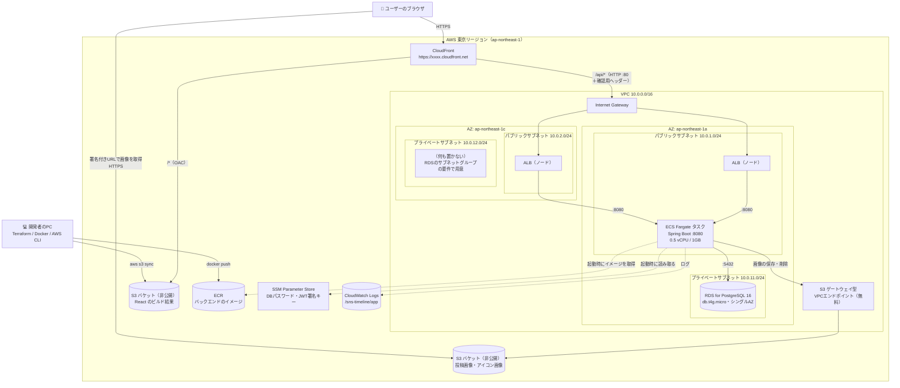
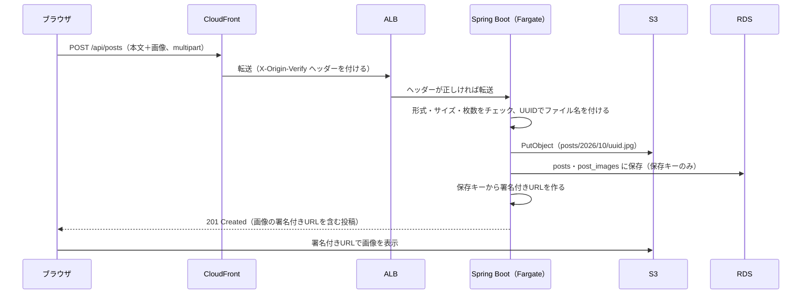
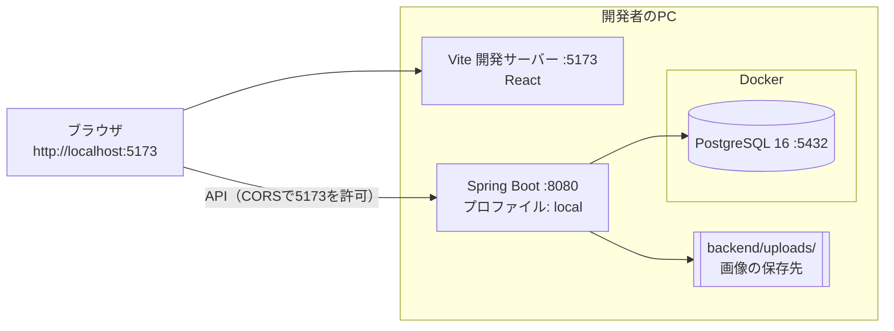
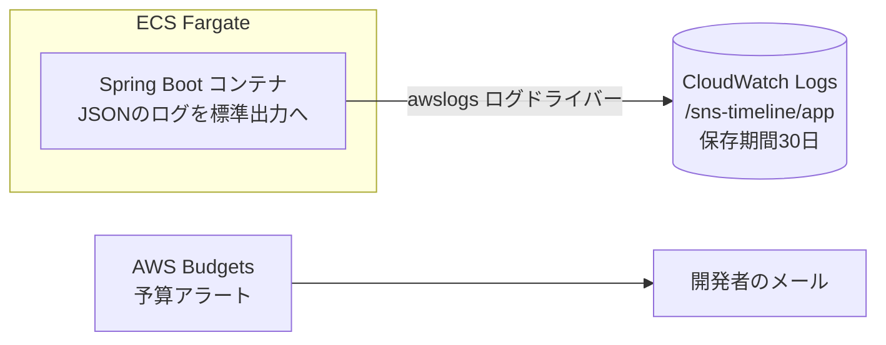

# インフラ構成図

作成日: 2026-10-02（2026-11-10 更新：EC2 をやめ、S3 + CloudFront + ECS Fargate の構成に変更）
関連ドキュメント: [要件定義書](./要件定義書.md)／[技術スタック](./技術スタック.md)／[設計書](./設計書.md)

AWS には **CloudFront + S3（画面）＋ ALB + ECS Fargate（API）＋ RDS + S3（画像）** の構成でデプロイする。サーバー（EC2）は使わない。前回の課題（Trello風アプリ、[kuroda1995/github-demo](https://github.com/kuroda1995/github-demo)）と同じく、すべて Terraform（[infra/](./infra/)）で作成する。

> **重要 — 動作確認が済んだら削除する**
> このアカウントはクレジット方式の無料プランで、この構成を動かし続けると**月 $70 前後**かかり、クレジットが1か月持たない（[5章](#5-コスト)）。そのため「`terraform apply` で作る → 動作確認する → その日のうちに `terraform destroy` で削除する」運用にする。Terraform のコードがあれば、いつでも同じ環境を作り直せる。

## 1. 構成のポイント

| 項目 | 以前の案（EC2） | 今回 | 変える理由 |
|------|-----------|------|--------------|
| 画面の配信 | EC2 の Nginx | **S3 + CloudFront** | サーバーを持たずに静的ファイルを配信できる |
| API | EC2 の Docker Compose | **ECS Fargate** | OS の更新・SSH などサーバーの管理が要らない。コンテナだけを渡せば動く |
| 入口 | ALB（HTTP） | **CloudFront（HTTPS）** → ALB | `xxxx.cloudfront.net` には証明書が付いているので、独自ドメインなしで HTTPS になる。JWT を平文の HTTP で送らずに済む |
| オリジン | 画面と API が同じ（Nginx が振り分け） | 同じ（**CloudFront がパスで振り分け**） | 画面と API が同じURLになり、CORS が要らない |
| イメージ置き場 | なし（EC2 上でビルド） | **ECR** | ECS がここからイメージを取得する |
| 秘密情報 | EC2 の `.env` | **SSM Parameter Store** | タスク定義やイメージに値を入れずに、起動時に環境変数として渡せる |
| ネットワーク | 自分で VPC を設計 | 同じ | ALB は2つ以上のAZのサブネットが必要。DB はプライベートサブネットに置く |
| 画像 | S3（非公開）＋署名付きURL | 同じ | |

## 2. 全体構成図



### 図の読み方

- **CloudFront** がブラウザの唯一の入口。`/api/*` は ALB に、それ以外は S3（画面）に振り分ける
- **ALB** は1つのリソースだが、実体は2つのAZのパブリックサブネットにそれぞれ置かれる（AWSが自動で配置する）
- **Fargate タスク**は1つだけ。起動し直すたびに IP アドレスが変わるため、CloudFront から直接はつなげない。ALB がタスクの IP を自動で追いかける（ターゲットタイプ `ip`）
- タスクは**パブリックサブネット**に置き、パブリック IP を付ける。ECR・CloudWatch Logs・SSM に接続するため。プライベートサブネットに置くと NAT Gateway（月 $45 程度）かインターフェース型の VPC エンドポイント（1つ月 $10 程度で4つ必要）が要る。代わりに、セキュリティグループで ALB 以外からの通信を遮断する
- **RDS** はシングルAZ。AZ-c のプライベートサブネットは、RDSの「サブネットグループは2つ以上のAZが必要」という決まりのためだけに作る（中身は空）
- **画像の表示**は、ブラウザがS3から直接取得する。S3は非公開なので、Spring Bootが発行した**署名付きURL**（1時間だけ有効なURL）を使う

## 3. リクエストの流れ

| リクエスト | 流れ |
|---|---|
| 画面（`/`、`/users/hanako` など） | ブラウザ → CloudFront →（CloudFront Function で `/index.html` に書き換え）→ S3 |
| 画面のファイル（`/assets/*`） | ブラウザ → CloudFront（キャッシュがあればここで返す）→ S3 |
| API（`/api/...`） | ブラウザ → CloudFront（キャッシュしない）→ ALB → Fargate タスク → RDS／S3 |
| 画像の表示 | ブラウザ → S3（署名付きURL） |
| ヘルスチェック | ALB → Fargate タスクの `/api/health`（30秒ごと） |

### CloudFront の振り分け（`infra/cloudfront.tf`）

| パス | 送り先 | キャッシュ | ヘッダーなどの転送 |
|---|---|---|---|
| `/api/*` | ALB | しない（`Managed-CachingDisabled`） | Host 以外すべて（`Managed-AllViewerExceptHostHeader`）。`Authorization` も届く |
| それ以外 | S3（OAC） | する（`Managed-CachingOptimized`） | なし |

> **ポイント — SPA のURLは CloudFront Function で index.html に書き換える**
> `/users/hanako` を直接開くと、S3 にはそのファイルが無いので 403 になる。よくある「403/404 のエラーページを index.html にする」設定は**ディストリビューション全体に効く**ため、API が返す 404（JSON）まで HTML に置き換わってしまう。そこで、S3 向けの振り分けにだけ CloudFront Function（[infra/functions/spa-rewrite.js](./infra/functions/spa-rewrite.js)）を付け、`/assets/*`・`/favicon.svg` 以外を `/index.html` に書き換える。ユーザー名に「.」が入っても誤ってファイルとみなさないよう、拡張子ではなくパスで判定する。

> **ポイント — CORS 設定が要らない理由**
> ブラウザは常に CloudFront の同じURLにアクセスし、CloudFront が `/api/*` だけを ALB に転送するため、フロントとAPIが「同じオリジン」になる。フロントの本番ビルドは API を同じオリジンに送る（`src/api/http.js` の `BASE_URL` が空）。

### 画像アップロードの流れ



## 4. セキュリティ

### セキュリティグループ（通信の許可ルール）

「どこから、どのポートへの通信を許可するか」を、役割ごとに決める。**それ以外の通信はすべて拒否**される。

| セキュリティグループ | 付ける先 | 受け付ける通信（インバウンド） | 理由 |
|---|---|---|---|
| `alb-sg` | ALB | 80番：**CloudFront の IP アドレスからのみ**（マネージドプレフィックスリスト `com.amazonaws.global.cloudfront.origin-facing`） | CloudFront を通らない直接アクセスを拒否する |
| `app-sg` | Fargate タスク | 8080番：**`alb-sg` からのみ** | タスクはパブリックサブネットにあるが、ALBを通らない直接アクセスは拒否する |
| `rds-sg` | RDS | 5432番：**`app-sg` からのみ** | DBにはタスクからしか接続できないようにする |

> **ポイント — ALB は2重に守る**
> セキュリティグループだけだと、**他人が作った CloudFront** からも ALB に届いてしまう（IP アドレスの一覧は全利用者で共通のため）。そこで CloudFront が秘密のヘッダー `X-Origin-Verify`（Terraform がランダムに作る値）を付けて送り、ALB のリスナールールでこの値が正しいときだけ Spring Boot に転送する。正しくなければ 403 を返す。

### IAM ロール

| ロール | 使う人 | 許可すること |
|---|---|---|
| タスク実行ロール（`sns-timeline-task-execution`） | ECS（タスクを起動するとき） | ECR からイメージを取得、CloudWatch Logs にログを送る、SSM のパラメータ2つ（DBパスワード・JWT署名キー）を読む |
| タスクロール（`sns-timeline-task`） | Spring Boot（アプリ） | 画像バケットの `s3:PutObject`・`s3:GetObject`・`s3:DeleteObject` だけ |

アクセスキーはどこにも置かない。Spring Boot の AWS SDK は、タスクロールの権限を自動で使う。

### S3 バケットの設定

| 項目 | フロント用（`sns-timeline-frontend-<アカウントID>`） | 画像用（`sns-timeline-images-<アカウントID>`） |
|---|---|---|
| パブリックアクセス | すべてブロック | すべてブロック |
| 読める人 | **この CloudFront だけ**（OAC。バケットポリシーで `AWS:SourceArn` を指定） | タスクロールと、署名付きURLを持つ人 |
| 暗号化 | SSE-S3（標準、無料） | SSE-S3（標準、無料） |
| CORS | 不要 | 不要（ブラウザは `` タグで表示するだけ） |
| destroy のとき | 中身ごと削除（`force_destroy`） | 中身ごと削除（`force_destroy`） |

## 5. コスト

> **注意 — このアカウントはクレジット方式の無料プラン**
> AWSは2025年7月に無料利用枠の仕組みを変えた。それ以降に作ったアカウントは「クレジット（無料で使える金額）が付与される」方式で、EC2・RDS の「750時間無料」のような枠は無く、**使った分がクレジットから引かれる**。クレジットを使い切るか期限が来ると、アカウントは停止される。残りのクレジットは `aws freetier get-account-plan-state --region us-east-1` で確認できる。

| リソース | 設定 | 1時間あたり（概算） | 1か月動かし続けた場合 |
|---|---|---|---|
| ECS Fargate | 0.5 vCPU / 1GB × 1タスク（x86_64） | $0.031 | 約 $22 |
| ALB | 1つ | $0.024 ＋ 処理量（LCU） | 約 $20 |
| パブリック IPv4 | ALB に2つ、タスクに1つ | $0.015 | 約 $11 |
| RDS | `db.t4g.micro`、シングルAZ、gp3 20GB | $0.029 | 約 $21 |
| CloudFront | | ほぼ $0 | 月1TB・1,000万リクエストまで無料 |
| S3・ECR・SSM（標準）・CloudWatch Logs | | ほぼ $0 | 数十セント |
| NAT Gateway | **使わない** | | |
| Route 53・独自ドメイン・ACM | **使わない**（CloudFront の既定ドメインを使う） | | |
| **合計** | | **約 $0.10** | **約 $72** |

### コストを抑えるための運用ルール

1. **動作確認が済んだら、その日のうちに `terraform destroy` で削除する**（1日動かしても $2.5 程度）
2. `terraform.tfvars` に `budget_alert_email` を書くと、予算（既定 $20/月）の 50%・80%・100% を超えたときにメールが届く
3. destroy する前に、残したいデータ（RDS・S3）が無いか確認する。RDS は最終スナップショットを取らずに削除する設定にしている

## 6. Terraformのファイル構成

```
infra/
├── providers.tf        # Terraform・AWS プロバイダー（6.70.0）・random プロバイダーの宣言、共通タグ
├── variables.tf        # リージョン、イメージのタグ、タスクの CPU・メモリ、予算アラートの通知先
├── network.tf          # VPC・サブネット4つ・Internet Gateway・ルートテーブル・S3 エンドポイント
├── security.tf         # セキュリティグループ3つ（alb-sg / app-sg / rds-sg）
├── alb.tf              # ALB・ターゲットグループ（ヘルスチェック /api/health）・リスナー（80番、確認用ヘッダー）
├── ecr.tf              # ECR リポジトリ（古いイメージは5つまで残して自動で削除）
├── ecs.tf              # ECS クラスター・タスク定義・サービス・IAM ロール2つ
├── rds.tf              # RDS・DBサブネットグループ
├── s3.tf               # S3 バケット2つ（フロント・画像）・パブリックアクセスブロック・バケットポリシー
├── cloudfront.tf       # CloudFront・OAC・CloudFront Function
├── ssm.tf              # DBパスワード・JWT署名キー（ランダムに作り、SecureString で保存）
├── monitoring.tf       # CloudWatch Logs のロググループ（保存期間30日）・予算アラート
├── outputs.tf          # アプリのURL、ECR のURL、バケット名など
├── functions/
│   └── spa-rewrite.js  # SPA のURLを index.html に書き換える CloudFront Function
├── scripts/
│   └── deploy-app.sh   # イメージの push・ECS の入れ替え・フロントのアップロード
├── .terraform.lock.hcl # プロバイダーのバージョンを固定する（コミットする）
└── terraform.tfvars    # 予算アラートの通知先など（.gitignore で除外。無くても動く）
```

秘密情報（DBパスワード・JWT署名キー・確認用ヘッダーの値）は `random_password` で作るため、手で決める値は無い。これらの値は **tfstate に平文で入る**ので、tfstate は絶対にコミットしない（`.gitignore` 済み）。

## 7. デプロイと削除の手順

前提：AWS CLI（認証済み）・Terraform 1.6 以上・Docker・Node.js が使えること。

```bash
cd infra
terraform init

# 1. ECR だけを先に作り、バックエンドのイメージを push する
#    （先に ECS のサービスを作ると、イメージが無くてタスクの起動に失敗し続けるため）
terraform apply -target=aws_ecr_repository.backend -target=aws_ecr_lifecycle_policy.backend
ECR=$(terraform output -raw ecr_repository_url)
aws ecr get-login-password | docker login --username AWS --password-stdin "${ECR%%/*}"
docker build --platform linux/amd64 -t "$ECR:latest" ../backend
docker push "$ECR:latest"

# 2. 残りをすべて作る（RDS・CloudFront の作成に10分前後かかる）
terraform apply

# 3. アプリを配置する（フロントのビルドとアップロード、ECS のタスクの入れ替え）
cd ..
bash infra/scripts/deploy-app.sh
```

最後に表示される `https://xxxx.cloudfront.net` をブラウザで開く。2回目以降にアプリだけを更新するときは、3 だけを実行すればよい。

**削除**：

```bash
cd infra
terraform destroy
```

ECR のイメージ・S3 のファイル・RDS のデータもすべて消える。CloudFront の削除には数分かかる。

### うまく動かないとき

| 症状 | 確認すること |
|---|---|
| 画面は出るが API が 502/503 | ECS のタスクが起動しているか（`aws ecs describe-services`）。CloudWatch Logs `/sns-timeline/app` に Spring Boot の起動エラーが出ていないか |
| API が 403（本文 `Forbidden`） | ALB のリスナールールの確認用ヘッダーと、CloudFront のカスタムヘッダーの値が一致しているか |
| タスクが起動と停止を繰り返す | ECR にイメージがあるか、DB に接続できているか（`rds-sg` の設定）、ヘルスチェックの猶予（180秒）内に起動できているか |
| 画面を更新しても古いまま | `deploy-app.sh` の `create-invalidation`（キャッシュの削除）が終わっているか |

## 8. ローカル開発環境の構成（フェーズ1）

AWSを使う前に、まずローカルで全機能を動かす。



| 項目 | ローカル（フェーズ1） | AWS（フェーズ2） |
|---|---|---|
| フロントの配信 | Vite 開発サーバー（5173番） | S3 + CloudFront |
| API | Spring Boot（8080番） | ECS Fargate（ALB 経由） |
| DB | Docker の PostgreSQL | RDS |
| 画像 | `backend/uploads/`（`LocalImageStorage`） | S3（`S3ImageStorage`） |
| Springのプロファイル | `local` | `aws`（画像の保存先を S3 に、ログを JSON にする） |
| 秘密情報の渡し方 | `application-local.properties`（.gitignore） | SSM Parameter Store → タスク定義の `secrets` で環境変数に |

## 9. 今後の発展（今回は作らない）

| 項目 | 内容 |
|------|------|
| 独自ドメイン | Route 53 でドメインを取得し、ACM の証明書を CloudFront に設定する（CloudFront 用の証明書は us-east-1 で作る） |
| CloudFront と ALB の間も HTTPS に | 独自ドメインがあれば ALB にも証明書を付けられる。または CloudFront の VPC オリジンで ALB をプライベートサブネットに置く |
| 画像も CloudFront から配信 | 画像を CloudFront の署名付きURL／署名付き Cookie で配信し、キャッシュを効かせる |
| タスクを2つに | ECS サービスの `desired_count` を2にし、片方が止まっても動き続けるようにする（料金も2倍） |
| CI/CD | GitHub Actions で、mainへのマージをきっかけにイメージの push と ECS の入れ替えを自動で行う（OIDC で AWS に接続し、アクセスキーを使わない） |
| アラーム | ALB の 5xx・`UnHealthyHostCount`、RDS の `FreeStorageSpace` などの CloudWatch アラーム（[設計書 8-5](./設計書.md#8-5-aws-での監視運用フェーズ2で構築)） |

## 10. ログと監視（フェーズ2）

アプリが出すログの形式・項目・レベルは [設計書 8章](./設計書.md#8-ログ設計) で決めている。AWS では、そのログを CloudWatch Logs に集める。



| 項目 | 設定 | 理由 |
|---|---|---|
| ログの送り方 | タスク定義の `logConfiguration`（`awslogs`、ロググループ `/sns-timeline/app`） | エージェントを入れずに、コンテナの出力をそのまま送れる |
| Spring のプロファイル | タスク定義の環境変数 `SPRING_PROFILES_ACTIVE=aws` | `application-aws.properties` でログを JSON にし、画像の保存先を S3 にする |
| IAM ロール | タスク実行ロールの `AmazonECSTaskExecutionRolePolicy` | ログの送信に必要な権限が含まれている |
| 保存期間 | 30日 | 初期設定の「無期限」だと料金が増え続ける |
| 予算アラート | `budget_alert_email` を指定したときだけ作る | 使いすぎにすぐ気づけるようにする |

> 動作確認のたびに削除する運用のため、エラー件数・5xx などの CloudWatch アラームはまだ作っていない（[9章](#9-今後の発展今回は作らない)）。ログの取り込み・保存は月5GBまで無料。Logs Insights は調べたデータ量で料金がかかるため、調べる期間は必要な分だけに絞る。
