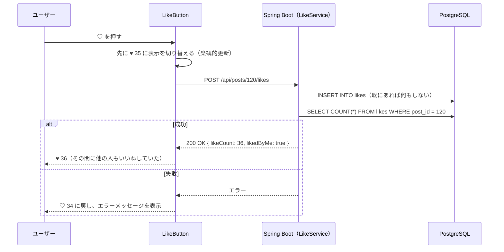

# いいね機能：投稿へのいいね・取り消し・いいね数の表示

作成日: 2026-10-02
関連ドキュメント: [要件定義書](../要件定義書.md)（3-1. No.5）／[機能一覧](../機能一覧.md)（LIKE-01〜04）／[設計書](../設計書.md#2-4-likesいいね)

投稿に「いいね」を付ける機能。自分の投稿にも、他の人（第三者）の投稿にもいいねできる。いいね数は、第三者からのいいねも含めた総数が誰からも見える。

## 1. できること

| 機能ID | できること |
|---|---|
| LIKE-01 | 投稿にいいねする。同じ投稿に同じ人がいいねできるのは1回だけ |
| LIKE-02 | いいね済みの投稿のいいねを取り消す |
| LIKE-03 | 投稿ごとのいいね数（第三者からのいいねを含む総数）を表示する |
| LIKE-04 | 自分がいいね済みの投稿は、ハートを塗りつぶして表示する |

### 今回やらないこと

- 「誰がいいねしたか」の一覧表示
- いいねされたときの通知

## 2. 画面操作の流れ

1. 投稿カードの ♡ を押す
2. **すぐに** ♥（塗りつぶし・赤色）に変わり、数字が1増える
3. もう一度押すと ♡ に戻り、数字が1減る
4. 通信に失敗した場合は、元の表示に戻して「いいねできませんでした」と表示する

## 3. 画面仕様

| 状態 | 表示 |
|---|---|
| いいねしていない | `♡ 34`（グレー） |
| いいね済み | `♥ 35`（赤色） |
| いいね数が0 | `♡`（数字は表示しない） |

- タイムライン（SC-03）、投稿詳細（SC-05）、プロフィールの投稿一覧（SC-06）のすべての投稿カードで同じように動く
- いいね数が1,000以上の場合も、今回はそのまま数字で表示する（「1.2K」のような省略はしない）

## 4. 処理のルール

| No | ルール | 理由 |
|---|---|---|
| 1 | `likes` テーブルに `UNIQUE (user_id, post_id)` を付ける | ボタンの連打や通信の再送で、同じいいねが2件登録されるのをDBで防ぐため |
| 2 | 既にいいね済みの投稿に「いいねする」を送っても、エラーにせず成功として扱う（**冪等**） | 連打したときに、2回目がエラーにならないようにするため |
| 3 | いいねしていない投稿に「取り消し」を送っても、エラーにせず成功として扱う | 同上 |
| 4 | いいね・取り消しのレスポンスで、**最新のいいね数**を返す | 他の人も同時にいいねしているため、画面で+1/−1しただけの数字は正確ではない。サーバーの数字で上書きする |
| 5 | 削除済みの投稿にはいいねできない（404） | |
| 6 | 画面は通信の完了を待たずに先に切り替える（**楽観的更新**）。失敗したら元に戻す | ボタンを押してから反応するまでの待ち時間を無くし、操作を軽快にするため |
| 7 | 登録は `INSERT ... ON CONFLICT (user_id, post_id) DO NOTHING` で行う（「確認してから登録」にしない） | 同時に届いた2つのリクエストが両方とも「未いいね」と判定し、2件目が一意制約違反（500）になるのを防ぐため（[設計書 2-4](../設計書.md#2-4-likesいいね)） |
| 8 | 通信中にもう一度押された場合は、同時にリクエストを出さず、前の通信が終わってから「最後に押した状態」になるまで1件ずつ送る | 「いいね」と「取り消し」の届く順番が入れ替わり、画面とサーバーの状態がずれるのを防ぐため |
| 9 | 投稿詳細でいいねした結果は、タイムラインの同じ投稿にも反映する | 詳細から戻ったときに、タイムラインの表示が古いままにならないようにするため |

> **用語 — 冪等（べきとう）**
> 同じ操作を1回やっても、何回やっても、結果が同じになること。「いいねする」を2回送っても、いいねは1件のまま、という状態。ネットワークが不安定で同じリクエストが2回届いても困らないように設計する。

> **用語 — 楽観的更新（Optimistic Update）**
> 「たぶん成功するだろう」と楽観的に考えて、サーバーの返事を待たずに画面を先に更新する方法。いいねのような軽い操作でよく使われる。失敗したときに元に戻す処理を忘れないことが大事。

## 5. 関連ファイル（フロントエンド）

| ファイル | 役割 |
|----------|------|
| `components/LikeButton.jsx` | ♡/♥ といいね数の表示。押したときに楽観的更新 → API呼び出し → 最新のいいね数で上書き、失敗時は元に戻す。通信中の連打は1件ずつ送る |
| `components/PostCard.jsx` | `LikeButton` を置き、変更を `onPostChange(postId, patch)` で親に伝える |
| `hooks/useTimeline.js` | `patchPost(postId, { likeCount, likedByMe })` で一覧の該当投稿の一部だけを書き換える |
| `pages/PostDetailPage.jsx` | 詳細の投稿と、タイムラインの同じ投稿の両方を書き換える |
| `api/postsApi.js` | `likePost(postId)`・`unlikePost(postId)` |

## 6. 関連ファイル（バックエンド）

| ファイル | 役割 |
|----------|------|
| `controller/LikeController.java` | `/api/posts/{postId}/likes` の受付 |
| `service/LikeService.java` | 投稿の存在確認（削除済みなら404） → 登録／削除 → 最新のいいね数を返す |
| `entity/PostLike.java` | `likes` テーブル（JPQLでは `LIKE` が予約語のため、クラス名は `PostLike`） |
| `repository/LikeRepository.java` | `insertIfAbsent()`（`ON CONFLICT DO NOTHING`）・`deleteByUserIdAndPostId()`・`countByPostId()`、一覧用にまとめて取得する `countByPostIds()`・`findLikedPostIds()` |
| `service/PostQueryService.java` | タイムライン・投稿詳細などの投稿に、いいね数・いいね済みを投稿IDまとめて付ける（[設計書 3-2](../設計書.md#3-2-いいね数コメント数いいね済みの判定)） |

## 7. API仕様

### L-01 いいねする `POST /api/posts/{postId}/likes`

### L-02 いいね取り消し `DELETE /api/posts/{postId}/likes`

どちらもリクエストボディは無し。レスポンスは同じ形。

```json
{ "likeCount": 35, "likedByMe": true }
```

| レスポンス | 条件 |
|---|---|
| 200 OK | 成功（既にいいね済み／いいねしていない場合も成功） |
| 404 Not Found | 投稿が存在しない、または削除済み |

## 8. データの流れ



## 9. 確認すること（テスト観点）

- [ ] ♡ を押すと ♥ になり、数字が1増える。もう一度押すと元に戻る
- [ ] ♡ を素早く連打しても、DBの `likes` に同じ組み合わせが2件できない
- [ ] ユーザーAといいね、ユーザーBでログインして同じ投稿を見ると、いいね数に A の分が含まれ、B の画面では ♡（いいねしていない）になっている
- [ ] 通信を切った状態で押すと、表示が元に戻りエラーが表示される
- [ ] 削除済みの投稿IDに `POST /api/posts/{id}/likes` を直接呼ぶと 404 になる
