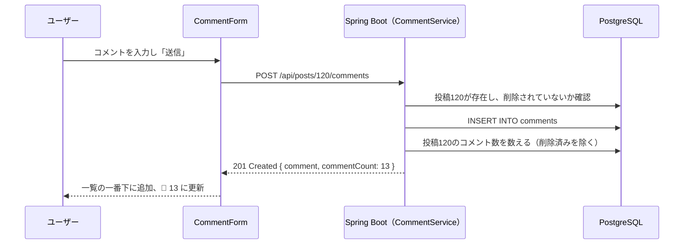

# コメント機能：投稿へのコメント・コメント数の表示

作成日: 2026-10-02
関連ドキュメント: [要件定義書](../要件定義書.md)（3-1. No.6）／[機能一覧](../機能一覧.md)（CMT-01〜04）／[設計書](../設計書.md#2-5-commentsコメント)／[投稿機能](./投稿機能.md)

投稿にコメントを書く機能。自分の投稿にも、他の人（第三者）の投稿にもコメントできる。コメント数は、第三者からのコメントも含めた総数が誰からも見える。

## 1. できること

| 機能ID | できること |
|---|---|
| CMT-01 | 投稿に140文字以内のコメントを書く |
| CMT-02 | 投稿詳細画面で、コメントを古い順に表示する |
| CMT-03 | 自分のコメントだけを削除できる（確認ダイアログあり） |
| CMT-04 | 投稿ごとのコメント数（第三者からのコメントを含む総数）を表示する |

### 今回やらないこと

- **コメントへの返信**（コメントは1階層のみ）
- コメントへのいいね
- コメントの編集
- 画像付きコメント

## 2. 画面操作の流れ

### コメントする

1. 投稿カードの 💬 、または投稿カード自体を押して、投稿詳細（SC-05）を開く
2. 「コメントを書く」欄に入力し、「送信」を押す
3. コメント一覧の一番下に自分のコメントが追加され、💬 の数字が1増える
4. 入力欄は空に戻る

### 削除する

1. 自分のコメントの 🗑 を押す
2. 「このコメントを削除しますか？この操作は取り消せません。」という確認ダイアログが表示される
3. 「OK」を押すとコメントが消え、💬 の数字が1減る

## 3. 画面仕様

### SC-05 投稿詳細（コメント部分）

```
+--------------------------------------------------------------+
| [投稿カード]                                                   |
|  💬 12          ♡ 34                                          |
+--------------------------------------------------------------+
| (icon) [ コメントを書く                         ] [ 送信 ]      |
|                                            残り 140 文字       |
+--------------------------------------------------------------+
| (icon) 太郎 @taro ・ 1時間前                          [🗑]     |
|        参考になります！                                         |
+--------------------------------------------------------------+
| (icon) 次郎 @jiro ・ 30分前                                    |
|        私も同じところでつまずきました                            |
+--------------------------------------------------------------+
|              （スクロールで次の20件を読み込み）                   |
+--------------------------------------------------------------+
```

| 項目 | 入力チェック |
|---|---|
| コメント本文 | 必須、1〜140文字、空白・改行だけは不可 |

- コメント者の表示名・ユーザー名・アイコンを押すと、そのユーザーのプロフィールへ移動する（[ユーザー検索機能](./ユーザー検索機能.md) SRCH-03）
- 🗑 は自分のコメントにだけ表示する
- 投稿者本人でも、他人が書いたコメントは削除できない
- コメントが0件のときは「まだコメントはありません」と表示する
- 送信中は「送信」ボタンを押せないようにする

> **補足 — コメントが古い順の理由**
> タイムラインは新しい順だが、コメントは会話の流れを上から順に読めるよう古い順にする（X/Twitterの返信表示と同じ）。

## 4. 処理のルール

| No | ルール |
|---|---|
| 1 | 削除は**論理削除**（`comments.deleted_at` に日時を入れる）。削除したコメントは一覧にもコメント数にも含めない |
| 2 | 削除できるのはコメントを書いた本人だけ。**サーバー側で** `comments.user_id` とログイン中のユーザーIDを比べる |
| 3 | 削除済みの投稿にはコメントできない（404） |
| 4 | コメント投稿・削除のレスポンスで、**最新のコメント数**を返す。画面はその数字で 💬 を更新する |
| 5 | コメント一覧は20件ずつ、古い順。2ページ目以降は「前回の最後のコメントID」より新しいものを取得する（カーソル方式） |
| 6 | 本文はHTMLとして解釈しない |
| 7 | コメント一覧ではコメント者を `join fetch` で一緒に取得する（N+1問題の回避、[設計書 3-4](../設計書.md#3-4-一覧取得でのn1問題の対策まとめ)） |

## 5. 関連ファイル（フロントエンド・予定）

| ファイル | 役割 |
|----------|------|
| `pages/PostDetailPage.jsx` | 投稿カード＋コメント欄を配置する |
| `components/CommentForm.jsx` | コメント入力欄・残り文字数・送信ボタン |
| `components/CommentList.jsx` | コメント一覧と無限スクロール |
| `components/CommentItem.jsx` | コメント1件（ユーザー名リンク・削除ボタン） |
| `hooks/useComments.js` | コメント一覧・`addComment()`・`deleteComment()` |
| `api/commentsApi.js` | `getComments()`・`createComment()`・`deleteComment()` |

## 6. 関連ファイル（バックエンド・予定）

| ファイル | 役割 |
|----------|------|
| `controller/CommentController.java` | `/api/posts/{postId}/comments`・`/api/comments/{commentId}` の受付 |
| `service/CommentService.java` | 投稿の存在確認、本人チェック、論理削除、コメント数の取得 |
| `entity/Comment.java`・`repository/CommentRepository.java` | `comments` テーブル |

## 7. API仕様

### C-01 コメント一覧 `GET /api/posts/{postId}/comments?cursor={commentId}`

```json
{
  "items": [
    {
      "id": 501,
      "author": { "id": 3, "username": "taro", "displayName": "太郎", "avatarUrl": null },
      "content": "参考になります！",
      "isMine": false,
      "createdAt": "2026-10-02T04:00:00Z"
    }
  ],
  "nextCursor": null,
  "hasNext": false
}
```

### C-02 コメント投稿 `POST /api/posts/{postId}/comments`

```json
{ "content": "参考になります！" }
```

| レスポンス | 条件 |
|---|---|
| 201 Created + `{ comment, commentCount }` | 成功 |
| 400 Bad Request | 空、141文字以上 |
| 404 Not Found | 投稿が存在しない、または削除済み |

### C-03 コメント削除 `DELETE /api/comments/{commentId}`

| レスポンス | 条件 |
|---|---|
| 200 OK + `{ "commentCount": 12 }` | 成功 |
| 403 Forbidden | 自分のコメントではない |
| 404 Not Found | 存在しない、または削除済み |

## 8. データの流れ



## 9. 確認すること（テスト観点）

- [ ] ユーザーAの投稿に、ユーザーBがコメントできる。Aが見てもコメント数が増えている
- [ ] コメントは古い順に並ぶ
- [ ] 他人のコメントには 🗑 が表示されない。APIを直接呼んでも 403 になる
- [ ] 投稿者本人でも、他人のコメントは削除できない
- [ ] コメントを削除すると、コメント数が1減る
- [ ] 返信ボタンが無い（コメントへのコメントはできない）
