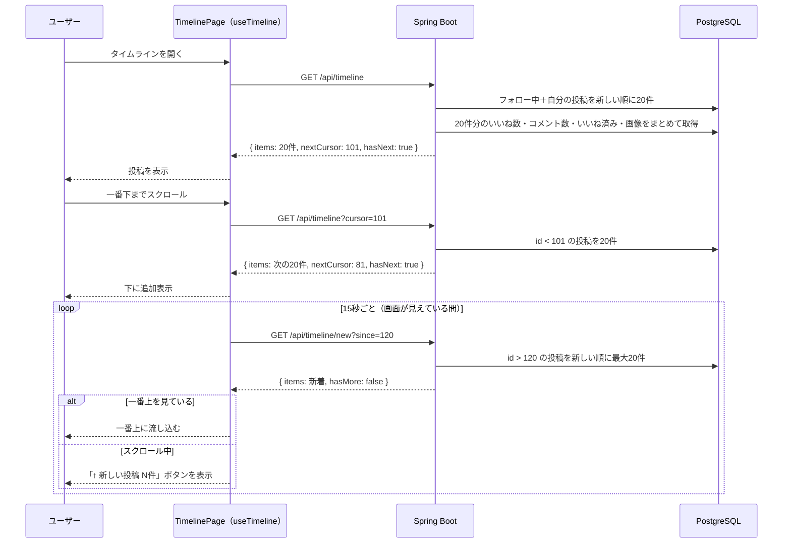

# タイムライン機能：フォロー中のユーザーと自分の投稿の一覧

作成日: 2026-10-02
関連ドキュメント: [要件定義書](../要件定義書.md)（3-1. No.4）／[機能一覧](../機能一覧.md)（TL-01〜05）／[設計書](../設計書.md#3-1-タイムラインフォロー中のユーザー自分の投稿)／[フォロー機能](./フォロー機能.md)

ログイン後に最初に表示される画面（ホーム）。フォローしているユーザーと自分の投稿を、新しい順に表示する。

## 1. できること

| 機能ID | できること |
|---|---|
| TL-01 | フォローしているユーザーと自分の投稿を新しい順に表示する |
| TL-02 | 20件ずつ表示し、一番下までスクロールすると次の20件を自動で読み込む |
| TL-03 | 各投稿に表示名・ユーザー名・日時・本文・画像・コメント数・いいね数を表示する |
| TL-04 | 投稿が1件も無いとき、ユーザー検索画面への案内を表示する |
| TL-05 | 他の人の新しい投稿を15秒ごとに確認し、再読み込みしなくても反映する |

> TL-05 は当初「自動更新はしない」としていたが、2026-10-23 に追加した（Issue #9）。X/Twitter と同じく、読んでいる途中の画面が勝手に動かないようにする。

### 表示しないもの（差別化ポイント）

- インプレッション数（何人に表示されたか）
- リツイート（リポスト）数・リツイートボタン
- おすすめ投稿（フォローしていない人の投稿を混ぜること）

## 2. 画面操作の流れ

1. ログインすると、タイムライン（SC-03）が表示される
2. 新しい投稿から順に20件が表示される
3. 下にスクロールして一番下に近づくと、次の20件が自動で読み込まれる
4. これ以上古い投稿が無くなったら「これ以上投稿はありません」と表示する
5. 他の人の新しい投稿は、次のどれかで一番上に流れ込む（TL-05）
   - 一番上を見ているとき：15秒ごとの確認で届いたら、そのまま流れ込む
   - 下にスクロールして読んでいる途中：「↑ 新しい投稿 N件」ボタンが表示される。ボタンを押すか、一番上まで戻ると流れ込む
   - 自分で更新したとき：ホームを表示中にサイドメニューの「ホーム」をもう一度押す、または画面を再読み込みする
6. 投稿を押して投稿詳細を開き、ブラウザの「戻る」で戻ると、元のスクロール位置から続きを読める

## 3. 画面仕様

### SC-03 タイムライン（`/`）

```
+--------------------------------------------------------------+
| ホーム                                                        |
+--------------------------------------------------------------+
| (icon) いまどうしてる？                       [ 投稿する ]      |
+--------------------------------------------------------------+
|                 [ ↑ 新しい投稿 2件 ]   ← スクロール中に新着が届いたとき |
| [投稿カード]                                                   |
+--------------------------------------------------------------+
| [投稿カード]                                                   |
+--------------------------------------------------------------+
| [投稿カード]                                                   |
+--------------------------------------------------------------+
|                    （読み込み中…）                              |
+--------------------------------------------------------------+
```

- 投稿カードの表示内容は [要件定義書 6-4](../要件定義書.md#6-4-投稿カード共通部品) を参照
- 投稿カードのユーザー名・アイコンを押すと、そのユーザーのプロフィールへ移動する（[ユーザー検索機能](./ユーザー検索機能.md) SRCH-03。プロフィール機能の実装時にリンクにする）
- 自分が新しく投稿したときは、APIを呼び直さずに一番上に追加する
- 「新しい投稿 N件」ボタンは、ヘッダーの下に固定して表示する（スクロールしても見える）。20件を超えて溜まったときは「20件以上」と表示し、押すとタイムラインを最初から読み込み直す

### 投稿が0件のとき（TL-04）

```
+--------------------------------------------------------------+
|                                                              |
|          まだ投稿がありません                                  |
|          ユーザーを探してフォローしてみましょう                   |
|                                                              |
|                 [ ユーザーを探す ]   → SC-09 ユーザー検索        |
+--------------------------------------------------------------+
```

> ユーザー検索画面（SC-09）ができるまでは「ユーザーを探す」の代わりに「投稿する」ボタンを表示する。

## 4. 処理のルール

| No | ルール |
|---|---|
| 1 | 表示対象は「ログイン中のユーザーがフォローしている人」と「自分」の投稿。削除済み（`deleted_at` あり）は表示しない |
| 2 | 並び順は投稿IDの降順（＝新しい順）。投稿IDは投稿順に増えるので、日時順と同じになる |
| 3 | ページングは**カーソル方式**。2ページ目以降は「前回の最後の投稿ID」を `cursor` として送り、それより古い投稿を取得する（[設計書 3-1](../設計書.md#3-1-タイムラインフォロー中のユーザー自分の投稿)） |
| 4 | いいね数・コメント数・いいね済みかどうか・画像は、20件分を**まとめて**取得する（N+1問題の回避、[設計書 3-2](../設計書.md#3-2-いいね数コメント数いいね済みの判定)） |
| 5 | フォローを解除すると、その人の投稿は次にタイムラインを読み込んだときから表示されなくなる（表示中の画面からはすぐには消さない） |
| 6 | 投稿日時は24時間以内なら「3分前」「5時間前」、それより前なら「2026/10/02」と表示する。表示は1分ごとに更新する |
| 7 | 新着の確認（T-02）は15秒ごと。`since` には「サーバーから受け取った中で一番新しい投稿ID」を送る。自分の投稿は先に一覧に入れるが、`since` は進めない（その間に届いた他人の投稿を取りこぼさないため） |
| 8 | 別のタブを見ている間（`document.visibilityState` が `hidden`）は新着を確認しない。戻ってきたらすぐに1回確認する |
| 9 | 「一番上を見ている」とは、スクロール位置が上から80px以内のこと |
| 10 | 他の人が投稿を編集・削除しても、表示中の画面にはすぐには反映しない（次に読み込んだときに反映される） |
| 11 | タイムラインの一覧とスクロール位置は、投稿詳細へ移動しても保持する（ログイン後の共通レイアウトで持つ）。ログアウトすると破棄する |

> **ポイント — 無限スクロールの仕組み**
> 一覧の一番下に目印の要素を置き、ブラウザの `IntersectionObserver`（要素が画面に入ったことを教えてくれる機能）で、その要素が見えたら次のページを読み込む。読み込み中は監視を止め、読み込み後に監視し直す（まだ目印が見えていれば続けて読み込む）。

> **ポイント — 新着を勝手に差し込まない理由**
> 読んでいる途中で一覧の上に投稿が増えると、読んでいた投稿が下にずれて見失ってしまう。そのため、一番上を見ているときだけ自動で流し込み、それ以外はボタンで知らせて、本人が見たいタイミングで流し込む（X/Twitter と同じ方式）。

> **ポイント — 定期確認（ポーリング）にした理由**
> サーバーから画面へ即座に知らせる方式（SSE・WebSocket）もあるが、接続を保ち続ける仕組みやJWTの渡し方、サーバーを複数台にしたときの対応が必要になる。今回は「15秒ほどの遅れは問題にならない」と判断し、作りが簡単で今のJWT認証・ALB構成をそのまま使える定期確認にした。

## 5. 関連ファイル（フロントエンド）

| ファイル | 役割 |
|----------|------|
| `pages/TimelinePage.jsx` | SC-03 タイムライン画面 |
| `layout/AppLayout.jsx` | ログイン後の共通レイアウト（サイドメニュー）。タイムラインの状態をここで持ち、投稿詳細から戻っても保てるようにする |
| `hooks/useTimeline.js` | 投稿一覧・`nextCursor`・`hasNext`・読み込み中フラグ・溜まっている新着を持つ。`reload()`・`loadMore()`・`checkNew()`・`flushPending()`・`prependPost()`・`updatePost()`・`removePost()` |
| `hooks/useInfiniteScroll.js` | `IntersectionObserver` で一番下に来たら `loadMore()` を呼ぶ（プロフィール・コメント一覧でも使い回す） |
| `hooks/useNewPostsPolling.js` | 15秒ごとの新着確認と、一番上にいるときの流し込み（TL-05） |
| `components/PostCard.jsx` | 投稿カード（共通部品） |
| `components/EmptyTimeline.jsx` | 0件のときの案内 |
| `utils/dateUtils.js` | `formatRelativeTime()`（「3分前」の形式に変換） |
| `api/postsApi.js` | `getTimeline(cursor)`・`getNewPosts(since)` |

## 6. 関連ファイル（バックエンド）

| ファイル | 役割 |
|----------|------|
| `controller/TimelineController.java` | `GET /api/timeline`・`GET /api/timeline/new` の受付 |
| `repository/PostRepository.java` | タイムライン用のクエリ（フォロー中＋自分、カーソル、20件）と新着用のクエリ |
| `service/PostQueryService.java` | 取得した20件をレスポンスの形にする（いいね数・コメント数・画像は各機能の実装時にまとめて付ける） |
| `entity/Follow.java` | `follows` テーブル（タイムラインの取得に使うため、フォロー機能より先にテーブルだけ用意している） |

## 7. API仕様

### T-01 タイムライン `GET /api/timeline?cursor={postId}`

| パラメータ | 必須 | 説明 |
|---|---|---|
| cursor | - | 前回のレスポンスの `nextCursor`。省略すると最新から取得する |

レスポンス `200 OK`

```json
{
  "items": [ { "id": 120, "author": { "...": "..." }, "content": "...", "images": [], "likeCount": 3, "commentCount": 1, "likedByMe": false, "isMine": false, "edited": false, "createdAt": "..." } ],
  "nextCursor": 101,
  "hasNext": true
}
```

- `items` は最大20件
- `hasNext` が `false` のとき、`nextCursor` は `null`

### T-02 新着投稿 `GET /api/timeline/new?since={postId}`

| パラメータ | 必須 | 説明 |
|---|---|---|
| since | ○ | 画面がサーバーから受け取った中で一番新しい投稿ID。これより新しい投稿を返す（0件のときは `0`） |

レスポンス `200 OK`

```json
{
  "items": [ { "id": 125, "...": "..." } ],
  "hasMore": false
}
```

- `items` は新しい順で最大20件。対象（フォロー中＋自分、削除済みを除く）はT-01と同じ
- `hasMore` が `true` のときは20件より多く溜まっているため、画面は流し込む代わりにタイムラインを読み込み直す
- `since` が無い・数値でない場合は `400 Bad Request`

## 8. データの流れ



## 9. 確認すること（テスト観点）

- [ ] フォローしている人と自分の投稿だけが表示され、フォローしていない人の投稿は表示されない
- [ ] 新しい順に並んでいる
- [ ] 21件以上あるとき、スクロールで次の20件が読み込まれ、同じ投稿が2回表示されない
- [ ] スクロールの途中で他の人が投稿しても、同じ投稿が2回表示されない
- [ ] 誰もフォローしておらず自分の投稿も無いとき、0件の案内が表示される
- [ ] 削除された投稿が表示されない
- [ ] インプレッション数・リツイートボタンが表示されていない
- [ ] 一番上を見ているとき、フォロー中の人の新しい投稿が15秒以内に一番上に流れ込む
- [ ] スクロール中に新しい投稿が届くと、一覧は動かずに「新しい投稿 N件」ボタンが表示され、押すか一番上まで戻ると流れ込む
- [ ] フォローしていない人の新しい投稿は、ボタンの件数にも数えられない
- [ ] 別のタブを見ている間は新着の確認（T-02）が呼ばれず、戻るとすぐ1回呼ばれる
- [ ] 投稿詳細を開いてブラウザの「戻る」で戻ると、元のスクロール位置に戻る
- [ ] ホームを表示中に「ホーム」を押すと、最新の投稿が読み込まれて一番上に戻る
