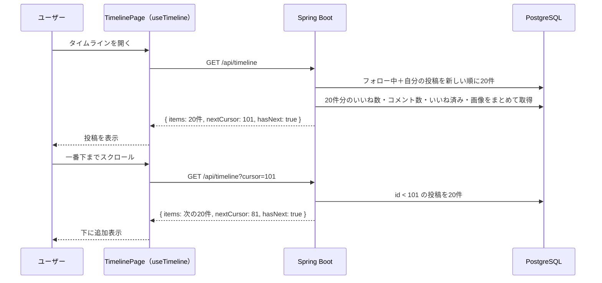

# タイムライン機能：フォロー中のユーザーと自分の投稿の一覧

作成日: 2026-10-02
関連ドキュメント: [要件定義書](../要件定義書.md)（3-1. No.4）／[機能一覧](../機能一覧.md)（TL-01〜04）／[設計書](../設計書.md#3-1-タイムラインフォロー中のユーザー自分の投稿)／[フォロー機能](./フォロー機能.md)

ログイン後に最初に表示される画面（ホーム）。フォローしているユーザーと自分の投稿を、新しい順に表示する。

## 1. できること

| 機能ID | できること |
|---|---|
| TL-01 | フォローしているユーザーと自分の投稿を新しい順に表示する |
| TL-02 | 20件ずつ表示し、一番下までスクロールすると次の20件を自動で読み込む |
| TL-03 | 各投稿に表示名・ユーザー名・日時・本文・画像・コメント数・いいね数を表示する |
| TL-04 | 投稿が1件も無いとき、ユーザー検索画面への案内を表示する |

### 表示しないもの（差別化ポイント）

- インプレッション数（何人に表示されたか）
- リツイート（リポスト）数・リツイートボタン
- おすすめ投稿（フォローしていない人の投稿を混ぜること）

## 2. 画面操作の流れ

1. ログインすると、タイムライン（SC-03）が表示される
2. 新しい投稿から順に20件が表示される
3. 下にスクロールして一番下に近づくと、次の20件が自動で読み込まれる
4. これ以上古い投稿が無くなったら「これ以上投稿はありません」と表示する
5. 最新の投稿を見たいときは、サイドメニューの「ホーム」を押すか画面を再読み込みする（自動更新はしない）

## 3. 画面仕様

### SC-03 タイムライン（`/`）

```
+--------------------------------------------------------------+
| ホーム                                                        |
+--------------------------------------------------------------+
| (icon) いまどうしてる？                       [ 投稿する ]      |
+--------------------------------------------------------------+
| [投稿カード]                                                   |
+--------------------------------------------------------------+
| [投稿カード]                                                   |
+--------------------------------------------------------------+
| [投稿カード]                                                   |
+--------------------------------------------------------------+
|                    （読み込み中…）                              |
+--------------------------------------------------------------+
```

- 投稿カードの表示内容は [要件定義書 6-4](../要件定義書.md#6-4-投稿カード共通部品) を参照
- 投稿カードのユーザー名・アイコンを押すと、そのユーザーのプロフィールへ移動する（[ユーザー検索機能](./ユーザー検索機能.md) SRCH-03）
- 自分が新しく投稿したときは、APIを呼び直さずに一番上に追加する

### 投稿が0件のとき（TL-04）

```
+--------------------------------------------------------------+
|                                                              |
|          まだ投稿がありません                                  |
|          ユーザーを探してフォローしてみましょう                   |
|                                                              |
|                 [ ユーザーを探す ]   → SC-09 ユーザー検索        |
+--------------------------------------------------------------+
```

## 4. 処理のルール

| No | ルール |
|---|---|
| 1 | 表示対象は「ログイン中のユーザーがフォローしている人」と「自分」の投稿。削除済み（`deleted_at` あり）は表示しない |
| 2 | 並び順は投稿IDの降順（＝新しい順）。投稿IDは投稿順に増えるので、日時順と同じになる |
| 3 | ページングは**カーソル方式**。2ページ目以降は「前回の最後の投稿ID」を `cursor` として送り、それより古い投稿を取得する（[設計書 3-1](../設計書.md#3-1-タイムラインフォロー中のユーザー自分の投稿)） |
| 4 | いいね数・コメント数・いいね済みかどうか・画像は、20件分を**まとめて**取得する（N+1問題の回避、[設計書 3-2](../設計書.md#3-2-いいね数コメント数いいね済みの判定)） |
| 5 | フォローを解除すると、その人の投稿は次にタイムラインを読み込んだときから表示されなくなる（表示中の画面からはすぐには消さない） |
| 6 | 投稿日時は24時間以内なら「3分前」「5時間前」、それより前なら「2026/10/02」と表示する |

> **ポイント — 無限スクロールの仕組み**
> 一覧の一番下に目印の要素を置き、ブラウザの `IntersectionObserver`（要素が画面に入ったことを教えてくれる機能）で、その要素が見えたら次のページを読み込む。読み込み中にもう一度呼ばれないよう、「読み込み中」フラグで制御する。

## 5. 関連ファイル（フロントエンド・予定）

| ファイル | 役割 |
|----------|------|
| `pages/TimelinePage.jsx` | SC-03 タイムライン画面 |
| `hooks/useTimeline.js` | 投稿一覧・`nextCursor`・`hasNext`・読み込み中フラグを持つ。`loadMore()`・`prependPost()`・`updatePost()` |
| `hooks/useInfiniteScroll.js` | `IntersectionObserver` で一番下に来たら `loadMore()` を呼ぶ（プロフィール・コメント一覧でも使い回す） |
| `components/PostCard.jsx` | 投稿カード（共通部品） |
| `components/EmptyTimeline.jsx` | 0件のときの案内 |
| `utils/dateUtils.js` | `formatRelativeTime()`（「3分前」の形式に変換） |
| `api/postsApi.js` | `getTimeline(cursor)` |

## 6. 関連ファイル（バックエンド・予定）

| ファイル | 役割 |
|----------|------|
| `controller/TimelineController.java` | `GET /api/timeline` の受付 |
| `repository/PostRepository.java` | タイムライン用のクエリ（フォロー中＋自分、カーソル、20件） |
| `service/PostQueryService.java` | 取得した20件にいいね数・コメント数・いいね済み・画像をまとめて付けて、レスポンスの形にする |

## 7. API仕様

### T-01 タイムライン `GET /api/timeline?cursor={postId}`

| パラメータ | 必須 | 説明 |
|---|---|---|
| cursor | - | 前回のレスポンスの `nextCursor`。省略すると最新から取得する |

レスポンス `200 OK`

```json
{
  "items": [ { "id": 120, "author": { "...": "..." }, "content": "...", "images": [], "likeCount": 3, "commentCount": 1, "likedByMe": false, "isMine": false, "createdAt": "..." } ],
  "nextCursor": 101,
  "hasNext": true
}
```

- `items` は最大20件
- `hasNext` が `false` のとき、`nextCursor` は `null`

## 8. データの流れ



## 9. 確認すること（テスト観点）

- [ ] フォローしている人と自分の投稿だけが表示され、フォローしていない人の投稿は表示されない
- [ ] 新しい順に並んでいる
- [ ] 21件以上あるとき、スクロールで次の20件が読み込まれ、同じ投稿が2回表示されない
- [ ] スクロールの途中で他の人が投稿しても、同じ投稿が2回表示されない
- [ ] 誰もフォローしておらず自分の投稿も無いとき、ユーザー検索への案内が表示される
- [ ] 削除された投稿が表示されない
- [ ] インプレッション数・リツイートボタンが表示されていない
