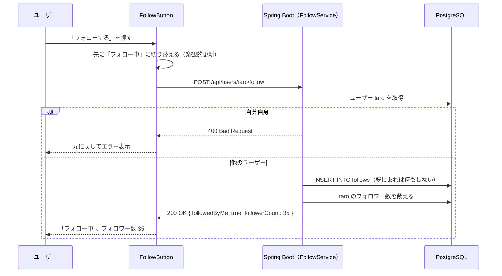

# フォロー機能：フォロー・フォロー解除・フォロー中／フォロワー一覧

作成日: 2026-10-02
関連ドキュメント: [要件定義書](../要件定義書.md)（3-1. No.7）／[機能一覧](../機能一覧.md)（FLW-01〜04）／[設計書](../設計書.md#2-6-followsフォロー)／[ユーザー検索機能](./ユーザー検索機能.md)／[タイムライン機能](./タイムライン機能.md)

他のユーザーをフォローする機能。フォローした人の投稿がタイムラインに表示されるようになる。フォローする相手の見つけ方は [ユーザー検索機能](./ユーザー検索機能.md) を参照。

## 1. できること

| 機能ID | できること |
|---|---|
| FLW-01 | 他のユーザーをフォローする（自分自身はフォローできない） |
| FLW-02 | フォローしているユーザーのフォローを解除する（確認ダイアログあり） |
| FLW-03 | プロフィールにフォロー数・フォロワー数を表示する |
| FLW-04 | あるユーザーがフォローしている人（フォロー中）／フォローされている人（フォロワー）の一覧を表示する |

### 用語

| 用語 | 意味 |
|---|---|
| フォロー中（following） | **自分が**フォローしている人 |
| フォロワー（followers） | **自分を**フォローしている人 |

### 今回やらないこと

- 鍵アカウント（フォローに承認が必要な設定）
- フォローされたときの通知
- 相互フォローの表示（「フォローされています」のラベル）

## 2. 画面操作の流れ

### フォローする

1. 相手のプロフィール（SC-06）、検索結果（SC-09）、フォロー中／フォロワー一覧（SC-08）で「フォローする」を押す
2. ボタンが**すぐに**「フォロー中」に変わる。プロフィール画面ならフォロワー数が1増える
3. 次にタイムラインを開いたとき、その人の投稿が表示される

### フォロー解除する

1. 「フォロー中」ボタンにマウスを乗せると、赤字の「フォロー解除」に変わる
2. 押すと「@taro さんのフォローを解除しますか？」という確認ダイアログが表示される
3. 「OK」を押すと、ボタンが「フォローする」に戻る

> **補足 — 解除だけ確認ダイアログを出す理由**
> フォローは押し間違えてもすぐ解除すればよいが、解除は気付かないうちにタイムラインからその人の投稿が消えてしまうため。

## 3. 画面仕様

### フォローボタン（共通部品）

| 状態 | 表示 | 押したとき |
|---|---|---|
| フォローしていない | `[ フォローする ]`（塗りつぶし） | フォローする |
| フォロー中 | `[ フォロー中 ]`（白抜き） | マウスを乗せると `[ フォロー解除 ]`（赤字）→ 確認後に解除 |
| 自分自身 | プロフィール：ボタンを表示しない（代わりに「プロフィール編集」）／一覧の行：ボタンの代わりに「あなた」と表示する（ユーザー検索の結果とそろえる） | - |
| 通信中 | ボタンを押せない | - |

### SC-06 プロフィール（フォロー部分）

```
|  12 フォロー中   34 フォロワー          [ フォローする ]          |
```

- 「12 フォロー中」を押すと `/users/:username/following`、「34 フォロワー」を押すと `/users/:username/followers` へ移動する

### SC-08 フォロー中／フォロワー一覧

```
+--------------------------------------------------------------+
| ← 太郎 @taro                                                  |
|    [ フォロー中 ]  [ フォロワー ]       ← タブで切り替え          |
+--------------------------------------------------------------+
| (icon) 花子  @hanako                        [ フォロー中 ]      |
|        Javaを勉強中です                                        |
+--------------------------------------------------------------+
| (icon) 次郎  @jiro                          [ フォローする ]    |
+--------------------------------------------------------------+
```

- 一覧の行は [ユーザー検索機能](./ユーザー検索機能.md) の検索結果と同じ部品（`UserRow`）を使う
- フォローボタンは「**ログイン中の自分が**その人をフォローしているか」を表す（一覧の持ち主ではない）
- 並び順はフォローした日時が新しい順。20件ずつ読み込む
- 0件のときは「まだ誰もフォローしていません」／「まだフォロワーはいません」と表示する

## 4. 処理のルール

| No | ルール | 理由 |
|---|---|---|
| 1 | 自分自身はフォローできない。サーバー側でもチェックし、DBにも `CHECK (follower_id <> followee_id)` を付ける | |
| 2 | `follows` に `UNIQUE (follower_id, followee_id)` を付ける | 連打で同じフォローが2件できるのを防ぐため |
| 3 | 既にフォロー済みでも「フォローする」はエラーにしない。フォローしていなくても「解除」はエラーにしない（**冪等**） | 連打や再送で困らないようにするため（[いいね機能](./いいね機能.md) と同じ考え方） |
| 4 | フォロー解除は**物理削除**（`follows` の行を消す） | 状態を表すだけのデータのため |
| 5 | 画面は通信の完了を待たずに切り替える（楽観的更新）。失敗したら元に戻す | |
| 6 | フォロー・解除のレスポンスで、相手の**最新のフォロワー数**を返す | 他の人も同時にフォローしている可能性があるため |
| 7 | APIでは相手をユーザーIDではなく**ユーザー名**で指定する | 画面のURL（`/users/taro`）とそろえるため |
| 8 | 一覧の相手ユーザーは `join fetch` で一緒に取得し、`followedByMe` は一覧のユーザーIDをまとめて1回で判定する | 1行ごとにSQLを発行するN+1問題を避けるため（[設計書 3-4](../設計書.md#3-4-一覧取得でのn1問題の対策まとめ)） |
| 9 | 登録は `INSERT ... ON CONFLICT (follower_id, followee_id) DO NOTHING` で行う（「確認してから登録」にしない） | 連打で同時に届いた2つのリクエストが、2件目で一意制約違反（500）になるのを防ぐため（[いいね機能](./いいね機能.md) と同じ） |
| 10 | フォロー・解除したら、次にホームを開いたときにタイムラインを読み込み直す | 「次にタイムラインを開いたときから表示される／表示されなくなる」ため（表示中の画面からはすぐには消さない） |
| 11 | 一覧の中でフォロー解除しても、その行は一覧から消さない（ボタンだけ「フォローする」に戻す） | 押し間違えたときに、すぐフォローし直せるようにするため |

## 5. 関連ファイル（フロントエンド）

| ファイル | 役割 |
|----------|------|
| `components/FollowButton.jsx` | 「フォローする」／「フォロー中」（ホバーで赤字の「フォロー解除」）の表示、楽観的更新、通信中は押せない、解除時の確認ダイアログ、成功したらタイムラインを読み込み直す印を付ける |
| `components/UserRow.jsx` | ユーザー1行（アイコン・名前・自己紹介の1行目・フォローボタン）。自分の行はボタンの代わりに「あなた」と表示する。ユーザー検索の結果でも使う |
| `components/FollowList.jsx` | 一覧の表示（無限スクロール、0件の表示）。ユーザー・タブが変わったら `key` で作り直す |
| `components/ProfileHeader.jsx` | 他人のプロフィールにフォローボタンを置く。フォロー数・フォロワー数を SC-08 へのリンクにする |
| `pages/ProfilePage.jsx` | フォローボタンに合わせてフォロワー数を ±1 し、サーバーの最新値で上書きする |
| `pages/FollowListPage.jsx` | SC-08。URLの `following`／`followers` でタブを切り替える。ヘッダーの表示名のためにプロフィールも読み込む |
| `hooks/useFollowList.js` | 一覧・`loadMore()`・`setFollowedByMe()` |
| `utils/paths.js` | `followListPath(username, kind)`：SC-08 のURL |
| `api/usersApi.js` | `follow(username)`・`unfollow(username)`・`getFollowList(username, kind, cursor)` |

## 6. 関連ファイル（バックエンド）

| ファイル | 役割 |
|----------|------|
| `controller/FollowController.java` | `/api/users/{username}/follow`・`/following`・`/followers` の受付 |
| `service/FollowService.java` | 自分自身のチェック（400）、登録／削除、フォロワー数の取得。`toSummaries()` で一覧に `followedByMe` をまとめて付ける（ユーザー検索でも使う） |
| `repository/FollowRepository.java` | `insertIfAbsent()`（`ON CONFLICT DO NOTHING`）・`deleteByFollowerIdAndFolloweeId()`・`findFollowing()`／`findFollowers()`（`join fetch`、`follows.id` の降順、カーソル）・`findFollowedIds()` |
| `entity/Follow.java` | `follows` テーブル |
| `dto/UserSummary.java` | 一覧の1行（設計書 4-3） |

## 7. API仕様

### F-01 フォローする `POST /api/users/{username}/follow`

### F-02 フォロー解除 `DELETE /api/users/{username}/follow`

どちらもリクエストボディは無し。

```json
{ "followedByMe": true, "followerCount": 35 }
```

| レスポンス | 条件 |
|---|---|
| 200 OK | 成功（既にフォロー済み／フォローしていない場合も成功） |
| 400 Bad Request | 自分自身を指定した |
| 404 Not Found | ユーザーが存在しない |

### F-03 フォロー中の一覧 `GET /api/users/{username}/following?cursor={followId}`

### F-04 フォロワーの一覧 `GET /api/users/{username}/followers?cursor={followId}`

```json
{
  "items": [
    { "id": 2, "username": "hanako", "displayName": "花子", "avatarUrl": null, "bio": "Javaを勉強中です", "followedByMe": true, "isMe": false }
  ],
  "nextCursor": null,
  "hasNext": false
}
```

- `followedByMe` は「ログイン中のユーザーが、その行の人をフォローしているか」
- `nextCursor` には `follows.id` を使う（フォローした順に増えるため）

## 8. データの流れ



## 9. 確認すること（テスト観点）

- [ ] フォローすると、次にタイムラインを開いたときにその人の投稿が表示される
- [ ] フォロー解除すると、次にタイムラインを開いたときにその人の投稿が表示されなくなる
- [ ] 自分のプロフィールにはフォローボタンが表示されない。APIで自分を指定すると 400 になる
- [ ] 連打しても `follows` に同じ組み合わせが2件できない
- [ ] 解除時に確認ダイアログが表示され、「キャンセル」なら解除されない
- [ ] 他人のフォロー中一覧で、ボタンが「自分がフォローしているか」で表示されている
