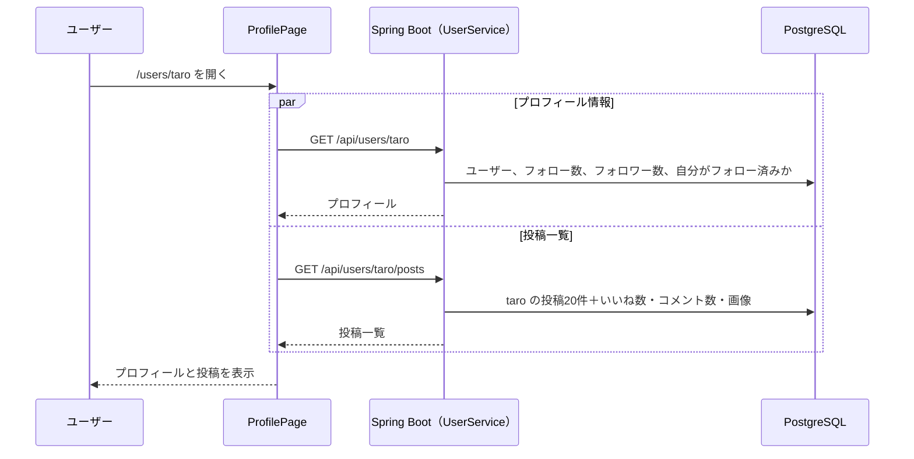

# プロフィール機能：プロフィールの表示・編集

作成日: 2026-10-02
関連ドキュメント: [要件定義書](../要件定義書.md)（3-1. No.9）／[機能一覧](../機能一覧.md)（USER-01〜02）／[設計書](../設計書.md#2-1-usersユーザー)／[フォロー機能](./フォロー機能.md)／[画像投稿機能](./画像投稿機能.md)

ユーザーごとのページ。そのユーザーの情報と投稿の一覧を表示する。他のユーザーのプロフィールでは「フォローする」ボタンを押せる（相手を見つけて最後にフォローする場所）。

## 1. できること

| 機能ID | できること |
|---|---|
| USER-01 | 表示名・@ユーザー名・自己紹介・アイコン・登録月・フォロー数・フォロワー数・そのユーザーの投稿一覧を表示する |
| USER-02 | 自分の表示名・自己紹介・アイコン画像を変更する |

> **実装の順番について** — USER-02 のうち**アイコン画像の変更（U-06）は、[画像投稿機能](./画像投稿機能.md) の後に実装した**（Issue #27）。画像の保存の仕組み（`ImageStorage`・形式チェック）を投稿画像と共通にするため。

### 今回やらないこと

- ユーザー名（@ID）・メールアドレス・パスワードの変更
- ヘッダー画像（プロフィール上部の横長の画像）
- 退会

## 2. 画面操作の流れ

### 他のユーザーのプロフィールを見る

1. 投稿者名・コメント者名・検索結果・フォロー一覧のユーザーを押す
2. プロフィール（SC-06）が開く
3. 「フォローする」でフォローできる。下にスクロールすると、そのユーザーの投稿を新しい順に見られる

### 自分のプロフィールを編集する

1. サイドメニューの「👤 プロフィール」で自分のプロフィールを開く
2. 「プロフィール編集」を押す
3. プロフィール編集（SC-07）で、表示名・自己紹介を書き換え、必要ならアイコン画像を選ぶ
4. 「保存」を押すと、自分のプロフィールに戻り、変更が反映されている

## 3. 画面仕様

### SC-06 プロフィール（`/users/:username`）

```
+--------------------------------------------------------------+
| ← 太郎                                                        |
+--------------------------------------------------------------+
|  (大きいicon)                                                 |
|                                  [ プロフィール編集 ] ※自分     |
|                                  [ フォローする ]     ※他人     |
|  太郎                                                         |
|  @taro                                                        |
|  Javaを勉強中です。Spring Bootでアプリを作っています。             |
|  📅 2026年10月から利用しています                                 |
|  12 フォロー中   34 フォロワー                                   |
+--------------------------------------------------------------+
| [このユーザーの投稿カード]                                        |
| [このユーザーの投稿カード]                                        |
|  …（20件ずつ読み込み）                                           |
+--------------------------------------------------------------+
```

| 項目 | 内容 |
|---|---|
| ボタン | 自分のプロフィール：「プロフィール編集」／他人のプロフィール：フォローボタン（[フォロー機能](./フォロー機能.md)） |
| 自己紹介 | 改行を反映して表示する。空なら何も表示しない |
| フォロー数・フォロワー数 | 押すと SC-08 へ移動する |
| 投稿一覧 | そのユーザーの投稿（削除済みを除く）を新しい順に20件ずつ。投稿カードは [要件定義書 6-4](../要件定義書.md#6-4-投稿カード共通部品) と同じ |
| 投稿が0件 | 「まだ投稿がありません」 |
| 存在しないユーザー | 「このアカウントは存在しません」 |

### SC-07 プロフィール編集（`/settings/profile`）

```
+------------------------------------------+
|  ×  プロフィール編集           [ 保存 ]    |
|                                          |
|  (icon) [ 画像を変更 ]                    |
|  表示名                                   |
|  [ 太郎                               ]  |
|  自己紹介                         12/160  |
|  [ Javaを勉強中です。                  ]  |
|  [                                    ]  |
+------------------------------------------+
```

| 項目 | 入力チェック |
|---|---|
| アイコン画像 | 任意。jpg / png / gif / webp、5MB以下。選ぶとすぐに丸く切り抜いたプレビューを表示する |
| 表示名 | 必須、1〜50文字 |
| 自己紹介 | 任意、0〜160文字 |

- 何も変更していない状態では「保存」を押せない
- 変更中に × を押したら「変更を破棄しますか？」と確認する

## 4. 処理のルール

| No | ルール |
|---|---|
| 1 | 編集できるのは自分のプロフィールだけ。APIは `/api/users/me`（ログイン中のユーザー）だけを用意し、他人のIDを指定して更新する方法そのものを作らない |
| 2 | アイコン画像は投稿画像と同じ仕組み（`ImageStorage`・`ImageValidator`）で保存する。保存キーは `avatars/{UUID}.{拡張子}`（拡張子はファイルの中身で判定した形式） |
| 3 | アイコンを変更したら、古いアイコン画像のファイルは削除する（投稿画像と違い、もう使われないため）。削除はDBへの保存が確定してから行い、DBへの保存に失敗したら新しく保存したファイルを削除する |
| 4 | アイコン未設定の場合は、表示名の1文字目をユーザーごとに決まった色の丸で表示する（`Avatar.jsx`。デフォルトの画像ファイルは同梱しない） |
| 5 | 表示名を変更すると、過去の投稿・コメントの表示名もすべて新しい名前で表示される（投稿には表示名をコピーせず、毎回 `users` から取得するため） |
| 6 | 「プロフィール編集」ボタンの表示は `isMe` で判定する |
| 7 | 表示名・自己紹介は前後の空白・改行を取り除いてから文字数を数える（絵文字も1文字）。自己紹介の改行は `\n` にそろえる。入力チェックは画面とサーバーの両方で行う |
| 8 | URLのユーザー名は大文字小文字を区別しない（`/users/Taro` と `/users/taro` は同じユーザー）。ユーザー名の登録時も大文字小文字を区別せずに重複を調べているため |
| 9 | 表示名を変えたら、サイドメニューの自分の表示名もすぐに変え、読み込み済みのタイムラインは次にホームを開いたときに読み込み直す（古い表示名が残らないように） |
| 10 | プロフィールの投稿一覧でのいいね・編集・削除は、タイムラインに出ている同じ投稿にも反映する |
| 11 | アイコンは選んだ時点ではアップロードせず、「保存」を押したときにアップロードする（プレビューは `URL.createObjectURL`）。保存したらサイドメニューのアイコンもすぐに変え、タイムラインは次にホームを開いたときに読み込み直す |
| 12 | `avatarUrl` は DB に保存せず、保存キー（`users.avatar_key`）から画面に返すときに組み立てる。投稿者・コメント者・プロフィール・ユーザー一覧・ログイン中のユーザー情報のすべてで同じ |

## 5. 関連ファイル（フロントエンド）

| ファイル | 役割 |
|----------|------|
| `pages/ProfilePage.jsx` | SC-06。プロフィール情報と投稿一覧。存在しないユーザーは「このアカウントは存在しません」 |
| `pages/ProfileEditPage.jsx` | SC-07。表示名・自己紹介・アイコン画像の編集（「画像を変更」で選ぶと丸いプレビュー、変更が無いと保存できない、× で破棄の確認） |
| `components/ProfileHeader.jsx` | アイコン・名前・自己紹介・登録月・フォロー数・フォロワー数（SC-08 へのリンク）・「プロフィール編集」ボタン（自分）／フォローボタン（他人） |
| `components/UserPostList.jsx` | プロフィールの投稿一覧（無限スクロール、0件の表示）。ユーザーが変わったら `key` で作り直す |
| `components/UserLink.jsx` | 表示名・@ユーザー名・アイコンをプロフィールへのリンクにする（投稿カード・コメントで使う、SRCH-03） |
| `components/Avatar.jsx` | アイコン（画像が無ければ表示名の1文字目）。全画面で共通 |
| `hooks/useUserPosts.js` | ユーザーの投稿一覧（`useTimeline` と同じ作り） |
| `hooks/useTimeline.js` | `invalidate()`：次にホームを開いたときにタイムラインを読み込み直す |
| `auth/AuthProvider.jsx` | `updateUser()`：サイドメニューなどに出ている自分の情報を書き換える |
| `utils/paths.js` | `profilePath(username)`：プロフィールのURL |
| `api/usersApi.js` | `getProfile()`・`getUserPosts()`・`updateProfile()`・`uploadAvatar()` |

## 6. 関連ファイル（バックエンド）

| ファイル | 役割 |
|----------|------|
| `controller/UserController.java` | `/api/users/{username}`・`/api/users/{username}/posts`・`/api/users/me`・`/api/users/me/avatar` の受付 |
| `service/UserService.java` | プロフィールの取得（フォロー数・フォロワー数・`followedByMe`・`isMe`）、表示名・自己紹介の入力チェックと更新、アイコンの差し替え（古いファイルの削除はトランザクション確定後） |
| `entity/User.java` | `changeAvatar()`：保存キーを差し替え、元の保存キーを返す |
| `dto/PostResponse.AuthorResponse`・`dto/UserResponse` | `avatarUrl` を保存キーから組み立てる（`ImageStorage#toUrl`） |
| `service/PostQueryService.java` | ユーザーの投稿一覧（タイムラインと共通の組み立て処理。いいね数・コメント数もまとめて取得） |
| `repository/UserRepository.java` | `findByUsernameIgnoreCase()`：大文字小文字を区別せずにユーザーを探す |
| `repository/PostRepository.java` | `findByAuthor()`：ユーザーの投稿を新しい順に20件（`join fetch p.user`、カーソル方式） |
| `repository/FollowRepository.java` | フォロー数・フォロワー数・フォロー済みかの判定 |

## 7. API仕様

### U-03 プロフィール `GET /api/users/{username}`

```json
{
  "id": 3,
  "username": "taro",
  "displayName": "太郎",
  "avatarUrl": "https://.../avatars/xxxx.jpg",
  "bio": "Javaを勉強中です。",
  "followingCount": 12,
  "followerCount": 34,
  "followedByMe": false,
  "isMe": false,
  "createdAt": "2026-10-01T00:00:00Z"
}
```

| レスポンス | 条件 |
|---|---|
| 200 OK | 成功 |
| 404 Not Found | ユーザーが存在しない |

### U-04 ユーザーの投稿一覧 `GET /api/users/{username}/posts?cursor={postId}`

- タイムライン（[タイムライン機能](./タイムライン機能.md)）と同じ形のページング付き一覧

### U-05 プロフィール更新 `PUT /api/users/me`

```json
{ "displayName": "太郎", "bio": "Javaを勉強中です。" }
```

| レスポンス | 条件 |
|---|---|
| 200 OK + 更新後のプロフィール | 成功 |
| 400 Bad Request | 入力チェックエラー |

### U-06 アイコン画像の変更 `POST /api/users/me/avatar`

- `multipart/form-data`、パート名 `avatar` に画像1枚
- レスポンス `200 OK` + `{ "avatarUrl": "https://..." }`
- 形式・サイズのチェックは [画像投稿機能](./画像投稿機能.md) と同じ

| レスポンス | 条件 |
|---|---|
| 200 OK | 成功 |
| 400 Bad Request | 画像が無い、対応していない形式（中身で判定） |
| 413 Payload Too Large | 5MB 超 |

## 8. データの流れ（プロフィール表示）



## 9. 確認すること（テスト観点）

- [ ] 自分のプロフィールには「プロフィール編集」、他人のプロフィールにはフォローボタンが表示される
- [ ] 存在しないユーザー名のURLを開くと「このアカウントは存在しません」と表示される
- [ ] 表示名を変更すると、過去の投稿の表示名も変わる
- [ ] アイコンを変更すると、投稿カード・コメントのアイコンも変わる
- [ ] 他人のプロフィールを更新するAPIが存在しない（`PUT /api/users/{他人}` は 404 または 405）
- [ ] 自己紹介に161文字以上入力できない
