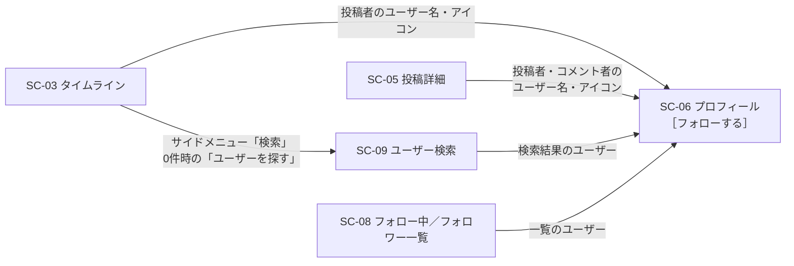
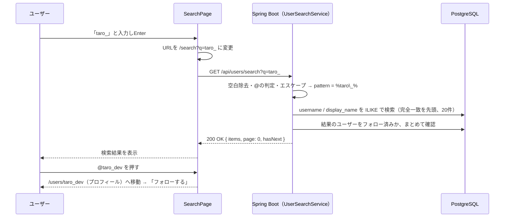

# ユーザー検索機能：フォローする相手を見つける

作成日: 2026-10-02
関連ドキュメント: [要件定義書](../要件定義書.md)（3-1. No.8）／[機能一覧](../機能一覧.md)（SRCH-01〜04）／[設計書](../設計書.md#3-3-ユーザー検索)／[フォロー機能](./フォロー機能.md)／[プロフィール機能](./プロフィール機能.md)

フォローする相手を見つけるための機能。タイムラインは「フォローしている人の投稿」を表示するため、フォロー相手を見つけられないとタイムラインが空のままになる。このアプリでは、相手を見つける方法を次の2つにする。

1. **ユーザー検索画面**でユーザー名を入力して探す
2. タイムラインや投稿詳細に表示されている**投稿者・コメント者のユーザー名を押して**、プロフィールを開く

どちらの方法でも、最後は**プロフィール画面の「フォローする」ボタン**でフォローする（検索結果の一覧からもその場でフォローできる）。

## 1. できること

| 機能ID | できること | 優先度 |
|---|---|---|
| SRCH-01 | キーワードを入力し、Enterキーまたは「検索」ボタンを押すと、ユーザー名に一致するユーザーを表示する | Must |
| SRCH-02 | 検索結果のユーザーを押すと、そのユーザーのプロフィールへ移動する。プロフィールからフォローできる | Must |
| SRCH-03 | 投稿カード・コメントの表示名・ユーザー名・アイコンを押すと、そのユーザーのプロフィールへ移動する | Must |
| SRCH-04 | 検索する前の検索画面に、最近登録したユーザーを表示する（新規ユーザーがすぐにフォロー相手を見つけられるように） | Should |

### 今回やらないこと

- 投稿本文の検索、ハッシュタグ検索
- 入力中に自動で検索する機能（インクリメンタルサーチ）
- 「おすすめユーザー」（フォローしている人がフォローしている人、など）
- 検索履歴の保存

## 2. 相手を見つけるまでの導線



## 3. 画面操作の流れ

### 検索画面から探す（SRCH-01・02・04）

1. サイドメニューの「🔍 検索」を押す（またはタイムラインが空のときの「ユーザーを探す」を押す）
2. 検索画面（SC-09）が開く。検索欄の下に「新しく参加したユーザー」が表示されている
3. 検索欄にキーワード（例：`taro`）を入力し、**Enterキー**または「**検索**」ボタンを押す
4. 一致したユーザーが一覧で表示される
5. 一覧のユーザーを押すと、そのユーザーのプロフィールが開く
6. プロフィールの「フォローする」を押す（一覧の「フォローする」ボタンからその場でフォローすることもできる）

### 投稿・コメントから探す（SRCH-03）

1. タイムラインや投稿詳細で、気になる投稿者・コメント者の表示名・@ユーザー名・アイコンのどれかを押す
2. そのユーザーのプロフィールが開く
3. 「フォローする」を押す

## 4. 画面仕様

### SC-09 ユーザー検索（`/search`、検索後は `/search?q=taro`）

```
+--------------------------------------------------------------+
| ユーザー検索                                                    |
| [ 🔍 ユーザー名で検索                          ] [ 検索 ]       |
+--------------------------------------------------------------+
| 「taro」の検索結果（3件）                                        |
+--------------------------------------------------------------+
| (icon) 太郎  @taro                          [ フォロー中 ]      |
|        Javaを勉強中です                                        |
+--------------------------------------------------------------+
| (icon) たろう  @taro_dev                     [ フォローする ]   |
|        フロントエンド担当                                       |
+--------------------------------------------------------------+
| (icon) Taro Yamada  @yamada                  [ フォローする ]   |
+--------------------------------------------------------------+
```

#### 検索前（SRCH-04）

```
+--------------------------------------------------------------+
| ユーザー検索                                                    |
| [ 🔍 ユーザー名で検索                          ] [ 検索 ]       |
+--------------------------------------------------------------+
| 新しく参加したユーザー                                           |
+--------------------------------------------------------------+
| (icon) 花子  @hanako                         [ フォローする ]   |
| (icon) 次郎  @jiro                           [ フォローする ]   |
|  …（最大20人）                                                  |
+--------------------------------------------------------------+
```

#### 項目

| 項目 | 内容 |
|---|---|
| 検索欄 | プレースホルダー「ユーザー名で検索」。画面を開いたら自動でカーソルを当てる |
| 検索ボタン | キーワードが空（空白だけを含む）のときは押せない |
| 検索結果の見出し | 「「taro」の検索結果（3件）」。21件以上ある場合は「（20件以上）」と表示する |
| ユーザー行 | アイコン・表示名・@ユーザー名・自己紹介の1行目（長い場合は「…」で省略）・フォローボタン |
| フォローボタン | 未フォロー：「フォローする」／フォロー中：「フォロー中」（マウスを乗せると赤字で「フォロー解除」）／**自分自身：ボタンを表示せず「あなた」と表示** |
| 0件のとき | 「「xxx」に一致するユーザーは見つかりませんでした」 |
| 追加読み込み | 20件ずつ。一番下までスクロールすると次の20件を読み込む |

#### 入力チェック

| チェック | 内容 |
|---|---|
| 前後の空白 | 取り除いてから検索する |
| 先頭の `@` | `@taro` と入力した場合は `@` を取り除き、**ユーザー名だけ**を対象に検索する |
| 文字数 | 1〜50文字（50文字を超える部分は入力できない）。`@` だけ・空白だけのときは「検索」ボタンを押せない |
| サーバー側 | 同じルール（空白の除去・`@` の判定・1〜50文字）でもう一度確認し、違反なら 400（APIを直接呼ばれた場合に備える）。`page` がマイナスも 400 |

#### URLとの連動

- 検索を実行すると、URLを `/search?q=taro` に変える
- そのため、検索結果からプロフィールを開いた後にブラウザの「戻る」を押すと、**同じ検索結果に戻れる**
- `/search?q=taro` を直接開いた場合も、自動で検索を実行する

## 5. 検索のルール

### 5-1. 検索対象

| 入力 | 検索対象 | 例 |
|---|---|---|
| `taro`（`@` なし） | **@ユーザー名** と **表示名** | `@taro`・`@taro_dev`・表示名「Taro Yamada」がヒット |
| `@taro`（`@` あり） | **@ユーザー名だけ** | `@taro`・`@taro_dev` がヒット（表示名「Taro Yamada」はヒットしない） |

> **補足 — 表示名も検索対象にする理由**
> 受講生同士では「@ID は知らないが、表示名（名前）は知っている」ことが多いため。@ID を知っている場合は、先頭に `@` を付ければ @ID だけで絞り込める。

### 5-2. 一致の条件

| ルール | 内容 |
|---|---|
| 部分一致 | キーワードを**含む**ユーザーがヒットする（`aro` でも `@taro` がヒット） |
| 大文字小文字 | 区別しない（`TARO` でも `@taro` がヒット）。PostgreSQL の `ILIKE` を使う |
| 全角・半角 | 区別する（`ｔａｒｏ` では `@taro` はヒットしない）。今回は変換しない |
| 複数キーワード | 対応しない。`taro yamada` は「taro yamada」という1つの文字列として検索する |

### 5-3. 並び順

1. @ユーザー名がキーワードと**完全に一致**するユーザー（例：`taro` で検索したときの `@taro`）
2. それ以外を、**登録が新しい順**

### 5-4. 検索に含めないユーザー

- 今回は無し（自分自身も結果に含め、「あなた」と表示する）

> **将来 — 退会機能を作った場合**
> 退会済みのユーザーを結果から除く条件を追加する。

## 6. 技術的な注意点

### 6-1. `_` と `%` のエスケープ（重要）

SQL の `LIKE`／`ILIKE` では、`%`（0文字以上の任意の文字）と `_`（任意の1文字）が特別な意味を持つ。ユーザー名には `_` が使えるため、**エスケープしないと意図しない結果になる**。

| 入力 | エスケープしない場合 | エスケープした場合 |
|---|---|---|
| `taro_` | `taro_` の `_` が「任意の1文字」になり、`@taro1`・`@taroX` もヒットする | `@taro_dev` のように `taro_` を含むものだけがヒットする |
| `%` | 全ユーザーがヒットする | `%` を含むユーザー（存在しない）だけ＝0件 |

```java
// キーワードの \ % _ の前に \ を付け、前後を % で囲む
String escaped = keyword.replace("\\", "\\\\").replace("%", "\\%").replace("_", "\\_");
String pattern = "%" + escaped + "%";
```

```sql
WHERE u.username ILIKE :pattern ESCAPE '\'
```

### 6-2. SQLインジェクション対策

キーワードは必ずパラメータ（`:pattern`）として渡し、SQLの文字列に直接つなげない。Spring Data JPA の `@Query` とパラメータを使えば自動で安全になる。

### 6-3. 性能

`'%taro%'` のような「前にも `%` が付く」検索では、通常のインデックスが使われず全件を順番に確認する。今回の想定規模（100人）なら問題ない。

> **将来 — ユーザーが数万人になったら**
> PostgreSQL の拡張機能 `pg_trgm` を使い、`username`・`display_name` に GIN インデックスを作ると、部分一致検索も速くなる。

### 6-4. 検索ボタン方式にした理由

入力中に自動で検索する方式（前回の課題の `SearchBar` のデバウンス方式）は便利だが、1文字入力するたびにAPIが呼ばれる。今回はEnterキー／検索ボタンを押したときだけAPIを呼ぶ方式にし、実装とサーバー負荷をシンプルにする。

## 7. 関連ファイル（フロントエンド）

| ファイル | 役割 |
|----------|------|
| `pages/SearchPage.jsx` | SC-09。URLの `q` を読み取って検索を実行する。`q` が無ければ「新しく参加したユーザー」を表示。キーワードが変わったら入力欄・結果を `key` で作り直す（兄弟要素の `key` は `form:`／`results:` で重ならないようにする） |
| `components/UserSearchForm.jsx` | 検索欄と検索ボタン。`<form onSubmit>` にすることで、Enterキーとボタンの両方で送信できる。画面を開いたら検索欄にカーソルを当てる |
| `components/UserSearchResults.jsx` | 検索結果（見出しの件数、無限スクロール、0件の表示） |
| `components/NewUsers.jsx` | 新しく参加したユーザー（SRCH-04） |
| `components/UserRow.jsx` | ユーザー1行（アイコン・名前・自己紹介の1行目・フォローボタン）。自分の行はボタンの代わりに「あなた」。フォロー中／フォロワー一覧と共通 |
| `components/FollowButton.jsx` | フォローボタン（[フォロー機能](./フォロー機能.md)） |
| `components/UserLink.jsx` | 表示名・@ユーザー名・アイコンを `/users/:username` へのリンクにする。投稿カード・コメント・ユーザー一覧で使う（SRCH-03） |
| `components/EmptyTimeline.jsx` | タイムラインが0件のときの「ユーザーを探す」ボタン（[タイムライン機能](./タイムライン機能.md) TL-04） |
| `layout/AppLayout.jsx` | サイドメニュー・スマホ用の下部メニューの「🔍 検索」 |
| `hooks/useUserSearch.js` | 検索結果をページ番号で20件ずつ読み込む・`setFollowedByMe()` |
| `utils/searchUtils.js` | `normalizeKeyword()`：前後の空白を取り、先頭の `@` を判定する |
| `api/usersApi.js` | `searchUsers(q, page)`・`getNewUsers()` |

## 8. 関連ファイル（バックエンド）

| ファイル | 役割 |
|----------|------|
| `controller/UserController.java` | `GET /api/users/search`・`GET /api/users/new` の受付 |
| `service/UserSearchService.java` | キーワードの正規化（空白・`@`・1〜50文字）、エスケープ、1件多く取得して次のページの判定。`followedByMe` は `FollowService#toSummaries` でまとめて付ける |
| `repository/UserRepository.java` | `search()`：検索クエリ（`ILIKE ... ESCAPE`、完全一致を先頭に登録が新しい順、`LIMIT`/`OFFSET`）。`findTop20ByIdNotOrderByCreatedAtDesc()`：新しく参加したユーザー |
| `dto/UserSearchResponse.java`・`dto/UserListResponse.java` | U-01・U-02 のレスポンス |

> **補足 — SQLの本数** — 検索（20件）・新しく参加したユーザーとも、SQL 2本（ユーザーの取得、`followedByMe` の判定）で、件数が増えても変わらない。

## 9. API仕様

### U-01 ユーザー検索 `GET /api/users/search?q={keyword}&page={page}`

| パラメータ | 必須 | 説明 |
|---|---|---|
| q | ○ | キーワード（1〜50文字）。先頭が `@` ならユーザー名だけを対象にする |
| page | - | ページ番号（0始まり、省略時は0）。1ページ20件 |

レスポンス `200 OK`

```json
{
  "items": [
    { "id": 3, "username": "taro", "displayName": "太郎", "avatarUrl": null, "bio": "Javaを勉強中です", "followedByMe": true, "isMe": false },
    { "id": 8, "username": "taro_dev", "displayName": "たろう", "avatarUrl": null, "bio": "フロントエンド担当", "followedByMe": false, "isMe": false }
  ],
  "page": 0,
  "hasNext": false
}
```

| レスポンス | 条件 |
|---|---|
| 200 OK | 成功（0件の場合は `items` が空の配列） |
| 400 Bad Request | `q` が無い、空、50文字を超える |

> **補足 — 検索だけ「ページ番号方式」にする理由**
> タイムラインは投稿IDの順に並ぶのでカーソル方式（[設計書 3-1](../設計書.md#3-1-タイムラインフォロー中のユーザー自分の投稿)）が使えるが、検索結果は「完全一致を先頭に」という並び順のため、IDをカーソルにできない。検索結果はタイムラインほど頻繁に増えないため、シンプルなページ番号方式（OFFSET）にする。

### U-02 新しく参加したユーザー `GET /api/users/new`

- 登録が新しい順に20人を返す（自分は除く）
- レスポンスの `items` の形は U-01 と同じ
- `followedByMe` は U-01 と同じく、20人分をまとめて1回で判定する（N+1問題の回避、[設計書 3-4](../設計書.md#3-4-一覧取得でのn1問題の対策まとめ)）

## 10. データの流れ



## 11. 確認すること（テスト観点）

- [ ] Enterキーでも「検索」ボタンでも検索できる。入力しただけでは検索されない
- [ ] 空白だけ入力した状態では検索ボタンが押せない
- [ ] `TARO` で `@taro` がヒットする（大文字小文字を区別しない）
- [ ] 表示名「太郎」のユーザーが `太郎` でヒットする
- [ ] `@taro` で検索すると、表示名だけが一致するユーザーはヒットしない
- [ ] `taro_` で検索したとき、`@taro1` はヒットせず `@taro_dev` はヒットする（エスケープの確認）
- [ ] `%` で検索しても全員はヒットしない
- [ ] @ユーザー名が完全一致するユーザーが一番上に表示される
- [ ] 検索結果からプロフィールを開き、ブラウザの「戻る」で同じ検索結果に戻れる
- [ ] 自分が検索結果に出たとき、フォローボタンではなく「あなた」と表示される
- [ ] タイムライン・投稿詳細の投稿者名、コメント者名を押すとプロフィールが開き、フォローできる
