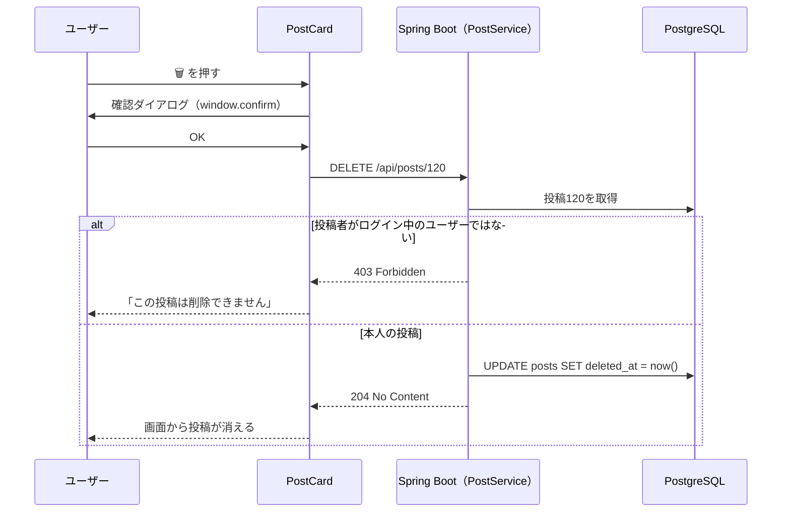

# 投稿機能：テキスト投稿・投稿削除・投稿詳細

作成日: 2026-10-02
関連ドキュメント: [要件定義書](../要件定義書.md)（3-1. No.2）／[機能一覧](../機能一覧.md)（PST-01〜03）／[設計書](../設計書.md)／[画像投稿機能](./画像投稿機能.md)

140文字以内のテキストを投稿する機能。画像の添付は [画像投稿機能](./画像投稿機能.md)、投稿へのコメントは [コメント機能](./コメント機能.md) を参照。

## 1. できること

| 機能ID | できること |
|---|---|
| PST-01 | 140文字以内のテキストを投稿する |
| PST-02 | 自分の投稿だけを削除できる（確認ダイアログあり） |
| PST-03 | 1件の投稿を詳細画面で表示する（その下にコメント一覧が表示される） |

投稿の**編集はできない**（[要件定義書 3-2](../要件定義書.md#3-2-あったら嬉しい機能後回しでもok今回は作らない)）。

## 2. 画面操作の流れ

### 投稿する

1. サイドメニューの「投稿する」、またはタイムライン上部の「いまどうしてる？」を押す
2. 投稿作成モーダル（SC-04）が開く
3. 本文を入力する（画像を添付する場合は [画像投稿機能](./画像投稿機能.md)）
4. 「投稿」ボタンを押す
5. モーダルが閉じ、タイムラインの一番上に自分の投稿が表示される

### 削除する

1. 自分の投稿の 🗑 ボタンを押す
2. 「この投稿を削除しますか？この操作は取り消せません。」という確認ダイアログが表示される
3. 「OK」を押すと投稿が画面から消える。「キャンセル」を押すと何も起きない
4. 投稿詳細画面で削除した場合は、タイムラインへ移動する

## 3. 画面仕様

### SC-04 投稿作成（モーダル）

```
+--------------------------------------------------+
|  ×                                               |
|  (icon)  いまどうしてる？                          |
|          [                                    ]  |
|          [                                    ]  |
|                                                  |
|          [画像プレビュー]                          |
|                                                  |
|  🖼 画像を追加            残り 98 文字  [ 投稿 ]    |
+--------------------------------------------------+
```

| 項目 | 入力チェック |
|---|---|
| 本文 | 0〜140文字。画像が無い場合は1文字以上必須。空白・改行だけの場合は「空」とみなす |

- 残り文字数を表示し、残り0文字を下回ったら赤字にして「投稿」ボタンを押せないようにする
- 本文も画像も無いときは「投稿」ボタンを押せないようにする
- 送信中は「投稿」ボタンを押せないようにする（二重投稿の防止）
- 入力中に × で閉じようとしたら「入力内容を破棄しますか？」と確認する

> **補足 — 文字数の数え方**
> 絵文字（例：👍）はJavaScriptの `"👍".length` では2文字と数えられてしまう。画面では `[...text].length` のように「見た目の1文字」で数え、サーバー側（Java）は `text.codePointCount(0, text.length())` で同じ数え方にそろえる。

### SC-05 投稿詳細（`/posts/:postId`）

```
+--------------------------------------------------------------+
| ← 投稿                                                        |
+--------------------------------------------------------------+
| (icon) 表示名  @username                              [🗑]     |
|                                                              |
| 本文テキスト（大きめの文字）                                    |
| [画像]                                                        |
|                                                              |
| 2026/10/02 12:34                                              |
|  💬 12          ♡ 34                                          |
+--------------------------------------------------------------+
| コメント入力欄・コメント一覧（→ コメント機能）                     |
+--------------------------------------------------------------+
```

- 投稿日時は詳細画面では「2026/10/02 12:34」のように時刻まで表示する
- 削除済みの投稿・存在しない投稿を開いた場合は「この投稿は削除されたか、存在しません」と表示する
- 投稿カードの共通仕様（いいね・コメント数・ユーザー名のリンク）は [要件定義書 6-4](../要件定義書.md#6-4-投稿カード共通部品) を参照

## 4. 処理のルール

| No | ルール |
|---|---|
| 1 | 本文の前後の空白・改行は取り除いてから保存する。途中の改行はそのまま保存し、画面でも改行して表示する |
| 2 | 本文はHTMLとして解釈しない（`<script>` と書いても文字としてそのまま表示される） |
| 3 | 削除は**論理削除**。`posts.deleted_at` に日時を入れ、以後どの画面・APIにも表示しない |
| 4 | 削除した投稿に付いていたいいね・コメント・画像の行は残す（画像ファイルも削除しない）。投稿が表示されなくなるので、それらも表示されない |
| 5 | 削除できるのは投稿者本人だけ。**サーバー側で** `posts.user_id` とログイン中のユーザーIDが一致するか確認する |

## 5. 関連ファイル（フロントエンド・予定）

| ファイル | 役割 |
|----------|------|
| `components/PostComposerModal.jsx` | SC-04 投稿作成モーダル。本文入力・残り文字数・画像選択 |
| `components/PostCard.jsx` | 投稿カード（共通部品）。削除ボタンは `post.isMine` が true のときだけ表示 |
| `pages/PostDetailPage.jsx` | SC-05 投稿詳細 |
| `api/postsApi.js` | `createPost()`・`getPost()`・`deletePost()` |
| `utils/textUtils.js` | `countChars()`（見た目の1文字で数える） |

## 6. 関連ファイル（バックエンド・予定）

| ファイル | 役割 |
|----------|------|
| `controller/PostController.java` | `/api/posts` の受付 |
| `service/PostService.java` | 投稿の保存（画像と一緒に保存）、本人チェック、論理削除 |
| `service/PostQueryService.java` | 投稿＋いいね数・コメント数・画像をまとめて組み立てる（タイムライン・プロフィールと共通） |
| `entity/Post.java`・`repository/PostRepository.java` | `posts` テーブル |

## 7. API仕様

### P-01 投稿作成 `POST /api/posts`

`Content-Type: multipart/form-data`（画像が無い場合も同じ形式で送る）

| パート名 | 必須 | 説明 |
|---|---|---|
| content | △ | 本文（0〜140文字）。画像が無い場合は必須 |
| images | - | 画像ファイル（[画像投稿機能](./画像投稿機能.md)） |

| レスポンス | 条件 |
|---|---|
| 201 Created + Post | 投稿成功 |
| 400 Bad Request | 本文が141文字以上、本文も画像も無い |

### P-02 投稿詳細 `GET /api/posts/{postId}`

| レスポンス | 条件 |
|---|---|
| 200 OK + Post | 取得成功 |
| 404 Not Found | 存在しない、または削除済み |

### P-03 投稿削除 `DELETE /api/posts/{postId}`

| レスポンス | 条件 |
|---|---|
| 204 No Content | 削除成功 |
| 403 Forbidden | 自分の投稿ではない |
| 404 Not Found | 存在しない、または削除済み |

Post のJSONの形は [設計書 4-3](../設計書.md#4-3-よく使うレスポンスの形) を参照。

## 8. データの流れ（削除）



## 9. 確認すること（テスト観点）

- [ ] 140文字ちょうどは投稿でき、141文字は投稿できない（絵文字を含む場合も）
- [ ] 空白・改行だけの本文は投稿できない
- [ ] `<script>alert(1)</script>` を投稿しても、文字としてそのまま表示される
- [ ] 他人の投稿には 🗑 が表示されない
- [ ] 他人の投稿IDを指定して `DELETE /api/posts/{id}` を直接呼ぶと 403 になる
- [ ] 削除した投稿は、タイムライン・プロフィール・投稿詳細のどこにも表示されない
