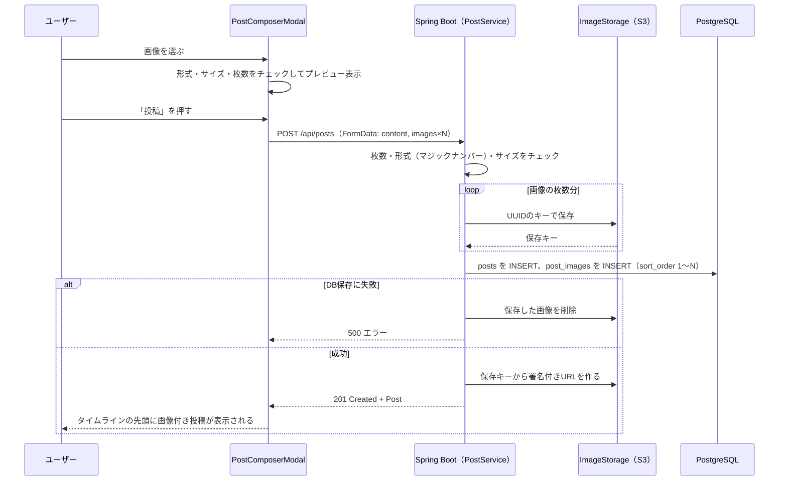

# 画像投稿機能：投稿への画像添付（最大4枚）

作成日: 2026-10-02
関連ドキュメント: [要件定義書](../要件定義書.md)（3-1. No.3）／[機能一覧](../機能一覧.md)（IMG-01〜04）／[設計書](../設計書.md#5-画像の保存とurlの組み立て)／[インフラ構成図](../インフラ構成図.md)／[投稿機能](./投稿機能.md)

投稿に画像を最大4枚まで添付する機能。画像はDBには入れず、ファイル置き場（ローカルではフォルダ、AWSではS3）に保存し、DBには「どこに保存したか（保存キー）」だけを記録する。

## 1. できること

| 機能ID | できること |
|---|---|
| IMG-01 | 1つの投稿に最大4枚の画像を添付する。画像だけの投稿（本文なし）もできる |
| IMG-02 | 選んだ画像を投稿前にプレビューし、1枚ずつ取り消せる |
| IMG-03 | 投稿カードの中で、枚数に応じたレイアウトで画像を表示する |
| IMG-04 | 画像をクリックすると大きく表示する（Could） |

## 2. 画面操作の流れ

1. 投稿作成モーダル（SC-04）の「🖼 画像を追加」を押す
2. ファイル選択ダイアログで画像を選ぶ（複数まとめて選べる）
3. 選んだ画像がモーダル内にプレビュー表示される。各画像の × で取り消せる
4. 4枚を選んだ時点で「画像を追加」ボタンは押せなくなる
5. 「投稿」を押すと、本文と画像がまとめて送信される

## 3. 画面仕様

### 投稿作成モーダル内のプレビュー

```
|          +--------+ +--------+ +--------+            |
|          | 画像1 ×| | 画像2 ×| | 画像3 ×|            |
|          +--------+ +--------+ +--------+            |
|  🖼 画像を追加（残り1枚）     残り 98 文字  [ 投稿 ]     |
```

| チェック | 内容 | エラーメッセージの例 |
|---|---|---|
| 枚数 | 合計4枚まで。5枚以上選んだ場合は先頭4枚だけ追加する | 「画像は4枚まで添付できます」 |
| 形式 | jpg / jpeg / png / gif / webp | 「jpg・png・gif・webp の画像を選んでください」 |
| サイズ | 1枚5MBまで | 「5MB以下の画像を選んでください」 |

- プレビューはブラウザの `URL.createObjectURL()` で表示する（サーバーには送らない）。取り消し・投稿・モーダルを閉じたときに `URL.revokeObjectURL()` で解放する

### 投稿カードでの表示（IMG-03）

| 枚数 | レイアウト |
|---|---|
| 1枚 | 横幅いっぱいに1枚 |
| 2枚 | 左右に2枚並べる |
| 3枚 | 左に大きく1枚、右に上下2枚 |
| 4枚 | 2×2 のグリッド |

```
 1枚           2枚            3枚            4枚
+--------+   +----+----+   +----+----+   +----+----+
|        |   |    |    |   |    | 2  |   | 1  | 2  |
|   1    |   | 1  | 2  |   | 1  +----+   +----+----+
|        |   |    |    |   |    | 3  |   | 3  | 4  |
+--------+   +----+----+   +----+----+   +----+----+
```

- 画像は枠に合わせて切り抜いて表示する（CSS の `object-fit: cover`）
- 表示順はアップロード時に選んだ順（`post_images.sort_order`）

## 4. 処理のルール

| No | ルール | 理由 |
|---|---|---|
| 1 | 形式は拡張子だけでなく、**ファイルの先頭のバイト列**（マジックナンバー）でも判定する | 拡張子を `.jpg` に変えただけの別ファイル（例：HTMLファイル）を防ぐため |
| 2 | 保存するファイル名はアップロード時の名前を使わず、**UUID** で付け直す（例：`posts/2026/10/550e8400-e29b-....jpg`） | 同じ名前のファイルの上書きや、`../../` のような不正なファイル名を防ぐため |
| 3 | DBには保存キーだけを保存し、URLは保存しない | 保存先（ローカル／S3）を切り替えやすくするため（[設計書 2-3](../設計書.md#2-3-post_images投稿画像)） |
| 4 | 投稿と画像の保存は**ひとまとめ**にする。画像の保存に失敗したら投稿も保存しない | 「投稿はあるのに画像が無い」状態を防ぐため |
| 5 | DBへの保存に失敗した場合、先に保存した画像ファイルを削除する | 使われない画像ファイルが残らないようにするため |
| 6 | 画像のサイズ上限はサーバー側でも設定する（`spring.servlet.multipart.max-file-size=5MB`、`max-request-size=20MB`） | 画面のチェックを通さずにAPIを直接呼ばれた場合に備えるため |
| 7 | 画像の加工（縮小・圧縮）は今回は行わない | 学習の範囲を絞るため（今後の課題） |
| 8 | 1枚でも不正な画像があれば、**1枚も保存せずに** 400 を返す（チェックをすべて終えてから保存を始める） | 途中まで保存して使われない画像ファイルが残らないようにするため |
| 9 | 5MB・20MB を超えたときも、本文を読み切ってから 413 を返す（`server.tomcat.max-swallow-size=25MB`） | 途中で接続を切ると、画面に 413 が届かず「通信エラー」になってしまうため |
| 10 | 投稿の編集で変えられるのは本文だけ（画像の追加・削除はできない）。画像付きの投稿は、本文を空にして保存してもよい | 作成時と同じ「画像があれば本文は空でもよい」ルールにそろえるため |
| 11 | 画像のURL（`/uploads/**`）はログインしなくても開ける | `` タグは Authorization ヘッダーを付けられないため。ファイル名は推測できない UUID にしている（AWS では S3 の署名付きURLで配信する） |

## 5. 保存先の切り替え

> **実装の状況** — `LocalImageStorage`・`S3ImageStorage` ともに実装済み。`app.storage.type`（`local`／`s3`）で切り替える。

| 項目 | フェーズ1（ローカル） | フェーズ2（AWS） |
|---|---|---|
| 使うクラス | `LocalImageStorage` | `S3ImageStorage` |
| 保存先 | `backend/uploads/posts/...` | S3バケットの `posts/...` |
| 画面に返すURL | `http://localhost:8080/uploads/posts/...` | 署名付きURL（有効期限1時間） |
| Springのプロファイル | `local` | `aws` |
| 切り替えの設定 | `app.storage.type=local`（未設定でもこちら） | `app.storage.type=s3`・`app.storage.s3-bucket`（環境変数 `IMAGE_BUCKET`） |

> **用語 — 署名付きURL（Presigned URL）**
> 非公開のS3のファイルを、「このURLを知っている人だけ、決められた時間だけ」見られるようにする特別なURL。URLの中に有効期限と署名が入っている。S3を公開設定にしなくても、ブラウザから直接画像を表示できる。

> **補足 — 署名付きURLの有効期限が切れたら**
> タイムラインを1時間以上開いたままにすると、画像のURLの期限が切れて表示されなくなる。画面を再読み込みすれば新しいURLが発行されるため、今回はそれで十分とする。

## 6. 関連ファイル（フロントエンド）

| ファイル | 役割 |
|----------|------|
| `components/PostComposerModal.jsx` | 「🖼 画像を追加（残りN枚）」ボタン、選択した画像の状態（最大4枚）。形式・サイズ・枚数のチェック。画像があれば本文は空でも投稿できる。プレビュー用のURLは取り消し・閉じたときに解放する。編集のときは画像のボタンを出さない |
| `components/ImagePreviewList.jsx` | 投稿前のプレビューと × ボタン |
| `components/PostImageGrid.jsx` | 投稿カード内の画像グリッド（1〜4枚のレイアウト）。押すと拡大表示 |
| `components/ImageViewer.jsx` | 画像の拡大表示（IMG-04）。× ・背景・Escで閉じる、複数枚は ‹ › と左右キーで切り替える |
| `components/PostCard.jsx` | 本文の下に `PostImageGrid` を置く。画像だけの投稿は本文の行を出さない |
| `utils/imageUtils.js` | 形式・サイズのチェック（`validateImageFile()`）、枚数・サイズの上限 |
| `api/postsApi.js` | `createPost({ content, images })`：`FormData` に本文と画像（同じ名前 `images`）を詰めて送る |

## 7. 関連ファイル（バックエンド）

| ファイル | 役割 |
|----------|------|
| `controller/PostController.java` | `@RequestParam` で本文と画像（`List<MultipartFile>`）を受け取る |
| `service/PostService.java` | 枚数チェック → 全画像の形式チェック → 画像保存 → 投稿・`post_images` の保存。DBへの保存に失敗したら保存済みの画像を削除する |
| `service/PostQueryService.java` | 投稿IDをまとめて渡して画像を1回で取得し、保存キーからURLを組み立てて投稿ごとに振り分ける（N+1問題の回避） |
| `service/ContentRules.java` | `normalizeAllowingEmpty()`：画像付きの投稿の本文（空でもよい） |
| `service/storage/ImageStorage.java` | `save(content, directory, extension)`・`delete(key)`・`toUrl(key)` を定義するインターフェース |
| `service/storage/LocalImageStorage.java` | ローカルフォルダ（`app.storage.local-dir`）への保存。保存先のフォルダの外を指すキーは受け付けない |
| `service/storage/S3ImageStorage.java` | AWS SDK で S3 に保存（Content-Type を付ける）、署名付きURL（有効期限1時間）を発行。`app.storage.type=s3` のときだけ使う |
| `service/storage/ImageValidator.java`・`ImageType.java` | 形式（マジックナンバー）・サイズのチェック。アイコン画像でも使う |
| `config/WebConfig.java` | `/uploads/**` で `backend/uploads/` の画像を配信する（ローカルのときだけ） |
| `config/SecurityConfig.java` | `/uploads/**` はログインなしで開ける |
| `exception/GlobalExceptionHandler.java` | 5MB・20MB の上限を超えたら 413 |
| `entity/PostImage.java`・`repository/PostImageRepository.java` | `post_images` テーブル（`UNIQUE (post_id, sort_order)`、`CHECK (sort_order between 1 and 4)`） |

## 8. API仕様

[投稿機能](./投稿機能.md) の `POST /api/posts` に画像を含めて送る。

| パート名 | 必須 | 説明 |
|---|---|---|
| content | △ | 本文（画像がある場合は省略・空文字でもよい） |
| images | - | 画像ファイル。同じ名前 `images` で最大4つ。送った順が表示順になる |

| レスポンス | 条件 |
|---|---|
| 201 Created + Post（`images` に署名付きURL） | 投稿成功 |
| 400 Bad Request | 5枚以上、対応していない形式、本文も画像も無い |
| 413 Payload Too Large | 1枚5MB超、合計20MB超 |

## 9. データの流れ



## 10. 確認すること（テスト観点）

- [ ] 1〜4枚それぞれで、正しいレイアウトで表示される
- [ ] 5枚目は追加できない。APIに直接5枚送っても 400 になる
- [ ] 5MBを超える画像は追加できない
- [ ] 拡張子だけ `.jpg` に変えたテキストファイルは 400 になる
- [ ] 画像だけ（本文なし）で投稿できる
- [ ] 同じファイル名の画像を2人がアップロードしても、上書きされない
- [ ] （AWS）S3のURLを署名なしで開くとアクセス拒否される
