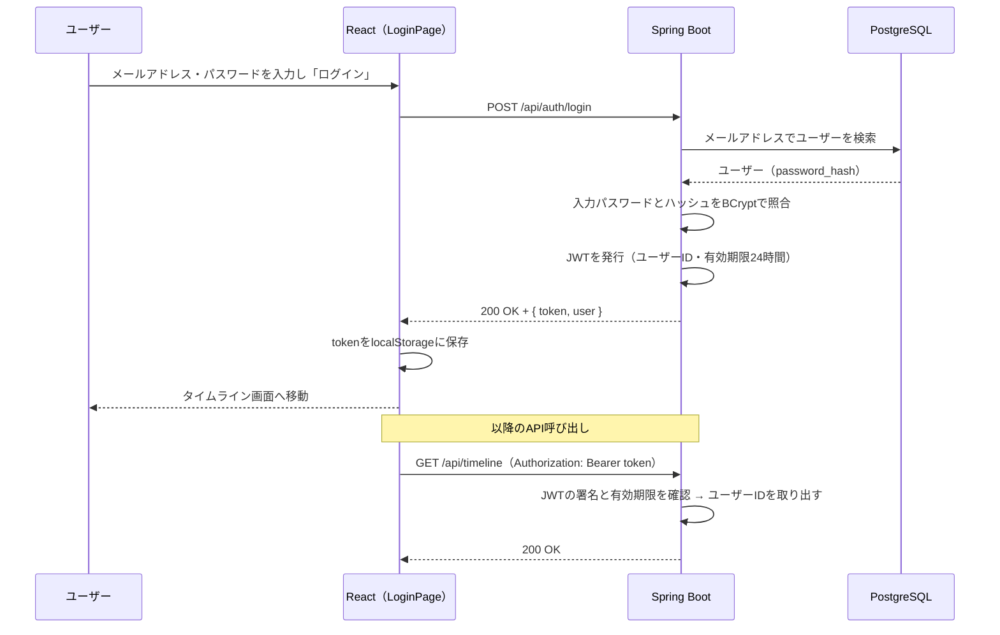

# 認証機能：新規登録・ログイン・ログアウト

作成日: 2026-10-02
関連ドキュメント: [要件定義書](../要件定義書.md)（3-1. No.1）／[機能一覧](../機能一覧.md)（AUTH-01〜05）／[設計書](../設計書.md)

アプリを使う人を区別するための機能。誰が投稿したのか、誰がいいねしたのか、を記録するためには「今操作しているのは誰か」が分かる必要がある。このアプリでは、ログインしていないとタイムラインなどの画面は一切使えない。

## 1. できること

| 機能ID | できること |
|---|---|
| AUTH-01 | ユーザー名・表示名・メールアドレス・パスワードを入力してアカウントを作る。作った後はそのままログイン状態になる |
| AUTH-02 | メールアドレスとパスワードでログインする |
| AUTH-03 | ログアウトする（ログイン画面に戻る） |
| AUTH-04 | ページを再読み込みしても、ログインから24時間はログイン状態が続く |
| AUTH-05 | ログインしていない状態で他の画面を開くと、ログイン画面に移動する |

## 2. 仕組み（JWT方式）

> **用語 — JWT（ジェイ・ダブリュー・ティー）**
> ログインに成功したときにサーバーが発行する「ログイン済みの証明書」のような文字列。中に「ユーザーID」「有効期限」が書かれており、サーバーだけが知っている秘密のキーで署名されているので、ブラウザ側で書き換えると無効になる。ブラウザは以後のすべてのAPI呼び出しにこの証明書を付けて送り、サーバーはそれを見て「誰からのリクエストか」を判断する。



## 3. 画面仕様

### SC-01 ログイン（`/login`）

```
+------------------------------------------+
|              SNS TimeLine                |
|                                          |
|  メールアドレス                            |
|  [                                    ]  |
|  パスワード                               |
|  [                                    ]  |
|                                          |
|  [            ログイン               ]    |
|                                          |
|  アカウントをお持ちでない方は 新規登録      |
+------------------------------------------+
```

| 項目 | 入力チェック |
|---|---|
| メールアドレス | 必須、メールアドレスの形式 |
| パスワード | 必須 |

- ログインに失敗したときは「メールアドレスまたはパスワードが正しくありません」と表示する。**どちらが間違っているかは伝えない**（登録済みのメールアドレスを調べられないようにするため）
- 送信中は「ログイン」ボタンを押せないようにする（二重送信防止）

### SC-02 新規登録（`/signup`）

```
+------------------------------------------+
|              アカウント作成                |
|                                          |
|  ユーザー名                               |
|  [ @                                  ]  |
|  表示名                                   |
|  [                                    ]  |
|  メールアドレス                            |
|  [                                    ]  |
|  パスワード                               |
|  [                                    ]  |
|  パスワード（確認）                         |
|  [                                    ]  |
|                                          |
|  [             登録する               ]   |
|                                          |
|  アカウントをお持ちの方は ログイン           |
+------------------------------------------+
```

| 項目 | 入力チェック | エラーメッセージの例 |
|---|---|---|
| ユーザー名 | 必須、半角英数字と `_` のみ、3〜15文字、他の人と重複不可（大文字小文字は区別しない）、予約語は不可 | 「このユーザー名は既に使われています」 |
| 表示名 | 必須、1〜50文字 | 「50文字以内で入力してください」 |
| メールアドレス | 必須、メールアドレスの形式、255文字以内、他の人と重複不可 | 「このメールアドレスは既に登録されています」 |
| パスワード | 必須、8〜72文字、英字と数字をそれぞれ1文字以上含む、半角英数字・記号のみ(スペース・全角文字は不可) | 「英字と数字を両方含めてください」 |
| パスワード（確認） | パスワードと一致する（画面側だけでチェック） | 「パスワードが一致しません」 |

> **補足 — ユーザー名の予約語**
> `search`・`new`・`me`・`admin`・`settings`・`login`・`signup` はユーザー名として登録できない。`/users/search` のようなURLと、ユーザーのプロフィールURL（`/users/{ユーザー名}`）が区別できなくなるため（[設計書 4-2](../設計書.md#4-2-api一覧)）。

> **補足 — パスワードの上限が72文字の理由**
> パスワードのハッシュ化に使う BCrypt は、72バイトより後ろの文字を無視する仕様のため。全角文字は1文字で3バイトになり、72文字以内でも72バイトを超えてしまうので、使える文字を1文字＝1バイトの半角英数字・記号に限定している。

### ログアウト（共通レイアウトのサイドメニュー）

1. サイドメニューの「ログアウト」を押す
2. localStorage の JWT を削除し、ログイン画面へ移動する（確認ダイアログは出さない）

## 4. 処理のルール

| No | ルール |
|---|---|
| 1 | パスワードは BCrypt でハッシュ化して `users.password_hash` に保存する。元のパスワードはどこにも保存しない・ログに出さない |
| 2 | JWTの有効期限は発行から24時間。期限が切れたら、APIは 401 を返す |
| 3 | フロントエンドは、APIから 401 が返ってきたら JWT を削除し、ログイン画面へ移動する（`http.js` の共通処理） |
| 4 | ページを開いたとき、localStorage に JWT があれば `GET /api/auth/me` を呼び、成功すればログイン状態として扱う |
| 5 | JWTの署名キーは環境変数で渡し、Gitにコミットしない |
| 6 | メールアドレスは前後の空白を取り除き、小文字に変換して保存・照合する |
| 7 | ログイン時、メールアドレスが登録されていない場合もダミーのハッシュでBCrypt照合を1回行う（応答時間の差から登録有無を推測されないようにするため） |
| 8 | ユーザー名・メールアドレスの重複は、事前チェックに加えてDBの一意インデックスでも防ぐ。同時に登録されて一意インデックスに違反した場合も 409 を返す |
| 9 | ログイン済みの状態でログイン画面・新規登録画面を開くと、ホームへ移動する |
| 10 | ブラウザの「戻る」「進む」でページがメモリから復元されたとき（Back-Forward Cache）、または別のタブでログイン・ログアウトしたときは、localStorage の JWT を確認し直す。JWT が無ければログイン画面へ移動する（ログアウト後に前のユーザーの画面が見えないようにするため） |

> **用語 — Back-Forward Cache**
> ブラウザの「戻る」「進む」を速くするため、直前のページをメモリに丸ごと保存しておき、そのまま復元する仕組み。JavaScript の状態（ログイン中のユーザー情報など）も保存したときのまま戻るため、ログアウト後に「戻る」を押すと、何もしなければログイン中だった画面がそのまま表示されてしまう。復元されたことは `pageshow` イベントの `persisted` で判定できる。

> **補足 — ログイン後の画面（仮）**
> タイムライン機能を実装するまでは、SC-03（`/`）に「Hello, {表示名} さん」とログアウトボタンだけを表示する仮の画面（`pages/HomePage.jsx`）を置いている。

## 5. 関連ファイル（フロントエンド）

| ファイル | 役割 |
|----------|------|
| `pages/LoginPage.jsx` | SC-01 ログイン画面 |
| `pages/SignupPage.jsx` | SC-02 新規登録画面 |
| `pages/HomePage.jsx` | SC-03 の仮画面（ログインできたことの確認とログアウト） |
| `auth/AuthContext.js` | ログイン中のユーザー情報を共有するための Context |
| `auth/AuthProvider.jsx` | ログイン中のユーザー情報と `login()`・`signup()`・`logout()` を全画面で共有する。起動時に `GET /api/auth/me` でログイン状態を復元する（AUTH-04）。Back-Forward Cache からの復元・別タブでの変更時に JWT を確認し直す（処理のルール No.10） |
| `auth/useAuth.js` | 画面から上記の値を取り出すフック |
| `components/RequireAuth.jsx` | ログインしていなければログイン画面へ移動させる（AUTH-05） |
| `components/GuestOnly.jsx` | ログイン済みならログイン画面・新規登録画面からホーム（または元々開こうとしていた画面）へ移動させる |
| `components/FormField.jsx` | ラベル・入力欄・エラーメッセージのセット |
| `utils/authValidation.js` | SC-01・SC-02 の入力チェック（サーバーと同じルール） |
| `api/http.js` | 全APIに `Authorization` ヘッダーを付ける。401 なら `logout()` |
| `api/authApi.js` | `signup()`・`login()`・`me()` |

## 6. 関連ファイル（バックエンド）

| ファイル | 役割 |
|----------|------|
| `config/SecurityConfig.java` | `/api/auth/signup`・`/api/auth/login`・`/api/health` 以外はログイン必須にする。401・403 のときも共通のエラーJSONを返す。`PasswordEncoder`（BCrypt）の定義 |
| `config/JwtConfig.java`・`JwtProperties.java` | JWTの発行・検証の設定（HS256）。署名キー `app.jwt.secret`（32バイト以上）と有効期限 `app.jwt.expiration` |
| `config/CorsConfig.java` | `http://localhost:5173` からのAPI呼び出しを許可する |
| `controller/AuthController.java` | `/api/auth/*` の受付 |
| `service/AuthService.java` | 予約語・重複チェック、パスワードのハッシュ化、ログイン時の照合 |
| `service/JwtService.java` | JWTの発行（`sub` にユーザーID、有効期限24時間） |
| `dto/SignupRequest.java`・`LoginRequest.java` | 入力チェック（`@NotBlank`・`@Size`・`@Pattern`・`@Email`）とメールアドレスの正規化 |
| `dto/AuthResponse.java`・`UserResponse.java`・`ErrorResponse.java` | レスポンスの形 |
| `exception/ApiException.java`・`GlobalExceptionHandler.java` | エラーレスポンスの共通化（設計書 4-1） |
| `entity/User.java`・`repository/UserRepository.java` | `users` テーブル |
| `resources/schema.sql` | 大文字小文字を区別しない一意インデックス（`LOWER(username)`・`LOWER(email)`）の作成 |

## 7. API仕様

### A-01 新規登録 `POST /api/auth/signup`

リクエスト

```json
{
  "username": "hanako",
  "displayName": "花子",
  "email": "hanako@example.com",
  "password": "password123"
}
```

| レスポンス | 条件 |
|---|---|
| 201 Created + `{ token, user }` | 登録成功 |
| 400 Bad Request | 入力チェックエラー、予約語のユーザー名 |
| 409 Conflict | ユーザー名・メールアドレスが既に使われている |

```json
{
  "token": "eyJhbGciOi...",
  "user": { "id": 2, "username": "hanako", "displayName": "花子", "avatarUrl": null, "bio": "" }
}
```

### A-02 ログイン `POST /api/auth/login`

```json
{ "email": "hanako@example.com", "password": "password123" }
```

| レスポンス | 条件 |
|---|---|
| 200 OK + `{ token, user }` | ログイン成功 |
| 401 Unauthorized | メールアドレスが無い、またはパスワードが違う（どちらかは区別しない） |

### A-03 ログイン中のユーザー情報 `GET /api/auth/me`

| レスポンス | 条件 |
|---|---|
| 200 OK + `user` | JWTが有効 |
| 401 Unauthorized | JWTが無い・期限切れ・改ざんされている |

## 8. 確認すること（テスト観点）

- [ ] 新規登録すると、そのままタイムラインが表示される
- [ ] 既に使われているユーザー名（大文字小文字だけ違うものも含む）では登録できない
- [ ] DBの `password_hash` に元のパスワードが入っていない
- [ ] 間違ったパスワードでログインできない。エラーメッセージからメールアドレスの登録有無が分からない
- [ ] ログアウト後、ブラウザの「戻る」でタイムラインを開いてもログイン画面に移動する（ログイン中に URL 欄から `/login` を開いてからログアウトした場合も含む）
- [ ] 別のタブでログアウトすると、開いている他のタブもログイン画面に移動する
- [ ] JWTを付けずに `GET /api/timeline` を呼ぶと 401 になる
- [ ] JWTの文字を1文字書き換えて送ると 401 になる
