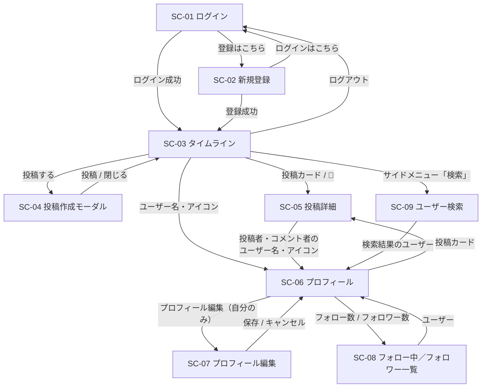

# 要件定義書：タイムライン型SNSアプリ（仮）

作成日: 2026-10-02
作成者: (ユーザー名を入れる)
関連ドキュメント: [機能一覧](./機能一覧.md)／[設計書](./設計書.md)／[技術スタック](./技術スタック.md)／[インフラ構成図](./インフラ構成図.md)／[機能定義書](./機能定義書/)

## 1. 背景・目的

このアプリは、プログラミングスクールの課題として作成する。
X（旧Twitter）のような「テキスト中心のタイムライン型SNS」を題材に、**複数のユーザーが使うWebアプリ**を、要件定義 → 設計 → 実装 → AWSへのデプロイまで一通り作り切ることが一番の目的。

前回の課題（Trello風タスク管理アプリ）は「1人で使う」アプリだったが、今回は「ログインした複数のユーザーが、お互いの投稿にいいね・コメントする」アプリになる。そのため、**誰のデータなのかを区別する**（認証・認可）、**ユーザー同士の関係を扱う**（フォロー）といった、複数人利用ならではの設計を学ぶ。

### X/Twitter との違い（差別化ポイント）

| X/Twitter | このアプリ | 理由（かんたんな説明） |
|---|---|---|
| インプレッション数（表示回数）を表示する | **表示しない** | 「何人に見られたか」を気にせず、気軽に投稿できる場にするため |
| リツイート（リポスト）・引用ができる | **機能を用意しない** | 拡散よりも、投稿そのものへの反応（いいね・コメント）を大事にするため |

### 学習目標（このアプリを通じて身につけたいこと）

| No | 学ぶこと | このアプリのどこで使うか |
|----|----------|--------------------------|
| 1 | 認証・認可（ログイン、本人だけが操作できる制御） | ログイン機能、投稿・コメントの削除 |
| 2 | 多対多のデータ設計 | いいね（ユーザー×投稿）、フォロー（ユーザー×ユーザー） |
| 3 | 集計クエリとN+1問題 | いいね数・コメント数の表示 |
| 4 | ページング（大量データの分割取得） | タイムラインの無限スクロール |
| 5 | ファイルアップロードとクラウドストレージ | 画像投稿（Amazon S3） |
| 6 | AWSでの本番に近い構成 | EC2 + ALB + RDS + S3（[インフラ構成図](./インフラ構成図.md)） |

## 2. 使う人

- スクールの受講生、または個人
- **複数のユーザーが同時に利用する**前提で作る
  - 自分以外の人（第三者）が、自分の投稿にいいね・コメントすることがある
  - 投稿ごとに「いいね数」「コメント数」が誰からも見える

## 3. できること（機能要件）

ここでは概要のみ記載する。機能IDごとの一覧は [機能一覧](./機能一覧.md)、機能ごとの詳しい仕様は [機能定義書](./機能定義書/) を参照。

### 3-1. 必須機能（これが無いとアプリとして成立しないもの）

| No | 機能 | 説明 | 機能定義書 |
|----|------|------|------------|
| 1 | ログイン機能 | 新規登録・ログイン・ログアウトができる。ログインしていないとアプリを使えない | [認証機能](./機能定義書/認証機能.md) |
| 2 | 投稿機能 | 140文字以内のテキストを投稿・削除できる | [投稿機能](./機能定義書/投稿機能.md) |
| 3 | 画像投稿機能 | 1つの投稿に最大4枚の画像を添付できる | [画像投稿機能](./機能定義書/画像投稿機能.md) |
| 4 | タイムライン機能 | フォローしているユーザーと自分の投稿が新しい順に並ぶ | [タイムライン機能](./機能定義書/タイムライン機能.md) |
| 5 | いいね機能 | 投稿にいいね・取り消しができる。いいね数が表示される | [いいね機能](./機能定義書/いいね機能.md) |
| 6 | コメント機能 | 投稿にコメントできる（返信は不可）。コメント数が表示される | [コメント機能](./機能定義書/コメント機能.md) |
| 7 | フォロー機能 | 他のユーザーをフォロー・解除できる。フォロー数・フォロワー数が表示される | [フォロー機能](./機能定義書/フォロー機能.md) |
| 8 | ユーザー検索機能 | ユーザー名でユーザーを検索し、プロフィールからフォローできる | [ユーザー検索機能](./機能定義書/ユーザー検索機能.md) |
| 9 | プロフィール機能 | ユーザーのプロフィールと投稿一覧を見られる。自分のプロフィールを編集できる | [プロフィール機能](./機能定義書/プロフィール機能.md) |

> **補足 — なぜフォロー機能・ユーザー検索機能が必要か**
> タイムラインは「フォローしている人の投稿」を表示するため、フォロー機能が無いと自分の投稿しか表示されない。さらに、フォローする相手を見つける手段（ユーザー検索、投稿やコメントからプロフィールへの移動）が無いと、新しく登録したユーザーは誰もフォローできない。この2つはタイムライン機能を成り立たせるために必須とする。

### 3-2. あったら嬉しい機能（後回しでもOK、今回は作らない）

| No | 機能 | 説明 |
|----|------|------|
| 1 | 通知 | いいね・コメント・フォローされたときに通知する |
| 2 | 投稿の検索・ハッシュタグ | 投稿本文をキーワードで検索する |
| 3 | 投稿の編集 | 投稿した後で本文を書き換える |
| 4 | メールアドレス・パスワードの変更 | アカウント設定画面 |
| 5 | HTTPS化・独自ドメイン | Route 53 + ACM で独自ドメインと SSL 証明書を設定する |

## 4. 対象外（今回は絶対に作らないもの）

- リツイート（リポスト）・引用投稿（差別化ポイントのため）
- インプレッション数（閲覧数）の計測・表示（差別化ポイントのため）
- コメントへの返信（スレッド表示）
- ダイレクトメッセージ
- ブロック・ミュート・通報
- おすすめタイムライン（アルゴリズムによる並び替え）
- スマホアプリ化（ブラウザで動けばOK）

## 5. どうやって作るか（使用技術）

詳細なバージョンは [技術スタック](./技術スタック.md) を参照。

| 項目 | 使うもの | 理由（かんたんな説明） |
|------|----------|--------------------------|
| 画面づくり | React（＋Vite） | 前回の課題で学んだ技術をそのまま使い、新しく覚えることを「複数ユーザー対応」に集中させるため |
| 画面の切り替え | React Router | 今回は画面が複数（ログイン・タイムライン・プロフィールなど）あるため、URLごとに画面を切り替える仕組みが必要 |
| サーバー（裏方の仕組み） | Java＋Spring Boot | 前回の課題と同じ。実務でも広く使われている |
| ログインの仕組み | Spring Security＋JWT | Spring Boot の標準的なセキュリティ機能。JWT は「ログイン済みの証明書」をブラウザに持たせる方式 |
| データベース | PostgreSQL | 前回の課題と同じ。ローカルでは Docker、AWS では RDS で動かす |
| 画像の保存先 | Amazon S3 | 画像のような大きなファイルは DB ではなく、ファイル置き場専用のサービスに保存するのが一般的なため |
| サーバーを置く場所 | AWS（EC2・ALB・RDS・S3） | [インフラ構成図](./インフラ構成図.md) 参照。無料利用枠に収まることを優先する |
| インフラの作り方 | Terraform | 前回の課題と同じ。コードでインフラを作り、何度でも同じ環境を再現できるようにする |

## 6. 画面仕様

### 6-1. 画面一覧

| 画面ID | 画面名 | URL | ログイン必須 | 詳細 |
|---|---|---|---|---|
| SC-01 | ログイン | `/login` | - | [認証機能](./機能定義書/認証機能.md) |
| SC-02 | 新規登録 | `/signup` | - | [認証機能](./機能定義書/認証機能.md) |
| SC-03 | タイムライン（ホーム） | `/` | ○ | [タイムライン機能](./機能定義書/タイムライン機能.md) |
| SC-04 | 投稿作成（モーダル） | -（各画面の上に表示） | ○ | [投稿機能](./機能定義書/投稿機能.md)／[画像投稿機能](./機能定義書/画像投稿機能.md) |
| SC-05 | 投稿詳細 | `/posts/:postId` | ○ | [コメント機能](./機能定義書/コメント機能.md) |
| SC-06 | プロフィール | `/users/:username` | ○ | [プロフィール機能](./機能定義書/プロフィール機能.md) |
| SC-07 | プロフィール編集 | `/settings/profile` | ○ | [プロフィール機能](./機能定義書/プロフィール機能.md) |
| SC-08 | フォロー中／フォロワー一覧 | `/users/:username/following`<br>`/users/:username/followers` | ○ | [フォロー機能](./機能定義書/フォロー機能.md) |
| SC-09 | ユーザー検索 | `/search` | ○ | [ユーザー検索機能](./機能定義書/ユーザー検索機能.md) |

### 6-2. 画面遷移図



### 6-3. 画面構成（ログイン後の共通レイアウト）

- 画面左：サイドメニュー（ホーム／検索／プロフィール／投稿するボタン／ログアウト）
- 画面中央：各画面のメインコンテンツ
- PC（幅1024px以上）を前提とし、スマートフォン幅（375px〜）では表示が大きく崩れなければよい

```
+----------------+---------------------------------------------+
| SNS TimeLine   |  メインコンテンツ                              |
|                |                                             |
|  🏠 ホーム       |                                             |
|  🔍 検索        |                                             |
|  👤 プロフィール  |                                             |
|                |                                             |
|  [ 投稿する ]    |                                             |
|                |                                             |
|  (icon) 表示名   |                                             |
|  [ログアウト]     |                                             |
+----------------+---------------------------------------------+
```

### 6-4. 投稿カード（共通部品）

タイムライン・プロフィール・投稿詳細で共通して使う部品。

```
+--------------------------------------------------------------+
| (icon) 表示名  @username ・ 3分前                     [🗑]      |
|                                                              |
| 本文テキスト本文テキスト本文テキスト……                            |
|                                                              |
| +-------------+-------------+                                |
| |   画像1     |   画像2      |   ← 1〜4枚をグリッド表示          |
| +-------------+-------------+                                |
|                                                              |
|  💬 12          ♡ 34                                          |
+--------------------------------------------------------------+
```

| 項目 | 内容 |
|------|------|
| アイコン・表示名・@username | クリックするとそのユーザーのプロフィール（SC-06）へ移動する。プロフィールからフォローできる |
| 投稿日時 | 24時間以内は「3分前」のような相対表示、それより前は「2026/10/02」の日付表示 |
| 🗑 削除ボタン | **自分の投稿にだけ**表示する |
| 💬 コメント数 | 第三者のコメントも含めた総数。押すと投稿詳細（SC-05）へ移動する |
| ♡ いいね数 | 第三者のいいねも含めた総数。押すといいね／取り消し。自分がいいね済みなら ♥（塗りつぶし）で表示する |

> X/Twitter にある「リツイート（リポスト）」ボタンと「インプレッション数（📊）」は**配置しない**。

## 7. ユースケース／操作フロー

代表的な流れのみ記載する。各機能の詳しい操作フローは [機能定義書](./機能定義書/) を参照。

### UC1. 新規登録してタイムラインを見る
1. 新規登録画面でユーザー名・表示名・メールアドレス・パスワードを入力し「登録する」を押す
2. ログインした状態でタイムラインが表示される（まだ誰もフォローしていないので、自分の投稿だけが表示される）
3. タイムラインに表示される「ユーザーを探す」から検索画面へ移動する

### UC2. ユーザーを探してフォローする
1. 検索画面でユーザー名を入力し、Enterキーまたは「検索」ボタンを押す
2. 検索結果からユーザーを選び、プロフィール画面を開く
3. 「フォローする」を押す
4. タイムラインに戻ると、フォローしたユーザーの投稿が表示されるようになる

（タイムラインや投稿詳細に表示されている投稿者・コメント者のユーザー名を押して、プロフィールからフォローすることもできる）

### UC3. 画像付きで投稿する
1. 「投稿する」を押して投稿作成モーダルを開く
2. 本文を入力し、「画像を追加」から画像を最大4枚まで選ぶ
3. 「投稿」を押すと、タイムラインの一番上に投稿が表示される

### UC4. 他の人の投稿にいいね・コメントする
1. タイムラインで投稿の ♡ を押すと、いいね数が1増えてハートが塗りつぶされる
2. 投稿の 💬 を押して投稿詳細を開き、コメントを入力して「送信」を押す
3. コメント一覧の一番下にコメントが追加され、コメント数が1増える

### UC5. 自分の投稿を削除する
1. 自分の投稿の 🗑 を押す
2. 「この投稿を削除しますか？この操作は取り消せません。」という確認ダイアログが表示される
3. 「OK」を押すと投稿が消える。「キャンセル」を押すと何も起きない

## 8. 非機能要件

「機能要件」が”何ができるか”だとしたら、「非機能要件」は”どのくらいの品質・環境で動けばよいか”を決めるもの。今回はスクール課題だが複数人が使うため、**セキュリティは前回より厳しめ**に決める。

| No | 項目 | 決めた内容 | かんたんな理由 |
|----|------|------------|------------------|
| 1 | 対応ブラウザ | Google Chromeの最新版で動作すること | 開発・確認をChromeに絞り、学習に集中するため |
| 2 | 画面サイズ | 幅1024px以上のPCを前提とする。スマートフォン幅（375px〜）でも大きく崩れないこと | SNSはスマホで見られることが多いため、最低限の対応はする |
| 3 | 想定規模 | ユーザー100人、投稿1万件程度まで | 受講生同士で使う規模を想定 |
| 4 | パフォーマンス | タイムラインの表示が1秒以内。1回に読み込む投稿は20件 | 全件を一度に読み込むと、投稿が増えたときに遅くなるため |
| 5 | パスワードの保存 | ハッシュ化（BCrypt）して保存し、元のパスワードはDBに残さない | DBの中身が漏れても、パスワードが分からないようにするため |
| 6 | 認可（本人チェック） | 投稿・コメントの削除、プロフィールの編集は、**サーバー側で**本人かどうかを必ず確認する | 画面のボタンを隠すだけでは、APIを直接呼ばれると防げないため |
| 7 | XSS対策 | 投稿・コメント・自己紹介をHTMLとして実行しない（Reactの標準のエスケープに任せ、`dangerouslySetInnerHTML`は使わない） | 他人が書いた文章を表示するアプリなので、悪意あるスクリプトを防ぐ必要がある |
| 8 | SQLインジェクション対策 | SQLは文字列連結で組み立てず、Spring Data JPA／プレースホルダを使う | 検索ワードなど、ユーザーの入力をSQLに使う場面があるため |
| 9 | 入力チェック | 画面（React）とサーバー（Spring Boot）の**両方で**チェックする | 画面のチェックは使いやすさのため、サーバーのチェックは安全のため |
| 10 | 画像 | jpg/png/gif/webp のみ、1枚5MBまで、1投稿4枚まで | S3の無料利用枠（5GB）を使い切らないため |
| 11 | データの削除 | 投稿・コメントは論理削除（削除日時を記録して非表示にする） | 他人のいいね・コメントが紐づいているため、誤削除時に調査・復旧できるようにする |
| 12 | 秘密情報の管理 | DBパスワード・JWTの署名キー・AWSのアクセスキーをGitにコミットしない | 公開リポジトリに載ると悪用されるため |
| 13 | コスト | AWSは無料利用枠の範囲に収めることを優先する。使わないときは `terraform destroy` で削除する | 学習用のため（詳細は [インフラ構成図](./インフラ構成図.md#5-無料利用枠とコスト)） |
| 14 | アクセシビリティ | 今回は対象外 | 学習の優先度として、複数ユーザー対応を優先するため |

### 8-1. 数値の一覧（変更するときはここを基準に、各ドキュメントを修正する）

| 項目 | 値 |
|---|---|
| 投稿本文 | 0〜140文字（画像が無い場合は1文字以上） |
| コメント本文 | 1〜140文字 |
| 1投稿あたりの画像 | 最大4枚 |
| 画像1枚のサイズ | 最大5MB |
| ユーザー名（@ID） | 3〜15文字（半角英数字と `_`） |
| 表示名 | 1〜50文字 |
| 自己紹介 | 0〜160文字 |
| パスワード | 8〜72文字（英字・数字を各1文字以上、半角英数字・記号のみ） |
| 検索キーワード | 1〜50文字 |
| 1回に読み込む件数 | 20件 |
| ログインの有効期限（JWT） | 24時間 |

## 9. 完成の目安（これができたら「完成」とする）

- 2人以上のユーザーで新規登録・ログインできる
- ユーザーを検索してフォローでき、フォローした人の投稿がタイムラインに表示される
- 画像付き（最大4枚）で投稿できる
- 他の人の投稿にいいね・コメントでき、いいね数・コメント数が正しく表示される
- 自分の投稿・コメントだけを削除できる（他人のものは削除できない）
- AWS（EC2・ALB・RDS・S3）上で動き、ブラウザからALBのURLでアクセスできる

## 10. 補足（実装前に決めておくこと）

### 10-1. 開発の進め方

前回の課題と同じく、段階的に作る。

| フェーズ | 内容 |
|----------|------|
| フェーズ1 | ローカル環境（React + Spring Boot + Docker の PostgreSQL）で、全機能を動かす。画像はローカルのフォルダに保存する |
| フェーズ2 | 画像の保存先を S3 に切り替え、Terraform で AWS（EC2・ALB・RDS・S3）にデプロイする |

### 10-2. 技術的な注意点（知らないとハマりやすい点）

| No | 注意点 | 内容 |
|----|--------|------|
| 1 | N+1問題 | タイムラインの20件それぞれに「いいね数」「コメント数」を別々のSQLで数えると、1回の表示でSQLが40回以上発行される。まとめて集計する（[設計書](./設計書.md#3-主要なデータ取得の考え方)） |
| 2 | 検索ワードの `_` と `%` | ユーザー名には `_` が使えるが、SQLの `LIKE` では `_` が「任意の1文字」という特別な意味になる。エスケープしないと意図しない結果になる（[ユーザー検索機能](./機能定義書/ユーザー検索機能.md)） |
| 3 | いいねの連打 | いいねボタンを素早く2回押すと、同じいいねが2件登録される恐れがある。DBのユニーク制約で防ぐ |
| 4 | JWTの保存場所 | 今回は学習用の簡易方式として localStorage に保存する。XSSがあるとトークンを盗まれるため、本番運用では HttpOnly Cookie を検討する |
| 5 | 画像のファイル名 | ユーザーがアップロードしたファイル名をそのまま使うと、上書きや不正なパスの問題が起きる。UUIDで名前を付け直す |
| 6 | ALBのヘルスチェック | ALBは定期的にサーバーが生きているか確認する。確認用のURL（`/api/health`）を用意しないと、ALBがサーバーを「故障中」と判断して通信を流さなくなる |
