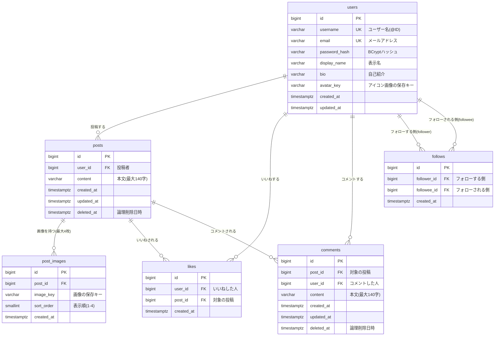

# 設計書：タイムライン型SNSアプリ（仮）

作成日: 2026-10-02
関連ドキュメント: [要件定義書](./要件定義書.md)／[機能一覧](./機能一覧.md)／[技術スタック](./技術スタック.md)／[インフラ構成図](./インフラ構成図.md)

[要件定義書](./要件定義書.md) で決めた機能を実現するための、データ（ER図・テーブル）とAPIの設計をまとめる。機能ごとの細かい振る舞いは [機能定義書](./機能定義書/) を参照。

## 1. ER図（データの実体と関連）



### ER図の読み方

| 関係 | 多重度 | 説明 |
|---|---|---|
| users → posts | 1 対 多 | 1人のユーザーは0件以上の投稿を持つ |
| posts → post_images | 1 対 0〜4 | 1つの投稿に画像は0〜4枚（4枚の上限はアプリ側でチェックする） |
| users ↔ posts（likes） | 多 対 多 | 「誰が・どの投稿に」いいねしたかを `likes` が記録する（中間テーブル） |
| posts → comments | 1 対 多 | 1つの投稿に0件以上のコメント。コメントへの返信は無いので、親コメントのIDは持たない |
| users ↔ users（follows） | 多 対 多 | ユーザー同士の関係。同じ `users` テーブルを2回参照する（**自己参照**） |

> **ポイント — いいね数・コメント数をカラムに持たない理由**
> `posts` に `like_count` のようなカラムは作らず、表示するたびに `likes` テーブルの件数を数える（[3-2](#3-2-いいね数コメント数いいね済みの判定)）。カラムに持つと、いいねのたびに +1 する処理と、2人が同時にいいねしたときに数がずれないようにする排他制御が必要になる。今回の規模（投稿1万件程度）では数える方式でも十分速く、データが常に正しいことを優先する。

## 2. テーブル定義

### 共通ルール

- 主キーは `bigint`（`GENERATED ALWAYS AS IDENTITY`＝自動採番）。JPAでは `@GeneratedValue(strategy = GenerationType.IDENTITY)`
  - 前回の課題ではUUIDを使ったが、今回は「新しい順に並べる」「ID を使ってページングする」ために、増えていく数値のIDにする
- 日時は `timestamptz`（タイムゾーン付き）。保存はUTC、画面では日本時間で表示する
- 投稿・コメントは**論理削除**（`deleted_at` に日時を入れて非表示にする）。いいね・フォローは取り消し時に**物理削除**（行ごと消す）

> **ポイント — 論理削除と物理削除の使い分け**
> 前回の課題ではカードを物理削除にした。今回の投稿・コメントは、他人のいいね・コメントが紐づいており、誤って消したときに調査・復旧できるよう論理削除にする。一方、いいね・フォローは「押した／押していない」の状態を表すだけなので、取り消したら行ごと消す。

### 2-1. users（ユーザー）

| カラム名 | 型 | NULL | デフォルト | 制約 | 説明 |
|---|---|---|---|---|---|
| id | bigint | NO | 自動採番 | PK | |
| username | varchar(15) | NO | | UNIQUE（大文字小文字を区別しない） | ユーザー名（@ID）。半角英数字と `_`、3〜15文字 |
| email | varchar(255) | NO | | UNIQUE（大文字小文字を区別しない） | ログインに使う |
| password_hash | varchar(255) | NO | | | BCryptでハッシュ化したパスワード |
| display_name | varchar(50) | NO | | | 表示名 |
| bio | varchar(160) | NO | `''` | | 自己紹介 |
| avatar_key | varchar(255) | YES | NULL | | アイコン画像の保存キー。NULLならデフォルト画像 |
| created_at | timestamptz | NO | `now()` | | 登録日時 |
| updated_at | timestamptz | NO | `now()` | | 更新日時 |

インデックス

- `UNIQUE (LOWER(username))`、`UNIQUE (LOWER(email))` … `Taro` と `taro` を別人として登録できないようにする
- `idx_users_created (created_at)` … 「新しく参加したユーザー」の表示用

### 2-2. posts（投稿）

| カラム名 | 型 | NULL | デフォルト | 制約 | 説明 |
|---|---|---|---|---|---|
| id | bigint | NO | 自動採番 | PK | |
| user_id | bigint | NO | | FK → users.id | 投稿者 |
| content | varchar(140) | NO | `''` | | 本文。画像だけの投稿の場合は空文字 |
| created_at | timestamptz | NO | `now()` | | 投稿日時 |
| updated_at | timestamptz | NO | `now()` | | 更新日時 |
| deleted_at | timestamptz | YES | NULL | | 論理削除日時。NULL＝表示中 |

インデックス

- `idx_posts_user_id (user_id, id DESC)` … タイムライン・プロフィールの投稿一覧を新しい順に取り出す用

### 2-3. post_images（投稿画像）

| カラム名 | 型 | NULL | デフォルト | 制約 | 説明 |
|---|---|---|---|---|---|
| id | bigint | NO | 自動採番 | PK | |
| post_id | bigint | NO | | FK → posts.id | 対象の投稿 |
| image_key | varchar(255) | NO | | | 画像の保存キー（例：`posts/2026/10/550e8400-....jpg`） |
| sort_order | smallint | NO | | CHECK (1〜4) | 表示順 |
| created_at | timestamptz | NO | `now()` | | |

制約

- `UNIQUE (post_id, sort_order)` … 同じ投稿の中で表示順が重複しない

> **ポイント — URLではなく「保存キー」を保存する理由**
> `https://xxx.s3.amazonaws.com/posts/...` のようなURLをそのまま保存すると、保存先をローカル → S3 に変えたときに全データを書き換える必要がある。保存キー（S3内のパス）だけを保存しておき、URLは画面に返すときに組み立てる。S3を非公開にして**署名付きURL**（期限付きでだけ見られるURL）を使う場合も、この方式なら対応できる。

### 2-4. likes（いいね）

| カラム名 | 型 | NULL | デフォルト | 制約 | 説明 |
|---|---|---|---|---|---|
| id | bigint | NO | 自動採番 | PK | |
| user_id | bigint | NO | | FK → users.id | いいねした人 |
| post_id | bigint | NO | | FK → posts.id | 対象の投稿 |
| created_at | timestamptz | NO | `now()` | | |

制約・インデックス

- `UNIQUE (user_id, post_id)` … **同じ人が同じ投稿に2回いいねできない**ことをDBで保証する（ボタンの連打対策）
- `idx_likes_post (post_id)` … 投稿ごとのいいね数を数える用

### 2-5. comments（コメント）

| カラム名 | 型 | NULL | デフォルト | 制約 | 説明 |
|---|---|---|---|---|---|
| id | bigint | NO | 自動採番 | PK | |
| post_id | bigint | NO | | FK → posts.id | 対象の投稿 |
| user_id | bigint | NO | | FK → users.id | コメントした人 |
| content | varchar(140) | NO | | | 本文（1〜140文字） |
| created_at | timestamptz | NO | `now()` | | |
| updated_at | timestamptz | NO | `now()` | | |
| deleted_at | timestamptz | YES | NULL | | 論理削除日時 |

インデックス

- `idx_comments_post (post_id, id)` … 投稿詳細のコメント一覧（古い順）とコメント数を数える用

### 2-6. follows（フォロー）

| カラム名 | 型 | NULL | デフォルト | 制約 | 説明 |
|---|---|---|---|---|---|
| id | bigint | NO | 自動採番 | PK | |
| follower_id | bigint | NO | | FK → users.id | フォローする側 |
| followee_id | bigint | NO | | FK → users.id | フォローされる側 |
| created_at | timestamptz | NO | `now()` | | フォローした日時 |

制約・インデックス

- `UNIQUE (follower_id, followee_id)` … 同じ相手を2回フォローできない
- `CHECK (follower_id <> followee_id)` … 自分自身をフォローできない（アプリ側でもチェックする）
- `idx_follows_followee (followee_id)` … フォロワー一覧・フォロワー数を取り出す用

## 3. 主要なデータ取得の考え方

### 3-1. タイムライン（フォロー中のユーザー＋自分の投稿）

```sql
SELECT p.*
FROM posts p
WHERE p.deleted_at IS NULL
  AND (
    p.user_id = :me
    OR p.user_id IN (SELECT f.followee_id FROM follows f WHERE f.follower_id = :me)
  )
  AND (:cursor IS NULL OR p.id < :cursor)   -- 2ページ目以降は「前回の最後の投稿ID」より古いもの
ORDER BY p.id DESC
LIMIT 20;
```

> **ポイント — OFFSET ではなく「カーソル方式」でページングする理由**
> `OFFSET 20 LIMIT 20`（21件目から20件）方式だと、読んでいる途中で誰かが新しく投稿すると全体が1件ずつずれ、同じ投稿が2回表示されてしまう。「前回の最後の投稿IDより小さいもの」を取る方式なら、新しい投稿が増えてもずれない。

### 3-2. いいね数・コメント数・いいね済みの判定

タイムラインで取得した20件の投稿IDに対して、**まとめて1回**で集計する。

```sql
SELECT
  p.id,
  (SELECT COUNT(*) FROM likes l WHERE l.post_id = p.id)                              AS like_count,
  (SELECT COUNT(*) FROM comments c WHERE c.post_id = p.id AND c.deleted_at IS NULL)  AS comment_count,
  EXISTS (SELECT 1 FROM likes l WHERE l.post_id = p.id AND l.user_id = :me)          AS liked_by_me
FROM posts p
WHERE p.id IN (:postIds);
```

> **用語 — N+1問題**
> 一覧を1回のSQLで取った（1回）あと、各行ごとに追加のSQLを発行（N回）してしまう問題。20件のタイムラインで「いいね数」「コメント数」「画像」を1件ずつ取ると 1 + 20×3 = 61回 のSQLが発行され、遅くなる。上のように投稿IDをまとめて渡して集計すれば、件数に関係なく数回で済む。画像（`post_images`）も同様に `WHERE post_id IN (...)` でまとめて取得する。

### 3-3. ユーザー検索

```sql
SELECT u.*
FROM users u
WHERE u.username ILIKE :pattern ESCAPE '\'
   OR u.display_name ILIKE :pattern ESCAPE '\'
ORDER BY (LOWER(u.username) = LOWER(:keyword)) DESC,  -- ユーザー名が完全一致する人を先頭に
         u.id DESC
LIMIT 20 OFFSET :offset;
```

- `:pattern` はキーワードの `\` `%` `_` をエスケープしたうえで、前後に `%` を付けたもの（例：`taro_1` → `%taro\_1%`）
- キーワードの先頭が `@` の場合は `@` を取り除き、`display_name` の条件を外して `username` だけを検索する
- `ILIKE` は PostgreSQL の「大文字小文字を区別しない LIKE」
- 詳しくは [ユーザー検索機能](./機能定義書/ユーザー検索機能.md) を参照

## 4. API設計

### 4-1. 共通仕様

| 項目 | 内容 |
|---|---|
| ベースURL | `/api` |
| データ形式 | JSON（画像アップロードのみ `multipart/form-data`） |
| 認証 | `Authorization: Bearer <JWT>` ヘッダー。「認証」欄が○のAPIは、ヘッダーが無い・期限切れの場合 401 を返す |
| 日時形式 | ISO 8601（UTC）。例：`2026-10-02T03:34:56Z` |
| JSONのキー | キャメルケース（例：`likeCount`） |

#### ステータスコード

| コード | 意味 | 主なケース |
|---|---|---|
| 200 OK | 成功 | 取得・更新、いいね・フォロー（最新の件数を返す）、コメント削除（最新のコメント数を返す） |
| 201 Created | 作成した | 新規登録・投稿・コメント |
| 204 No Content | 成功（返す内容なし） | 投稿削除 |
| 400 Bad Request | 入力内容の誤り | バリデーションエラー、自分をフォローしようとした |
| 401 Unauthorized | ログインしていない | トークン無し・期限切れ、ログイン失敗 |
| 403 Forbidden | 権限が無い | 他人の投稿・コメントを削除しようとした |
| 404 Not Found | 見つからない | 存在しない／削除済みの投稿・ユーザー |
| 409 Conflict | 重複 | ユーザー名・メールアドレスが既に使われている |
| 413 Payload Too Large | ファイルが大きすぎる | 画像1枚5MB超、1回の送信の合計20MB超 |

#### エラーレスポンスの形

```json
{
  "status": 400,
  "message": "入力内容に誤りがあります",
  "errors": [
    { "field": "content", "message": "140文字以内で入力してください" }
  ]
}
```

### 4-2. API一覧

| No | メソッド | パス | 内容 | 認証 | 機能定義書 |
|---|---|---|---|---|---|
| A-01 | POST | /api/auth/signup | 新規登録（JWTを返す） | - | [認証機能](./機能定義書/認証機能.md) |
| A-02 | POST | /api/auth/login | ログイン（JWTを返す） | - | [認証機能](./機能定義書/認証機能.md) |
| A-03 | GET | /api/auth/me | ログイン中のユーザー情報 | ○ | [認証機能](./機能定義書/認証機能.md) |
| T-01 | GET | /api/timeline | タイムライン | ○ | [タイムライン機能](./機能定義書/タイムライン機能.md) |
| P-01 | POST | /api/posts | 投稿作成（画像添付可） | ○ | [投稿機能](./機能定義書/投稿機能.md)／[画像投稿機能](./機能定義書/画像投稿機能.md) |
| P-02 | GET | /api/posts/{postId} | 投稿詳細 | ○ | [投稿機能](./機能定義書/投稿機能.md) |
| P-03 | DELETE | /api/posts/{postId} | 投稿削除（本人のみ） | ○ | [投稿機能](./機能定義書/投稿機能.md) |
| L-01 | POST | /api/posts/{postId}/likes | いいねする | ○ | [いいね機能](./機能定義書/いいね機能.md) |
| L-02 | DELETE | /api/posts/{postId}/likes | いいね取り消し | ○ | [いいね機能](./機能定義書/いいね機能.md) |
| C-01 | GET | /api/posts/{postId}/comments | コメント一覧 | ○ | [コメント機能](./機能定義書/コメント機能.md) |
| C-02 | POST | /api/posts/{postId}/comments | コメント投稿 | ○ | [コメント機能](./機能定義書/コメント機能.md) |
| C-03 | DELETE | /api/comments/{commentId} | コメント削除（本人のみ） | ○ | [コメント機能](./機能定義書/コメント機能.md) |
| U-01 | GET | /api/users/search | ユーザー検索 | ○ | [ユーザー検索機能](./機能定義書/ユーザー検索機能.md) |
| U-02 | GET | /api/users/new | 新しく参加したユーザー | ○ | [ユーザー検索機能](./機能定義書/ユーザー検索機能.md) |
| U-03 | GET | /api/users/{username} | プロフィール | ○ | [プロフィール機能](./機能定義書/プロフィール機能.md) |
| U-04 | GET | /api/users/{username}/posts | ユーザーの投稿一覧 | ○ | [プロフィール機能](./機能定義書/プロフィール機能.md) |
| U-05 | PUT | /api/users/me | プロフィール更新 | ○ | [プロフィール機能](./機能定義書/プロフィール機能.md) |
| U-06 | POST | /api/users/me/avatar | アイコン画像の変更 | ○ | [プロフィール機能](./機能定義書/プロフィール機能.md) |
| F-01 | POST | /api/users/{username}/follow | フォローする | ○ | [フォロー機能](./機能定義書/フォロー機能.md) |
| F-02 | DELETE | /api/users/{username}/follow | フォロー解除 | ○ | [フォロー機能](./機能定義書/フォロー機能.md) |
| F-03 | GET | /api/users/{username}/following | フォロー中の一覧 | ○ | [フォロー機能](./機能定義書/フォロー機能.md) |
| F-04 | GET | /api/users/{username}/followers | フォロワーの一覧 | ○ | [フォロー機能](./機能定義書/フォロー機能.md) |
| H-01 | GET | /api/health | ヘルスチェック（ALB用） | - | [インフラ構成図](./インフラ構成図.md) |

> ログアウトは、ブラウザに保存したJWTを消すだけなのでAPIは用意しない。

> **ポイント — `/api/users/search` と `/api/users/{username}` の衝突**
> `/api/users/search` は `/api/users/{username}` の `{username}` に `search` が入ったものとも読める。Spring では固定のパスが優先されるので動作はするが、`search` や `new` というユーザー名が登録されると区別できなくなる。そのため、**`search`・`new`・`me` などはユーザー名として登録できない予約語**にする（[認証機能](./機能定義書/認証機能.md) の入力チェック参照）。

### 4-3. よく使うレスポンスの形

#### UserSummary（ユーザーの概要。一覧・投稿者表示で使う）

```json
{
  "id": 2,
  "username": "hanako",
  "displayName": "花子",
  "avatarUrl": "https://.../avatars/xxxx.png",
  "bio": "Javaを勉強中です",
  "followedByMe": false,
  "isMe": false
}
```

| キー | 説明 |
|---|---|
| followedByMe | ログイン中のユーザーがこの人をフォローしているか（フォローボタンの表示に使う） |
| isMe | ログイン中のユーザー本人か（本人ならフォローボタンを出さない） |

#### Post（投稿）

```json
{
  "id": 120,
  "author": { "id": 2, "username": "hanako", "displayName": "花子", "avatarUrl": "https://..." },
  "content": "今日はSpring Securityを学びました",
  "images": [
    { "url": "https://.../posts/2026/10/aaaa.jpg", "sortOrder": 1 },
    { "url": "https://.../posts/2026/10/bbbb.jpg", "sortOrder": 2 }
  ],
  "likeCount": 34,
  "commentCount": 12,
  "likedByMe": true,
  "isMine": false,
  "createdAt": "2026-10-02T03:34:56Z"
}
```

| キー | 説明 |
|---|---|
| likeCount | 第三者を含むいいねの総数 |
| commentCount | 第三者を含むコメントの総数（削除済みを除く） |
| likedByMe | ログイン中のユーザーがいいね済みか（ハートの塗りつぶしに使う） |
| isMine | ログイン中のユーザーの投稿か（削除ボタンの表示に使う） |

> インプレッション数・リツイート数は**レスポンスに含めない**。

#### ページング付きの一覧

```json
{
  "items": [ /* Post や UserSummary の配列 */ ],
  "nextCursor": 101,
  "hasNext": true
}
```

次のページは `?cursor={nextCursor}` を付けて取得する。1ページ20件。

## 5. 画像の保存とURLの組み立て

| 項目 | フェーズ1（ローカル） | フェーズ2（AWS） |
|---|---|---|
| 保存先 | `backend/uploads/` フォルダ | S3 バケット（非公開） |
| 保存キーの例 | `posts/2026/10/550e8400-....jpg` | 同じ |
| 画面に返すURL | `http://localhost:8080/uploads/posts/2026/10/....jpg` | 署名付きURL（有効期限1時間） |
| 切り替え方法 | Springのプロファイル `local` | Springのプロファイル `aws` |

詳しくは [画像投稿機能](./機能定義書/画像投稿機能.md) と [インフラ構成図](./インフラ構成図.md) を参照。

## 6. ローカル起動方法（予定）

```bash
# 1. PostgreSQLコンテナを起動（backend/ ディレクトリで実行）
cd backend
docker compose up -d

# 2. Spring Bootアプリを起動
./gradlew.bat bootRun   # Windows

# 3. フロントエンドを起動（別のターミナルで）
cd frontend
npm install
npm run dev
```

`http://localhost:5173` をブラウザで開き、新規登録画面が表示されれば起動成功。
