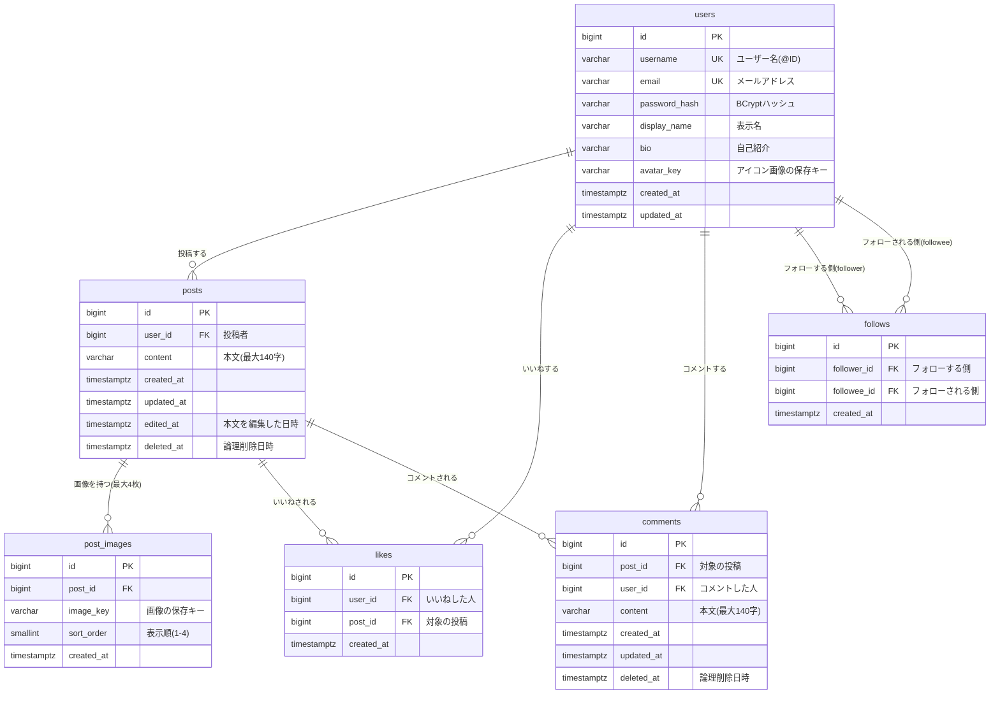

# 設計書：タイムライン型SNSアプリ（仮）

作成日: 2026-10-02
関連ドキュメント: [要件定義書](./要件定義書.md)／[機能一覧](./機能一覧.md)／[技術スタック](./技術スタック.md)／[インフラ構成図](./インフラ構成図.md)

[要件定義書](./要件定義書.md) で決めた機能を実現するための、データ（ER図・テーブル）とAPIの設計をまとめる。機能ごとの細かい振る舞いは [機能定義書](./機能定義書/) を参照。

## 1. ER図（データの実体と関連）



### ER図の読み方

| 関係 | 多重度 | 説明 |
|---|---|---|
| users → posts | 1 対 多 | 1人のユーザーは0件以上の投稿を持つ |
| posts → post_images | 1 対 0〜4 | 1つの投稿に画像は0〜4枚（4枚の上限はアプリ側でチェックする） |
| users ↔ posts（likes） | 多 対 多 | 「誰が・どの投稿に」いいねしたかを `likes` が記録する（中間テーブル） |
| posts → comments | 1 対 多 | 1つの投稿に0件以上のコメント。コメントへの返信は無いので、親コメントのIDは持たない |
| users ↔ users（follows） | 多 対 多 | ユーザー同士の関係。同じ `users` テーブルを2回参照する（**自己参照**） |

> **ポイント — いいね数・コメント数をカラムに持たない理由**
> `posts` に `like_count` のようなカラムは作らず、表示するたびに `likes` テーブルの件数を数える（[3-2](#3-2-いいね数コメント数いいね済みの判定)）。カラムに持つと、いいねのたびに +1 する処理と、2人が同時にいいねしたときに数がずれないようにする排他制御が必要になる。今回の規模（投稿1万件程度）では数える方式でも十分速く、データが常に正しいことを優先する。

## 2. テーブル定義

### 共通ルール

- 主キーは `bigint`（`GENERATED ALWAYS AS IDENTITY`＝自動採番）。JPAでは `@GeneratedValue(strategy = GenerationType.IDENTITY)`
  - 前回の課題ではUUIDを使ったが、今回は「新しい順に並べる」「ID を使ってページングする」ために、増えていく数値のIDにする
- 日時は `timestamptz`（タイムゾーン付き）。保存はUTC、画面では日本時間で表示する
- 投稿・コメントは**論理削除**（`deleted_at` に日時を入れて非表示にする）。いいね・フォローは取り消し時に**物理削除**（行ごと消す）

> **ポイント — 論理削除と物理削除の使い分け**
> 前回の課題ではカードを物理削除にした。今回の投稿・コメントは、他人のいいね・コメントが紐づいており、誤って消したときに調査・復旧できるよう論理削除にする。一方、いいね・フォローは「押した／押していない」の状態を表すだけなので、取り消したら行ごと消す。

### 2-1. users（ユーザー）

| カラム名 | 型 | NULL | デフォルト | 制約 | 説明 |
|---|---|---|---|---|---|
| id | bigint | NO | 自動採番 | PK | |
| username | varchar(15) | NO | | UNIQUE（大文字小文字を区別しない） | ユーザー名（@ID）。半角英数字と `_`、3〜15文字 |
| email | varchar(255) | NO | | UNIQUE（大文字小文字を区別しない） | ログインに使う |
| password_hash | varchar(255) | NO | | | BCryptでハッシュ化したパスワード |
| display_name | varchar(50) | NO | | | 表示名 |
| bio | varchar(160) | NO | `''` | | 自己紹介 |
| avatar_key | varchar(255) | YES | NULL | | アイコン画像の保存キー。NULLならデフォルト画像 |
| created_at | timestamptz | NO | `now()` | | 登録日時 |
| updated_at | timestamptz | NO | `now()` | | 更新日時 |

インデックス

- `UNIQUE (LOWER(username))`、`UNIQUE (LOWER(email))` … `Taro` と `taro` を別人として登録できないようにする（Hibernateでは作れないため `backend/src/main/resources/schema.sql` で作成）
- `idx_users_created (created_at)` … 「新しく参加したユーザー」の表示用

### 2-2. posts（投稿）

| カラム名 | 型 | NULL | デフォルト | 制約 | 説明 |
|---|---|---|---|---|---|
| id | bigint | NO | 自動採番 | PK | |
| user_id | bigint | NO | | FK → users.id | 投稿者 |
| content | varchar(140) | NO | `''` | | 本文。画像だけの投稿の場合は空文字。改行は `\n` にそろえて保存する |
| created_at | timestamptz | NO | `now()` | | 投稿日時 |
| updated_at | timestamptz | NO | `now()` | | 更新日時（論理削除でも変わる） |
| edited_at | timestamptz | YES | NULL | | 本文を最後に編集した日時。NULL＝一度も編集していない（「編集済み」の表示に使う） |
| deleted_at | timestamptz | YES | NULL | | 論理削除日時。NULL＝表示中 |

> **ポイント — 「編集済み」を updated_at で判定しない理由**
> `updated_at` は論理削除など本文以外の変更でも更新されるため、「本文を編集したか」の判定には使えない。本文を編集したときだけ日時を入れる `edited_at` を別に持つ。

インデックス

- `idx_posts_user_id (user_id, id DESC)` … タイムライン・プロフィールの投稿一覧を新しい順に取り出す用

### 2-3. post_images（投稿画像）

| カラム名 | 型 | NULL | デフォルト | 制約 | 説明 |
|---|---|---|---|---|---|
| id | bigint | NO | 自動採番 | PK | |
| post_id | bigint | NO | | FK → posts.id | 対象の投稿 |
| image_key | varchar(255) | NO | | | 画像の保存キー（例：`posts/2026/10/550e8400-....jpg`） |
| sort_order | smallint | NO | | CHECK (1〜4) | 表示順 |
| created_at | timestamptz | NO | `now()` | | |

制約

- `UNIQUE (post_id, sort_order)` … 同じ投稿の中で表示順が重複しない

> **ポイント — URLではなく「保存キー」を保存する理由**
> `https://xxx.s3.amazonaws.com/posts/...` のようなURLをそのまま保存すると、保存先をローカル → S3 に変えたときに全データを書き換える必要がある。保存キー（S3内のパス）だけを保存しておき、URLは画面に返すときに組み立てる。S3を非公開にして**署名付きURL**（期限付きでだけ見られるURL）を使う場合も、この方式なら対応できる。

### 2-4. likes（いいね）

| カラム名 | 型 | NULL | デフォルト | 制約 | 説明 |
|---|---|---|---|---|---|
| id | bigint | NO | 自動採番 | PK | |
| user_id | bigint | NO | | FK → users.id | いいねした人 |
| post_id | bigint | NO | | FK → posts.id | 対象の投稿 |
| created_at | timestamptz | NO | `now()` | | |

制約・インデックス

- `UNIQUE (user_id, post_id)` … **同じ人が同じ投稿に2回いいねできない**ことをDBで保証する（ボタンの連打対策）
- `idx_likes_post (post_id)` … 投稿ごとのいいね数を数える用

> **補足 — エンティティ名が `PostLike` の理由**
> JPQL（JPAのクエリ言語）では `LIKE` が予約語のため、エンティティのクラス名を `Like` にするとクエリが書きにくい。テーブル名は `likes` のまま、クラス名を `PostLike` にする。
>
> **補足 — いいねの登録は `ON CONFLICT DO NOTHING`**
> 「いいね済みか確認してから登録」だと、連打で同時に届いた2つのリクエストが両方とも確認を通り、2件目が一意制約違反（500エラー）になる。`INSERT ... ON CONFLICT (user_id, post_id) DO NOTHING`（PostgreSQL）で、重複していれば何もしないようにする。

### 2-5. comments（コメント）

| カラム名 | 型 | NULL | デフォルト | 制約 | 説明 |
|---|---|---|---|---|---|
| id | bigint | NO | 自動採番 | PK | |
| post_id | bigint | NO | | FK → posts.id | 対象の投稿 |
| user_id | bigint | NO | | FK → users.id | コメントした人 |
| content | varchar(140) | NO | | | 本文（1〜140文字） |
| created_at | timestamptz | NO | `now()` | | |
| updated_at | timestamptz | NO | `now()` | | |
| deleted_at | timestamptz | YES | NULL | | 論理削除日時 |

インデックス

- `idx_comments_post (post_id, id)` … 投稿詳細のコメント一覧（古い順）とコメント数を数える用

### 2-6. follows（フォロー）

| カラム名 | 型 | NULL | デフォルト | 制約 | 説明 |
|---|---|---|---|---|---|
| id | bigint | NO | 自動採番 | PK | |
| follower_id | bigint | NO | | FK → users.id | フォローする側 |
| followee_id | bigint | NO | | FK → users.id | フォローされる側 |
| created_at | timestamptz | NO | `now()` | | フォローした日時 |

制約・インデックス

- `UNIQUE (follower_id, followee_id)` … 同じ相手を2回フォローできない
- `CHECK (follower_id <> followee_id)` … 自分自身をフォローできない（アプリ側でもチェックする）
- `idx_follows_followee (followee_id)` … フォロワー一覧・フォロワー数を取り出す用

## 3. 主要なデータ取得の考え方

### 3-1. タイムライン（フォロー中のユーザー＋自分の投稿）

```sql
SELECT p.*
FROM posts p
WHERE p.deleted_at IS NULL
  AND (
    p.user_id = :me
    OR p.user_id IN (SELECT f.followee_id FROM follows f WHERE f.follower_id = :me)
  )
  AND (:cursor IS NULL OR p.id < :cursor)   -- 2ページ目以降は「前回の最後の投稿ID」より古いもの
ORDER BY p.id DESC
LIMIT 20;
```

新着投稿の確認（T-02）は、最後の条件を `p.id > :since`（画面に表示中で一番新しい投稿IDより新しいもの）に変えた同じクエリで取得する。

> **ポイント — OFFSET ではなく「カーソル方式」でページングする理由**
> `OFFSET 20 LIMIT 20`（21件目から20件）方式だと、読んでいる途中で誰かが新しく投稿すると全体が1件ずつずれ、同じ投稿が2回表示されてしまう。「前回の最後の投稿IDより小さいもの」を取る方式なら、新しい投稿が増えてもずれない。

### 3-2. いいね数・コメント数・いいね済みの判定

タイムラインで取得した20件の投稿IDに対して、項目ごとに**まとめて1回**で集計する（`PostQueryService#toResponses`）。

```sql
-- いいね数（いいねが0件の投稿は結果に出てこないので、アプリ側で0とする）
SELECT l.post_id, COUNT(*) FROM likes l
WHERE l.post_id IN (:postIds)
GROUP BY l.post_id;

-- いいね済み（ログイン中のユーザーがいいねした投稿のIDだけを取り出す）
SELECT l.post_id FROM likes l
WHERE l.user_id = :me AND l.post_id IN (:postIds);

-- コメント数（削除済みは数えない）
SELECT c.post_id, COUNT(*) FROM comments c
WHERE c.post_id IN (:postIds) AND c.deleted_at IS NULL
GROUP BY c.post_id;
```

- 投稿IDごとの結果を Java の `Map`／`Set` に入れ、20件それぞれに振り分ける
- 投稿の取得1回＋集計数回で、**投稿の件数が増えてもSQLの本数は変わらない**（画像実装時点で、タイムライン1回の表示はSQL 5本：投稿＋投稿者、いいね数、いいね済み、コメント数、画像）
- 投稿が0件のときは集計しない（空の `IN ()` にしない）

> **用語 — N+1問題**
> 一覧を1回のSQLで取った（1回）あと、各行ごとに追加のSQLを発行（N回）してしまう問題。20件のタイムラインで「いいね数」「コメント数」「画像」を1件ずつ取ると 1 + 20×3 = 61回 のSQLが発行され、遅くなる。上のように投稿IDをまとめて渡して集計すれば、件数に関係なく数回で済む。画像（`post_images`）も同様に `WHERE post_id IN (...)` でまとめて取得する。

### 3-3. ユーザー検索

```sql
SELECT u.*
FROM users u
WHERE u.username ILIKE :pattern ESCAPE '\'
   OR u.display_name ILIKE :pattern ESCAPE '\'
ORDER BY (LOWER(u.username) = LOWER(:keyword)) DESC,  -- ユーザー名が完全一致する人を先頭に
         u.id DESC
LIMIT 20 OFFSET :offset;
```

- `:pattern` はキーワードの `\` `%` `_` をエスケープしたうえで、前後に `%` を付けたもの（例：`taro_1` → `%taro\_1%`）
- キーワードの先頭が `@` の場合は `@` を取り除き、`display_name` の条件を外して `username` だけを検索する
- `ILIKE` は PostgreSQL の「大文字小文字を区別しない LIKE」
- 詳しくは [ユーザー検索機能](./機能定義書/ユーザー検索機能.md) を参照

### 3-4. 一覧取得でのN+1問題の対策（まとめ）

一覧を返すAPIでは、1行ごとに追加のSQLを発行しないようにする（[3-2](#3-2-いいね数コメント数いいね済みの判定) の「用語 — N+1問題」を参照）。
JPAでは `@ManyToOne` の関連（例：`post.getUser()`）を辿るだけで裏でSQLが発行されるため、**コード上はループでSQLを書いていなくても発生する**点に注意する。

| 一覧 | 1行ごとに取得しがちなもの | 対策 | 状態 |
|---|---|---|---|
| タイムライン（T-01・T-02）・ユーザーの投稿一覧（U-04） | 投稿者（`users`） | 投稿の取得クエリで `join fetch p.user` する | 実装済み（U-04 は20件の一覧でSQL 5本：ユーザーの取得、投稿＋投稿者、いいね数、いいね済み、コメント数） |
| 同上 | いいね数・コメント数・いいね済み | 投稿IDをまとめて渡して1回で集計する（3-2） | 実装済み |
| 同上 | 画像（`post_images`） | `WHERE post_id IN (:postIds)` で1回で取得し、投稿IDごとに振り分ける | 実装済み |
| コメント一覧（C-01） | コメント者（`users`） | `join fetch c.user` する | 実装済み（20件の一覧でSQL 2本：投稿の存在確認、コメント＋コメント者） |
| フォロー中／フォロワー一覧（F-03・F-04） | 相手のユーザー（`users`） | `join fetch` する | 実装済み（一覧1回でSQL 3本：ユーザーの取得、フォロー＋相手のユーザー、`followedByMe`） |
| フォロー中／フォロワー一覧・ユーザー検索（U-01）・新しく参加したユーザー（U-02） | `followedByMe`（ログイン中のユーザーがフォローしているか） | 一覧のユーザーIDをまとめて渡し、下のSQLで1回で取得する | 実装済み（U-01・U-02 は一覧1回でSQL 2本：ユーザーの取得、`followedByMe`） |

```sql
-- 一覧に出てくるユーザーのうち、ログイン中のユーザーがフォローしている人のIDを1回で取得する
SELECT f.followee_id
FROM follows f
WHERE f.follower_id = :me
  AND f.followee_id IN (:userIds);
```

- `followedByMe` を付ける処理は1か所（`FollowService#toSummaries`）にまとめ、検索・新規ユーザー・フォロー一覧で使い回す
- 投稿一覧の組み立ては `PostQueryService` に集め、プロフィールの投稿一覧（U-04）や投稿詳細でも同じ処理を通す（別の簡易実装を作るとN+1が再発しやすい）

> **ポイント — N+1が起きていないかの確かめ方**
> `logging.level.org.hibernate.SQL=DEBUG` でSQLをログに出し、一覧を1回表示したときのSQLの本数を数える。件数（20件）に比例して本数が増えていればN+1が起きている（[品質チェックリスト](./品質チェックリスト.md) BE-12）。
> なお `spring.jpa.open-in-view=false` のため、トランザクションの外で関連を辿ると `LazyInitializationException` になるが、`@Transactional` のServiceの中ではエラーにならずにN+1が起きる。エラーが出ないことは、N+1が無いことの確認にはならない。

## 4. API設計

### 4-1. 共通仕様

| 項目 | 内容 |
|---|---|
| ベースURL | `/api` |
| データ形式 | JSON（画像アップロードのみ `multipart/form-data`） |
| 認証 | `Authorization: Bearer <JWT>` ヘッダー。「認証」欄が○のAPIは、ヘッダーが無い・期限切れの場合 401 を返す |
| 日時形式 | ISO 8601（UTC）。例：`2026-10-02T03:34:56Z` |
| JSONのキー | キャメルケース（例：`likeCount`） |
| リクエストID | すべてのレスポンスに `X-Request-Id` ヘッダーを付ける。ログの `requestId` と同じ値で、問い合わせを受けたときにログを探す手がかりにする（[8-2](#8-2-すべてのログに付く項目)） |

#### ステータスコード

| コード | 意味 | 主なケース |
|---|---|---|
| 200 OK | 成功 | 取得・更新、いいね・フォロー（最新の件数を返す）、コメント削除（最新のコメント数を返す） |
| 201 Created | 作成した | 新規登録・投稿・コメント |
| 204 No Content | 成功（返す内容なし） | 投稿削除 |
| 400 Bad Request | 入力内容の誤り | バリデーションエラー、自分をフォローしようとした |
| 401 Unauthorized | ログインしていない | トークン無し・期限切れ、ログイン失敗 |
| 403 Forbidden | 権限が無い | 他人の投稿を編集・削除しようとした、他人のコメントを削除しようとした |
| 404 Not Found | 見つからない | 存在しない／削除済みの投稿・ユーザー |
| 409 Conflict | 重複 | ユーザー名・メールアドレスが既に使われている |
| 413 Payload Too Large | ファイルが大きすぎる | 画像1枚5MB超、1回の送信の合計20MB超 |
| 415 Unsupported Media Type | 送信形式の誤り | 投稿作成（multipart/form-data）にJSONで送った |

#### エラーレスポンスの形

```json
{
  "status": 400,
  "message": "入力内容に誤りがあります",
  "errors": [
    { "field": "content", "message": "140文字以内で入力してください" }
  ]
}
```

### 4-2. API一覧

| No | メソッド | パス | 内容 | 認証 | 機能定義書 |
|---|---|---|---|---|---|
| A-01 | POST | /api/auth/signup | 新規登録（JWTを返す） | - | [認証機能](./機能定義書/認証機能.md) |
| A-02 | POST | /api/auth/login | ログイン（JWTを返す） | - | [認証機能](./機能定義書/認証機能.md) |
| A-03 | GET | /api/auth/me | ログイン中のユーザー情報 | ○ | [認証機能](./機能定義書/認証機能.md) |
| T-01 | GET | /api/timeline | タイムライン | ○ | [タイムライン機能](./機能定義書/タイムライン機能.md) |
| T-02 | GET | /api/timeline/new | 新着投稿の確認 | ○ | [タイムライン機能](./機能定義書/タイムライン機能.md) |
| P-01 | POST | /api/posts | 投稿作成（画像添付可） | ○ | [投稿機能](./機能定義書/投稿機能.md)／[画像投稿機能](./機能定義書/画像投稿機能.md) |
| P-02 | GET | /api/posts/{postId} | 投稿詳細 | ○ | [投稿機能](./機能定義書/投稿機能.md) |
| P-03 | DELETE | /api/posts/{postId} | 投稿削除（本人のみ） | ○ | [投稿機能](./機能定義書/投稿機能.md) |
| P-04 | PUT | /api/posts/{postId} | 投稿編集（本人のみ） | ○ | [投稿機能](./機能定義書/投稿機能.md) |
| L-01 | POST | /api/posts/{postId}/likes | いいねする | ○ | [いいね機能](./機能定義書/いいね機能.md) |
| L-02 | DELETE | /api/posts/{postId}/likes | いいね取り消し | ○ | [いいね機能](./機能定義書/いいね機能.md) |
| C-01 | GET | /api/posts/{postId}/comments | コメント一覧 | ○ | [コメント機能](./機能定義書/コメント機能.md) |
| C-02 | POST | /api/posts/{postId}/comments | コメント投稿 | ○ | [コメント機能](./機能定義書/コメント機能.md) |
| C-03 | DELETE | /api/comments/{commentId} | コメント削除（本人のみ） | ○ | [コメント機能](./機能定義書/コメント機能.md) |
| U-01 | GET | /api/users/search | ユーザー検索 | ○ | [ユーザー検索機能](./機能定義書/ユーザー検索機能.md) |
| U-02 | GET | /api/users/new | 新しく参加したユーザー | ○ | [ユーザー検索機能](./機能定義書/ユーザー検索機能.md) |
| U-03 | GET | /api/users/{username} | プロフィール | ○ | [プロフィール機能](./機能定義書/プロフィール機能.md) |
| U-04 | GET | /api/users/{username}/posts | ユーザーの投稿一覧 | ○ | [プロフィール機能](./機能定義書/プロフィール機能.md) |
| U-05 | PUT | /api/users/me | プロフィール更新 | ○ | [プロフィール機能](./機能定義書/プロフィール機能.md) |
| U-06 | POST | /api/users/me/avatar | アイコン画像の変更 | ○ | [プロフィール機能](./機能定義書/プロフィール機能.md) |
| F-01 | POST | /api/users/{username}/follow | フォローする | ○ | [フォロー機能](./機能定義書/フォロー機能.md) |
| F-02 | DELETE | /api/users/{username}/follow | フォロー解除 | ○ | [フォロー機能](./機能定義書/フォロー機能.md) |
| F-03 | GET | /api/users/{username}/following | フォロー中の一覧 | ○ | [フォロー機能](./機能定義書/フォロー機能.md) |
| F-04 | GET | /api/users/{username}/followers | フォロワーの一覧 | ○ | [フォロー機能](./機能定義書/フォロー機能.md) |
| H-01 | GET | /api/health | ヘルスチェック（ALB用） | - | [インフラ構成図](./インフラ構成図.md) |

> ログアウトは、ブラウザに保存したJWTを消すだけなのでAPIは用意しない。

> **ポイント — `/api/users/search` と `/api/users/{username}` の衝突**
> `/api/users/search` は `/api/users/{username}` の `{username}` に `search` が入ったものとも読める。Spring では固定のパスが優先されるので動作はするが、`search` や `new` というユーザー名が登録されると区別できなくなる。そのため、**`search`・`new`・`me` などはユーザー名として登録できない予約語**にする（[認証機能](./機能定義書/認証機能.md) の入力チェック参照）。

### 4-3. よく使うレスポンスの形

ここでは画面を作るときによく使う形の意味を説明する。すべてのAPIのリクエスト・レスポンスの項目と型は、[4-4](#4-4-api仕様書openapiの自動生成) の API仕様書（`docs/api/openapi.yaml`）を参照。

#### UserSummary（ユーザーの概要。一覧・投稿者表示で使う）

```json
{
  "id": 2,
  "username": "hanako",
  "displayName": "花子",
  "avatarUrl": "https://.../avatars/xxxx.png",
  "bio": "Javaを勉強中です",
  "followedByMe": false,
  "isMe": false
}
```

| キー | 説明 |
|---|---|
| followedByMe | ログイン中のユーザーがこの人をフォローしているか（フォローボタンの表示に使う） |
| isMe | ログイン中のユーザー本人か（本人ならフォローボタンを出さない） |

#### Post（投稿）

```json
{
  "id": 120,
  "author": { "id": 2, "username": "hanako", "displayName": "花子", "avatarUrl": "https://..." },
  "content": "今日はSpring Securityを学びました",
  "images": [
    { "url": "https://.../posts/2026/10/aaaa.jpg", "sortOrder": 1 },
    { "url": "https://.../posts/2026/10/bbbb.jpg", "sortOrder": 2 }
  ],
  "likeCount": 34,
  "commentCount": 12,
  "likedByMe": true,
  "isMine": false,
  "edited": false,
  "createdAt": "2026-10-02T03:34:56Z"
}
```

| キー | 説明 |
|---|---|
| likeCount | 第三者を含むいいねの総数 |
| commentCount | 第三者を含むコメントの総数（削除済みを除く） |
| likedByMe | ログイン中のユーザーがいいね済みか（ハートの塗りつぶしに使う） |
| isMine | ログイン中のユーザーの投稿か（編集・削除ボタンの表示に使う） |

| edited | 本文を編集したことがあるか（「編集済み」の表示に使う） |

> インプレッション数・リツイート数は**レスポンスに含めない**。

#### ページング付きの一覧

```json
{
  "items": [ /* Post や UserSummary の配列 */ ],
  "nextCursor": 101,
  "hasNext": true
}
```

次のページは `?cursor={nextCursor}` を付けて取得する。1ページ20件。

### 4-4. API仕様書（OpenAPI）の自動生成

API仕様書は手で書かず、Controller・DTO から [springdoc-openapi](https://springdoc.org/) で生成する。実装と仕様書がずれないように、テストと CI で差分をチェックする。

```
Controller・DTO（@Operation・@ApiResponse・@Schema）
   │ springdoc-openapi が解析
   ├─► Swagger UI（ローカルのみ） http://localhost:8080/swagger-ui.html
   └─► OpenApiDocTest が書き出す ─► docs/api/openapi.yaml（Gitで管理）
                                      ├─► npm run build:api-doc  ─► docs/api/dist/index.html（1枚もののHTML）
                                      └─► npm run gen:api-types ─► frontend/src/api/schema.d.ts（フロントの型）
```

| 生成物 | 作り方 | Gitで管理 | 差分チェック |
|---|---|---|---|
| `docs/api/openapi.yaml` | `backend/` で `./gradlew test -PupdateApiDoc` | ○ | `./gradlew test`（`OpenApiDocTest`）で、実装から生成した結果と違えば失敗する |
| `frontend/src/api/schema.d.ts` | `frontend/` で `npm run gen:api-types` | ○ | CI で生成し直し、差分があれば失敗する |
| `docs/api/dist/index.html` | `frontend/` で `npm run build:api-doc`（Redocly CLI） | ×（`.gitignore`） | なし。CI の成果物 `api-doc` からもダウンロードできる |

**APIを変更したときの手順**

1. Controller・DTO を変更し、必要なら `@Operation`・`@ApiResponse` も直す
2. `backend/` で `./gradlew test -PupdateApiDoc` を実行して `docs/api/openapi.yaml` を更新する
3. `frontend/` で `npm run gen:api-types` を実行して `src/api/schema.d.ts` を更新する
4. 3つをまとめてコミットする（どれかを忘れると CI が失敗する）

**仕様書の書き方のルール**

| 項目 | ルール |
|---|---|
| summary | 先頭に 4-2 の API ID を付ける（例：`P-01 投稿作成`） |
| グループ（タグ） | 機能定義書の機能単位（`ApiTags`）。並び順は 4-2 と同じ |
| エラー | 各APIの `@ApiResponse` には、機能定義書の「API仕様」に書いたエラーだけを書く。形はすべて `ErrorResponse`（4-1）になる |
| 401 | JWTが必要なAPIすべてに自動で付ける（`OpenApiConfig`）。不要なAPI（A-01・A-02）には `@SecurityRequirements` を付ける |
| レスポンスの項目 | すべて必ず返すため、自動で required にする（フロントの型が省略可能にならないように）。null になる項目（`avatarUrl`・`nextCursor`）は `@Schema(types = {"...", "null"})` を付ける |

**公開範囲**

- `springdoc.api-docs.enabled`・`springdoc.swagger-ui.enabled` は `application.properties` で `false`（本番では公開しない）、`application-local.properties` で `true` にする
- Swagger UI の「Authorize」に A-01・A-02 で受け取ったJWTを入れると、ログインが必要なAPIも試せる
- H-01（`/api/health`）は Spring Boot Actuator のため、仕様書には載らない

## 5. 画像の保存とURLの組み立て

| 項目 | フェーズ1（ローカル） | フェーズ2（AWS） |
|---|---|---|
| 保存先 | `backend/uploads/` フォルダ | S3 バケット（非公開） |
| 保存キーの例 | `posts/2026/10/550e8400-....jpg` | 同じ |
| 画面に返すURL | `http://localhost:8080/uploads/posts/2026/10/....jpg` | 署名付きURL（有効期限1時間） |
| 切り替え方法 | Springのプロファイル `local` | Springのプロファイル `aws` |
| 配信 | `/uploads/**`（`WebConfig`）。`` タグはJWTを付けられないため、ログインなしで開ける | S3 の署名付きURLをブラウザが直接開く |
| 実装の状況 | 実装済み（`LocalImageStorage`） | フェーズ2で `S3ImageStorage` を追加する |

- 保存の仕組みは `ImageStorage` インターフェース（`save`・`delete`・`toUrl`）にまとめ、投稿画像とアイコン画像で共通にする
- 設定値：`app.storage.local-dir`（保存先のフォルダ）・`app.storage.public-base-url`（画面に返すURLの先頭）
- アップロードの上限：`spring.servlet.multipart.max-file-size=5MB`・`max-request-size=20MB`（超えたら 413）

詳しくは [画像投稿機能](./機能定義書/画像投稿機能.md) と [インフラ構成図](./インフラ構成図.md) を参照。

## 6. ローカル起動方法

```bash
# 0. 初回のみ: 設定ファイルを雛形からコピーし、パスワード・JWT署名キーを書き換える
cp backend/.env.example backend/.env
cp backend/src/main/resources/application-local.properties.example backend/src/main/resources/application-local.properties
cp frontend/.env.example frontend/.env

# 1. PostgreSQLコンテナを起動（backend/ ディレクトリで実行。compose のプロジェクト名は sns-timeline 固定）
cd backend
docker compose up -d

# 2. Spring Bootアプリを起動（local プロファイルで application-local.properties を読み込む）
./gradlew.bat bootRun --args="--spring.profiles.active=local"   # Windows

# 3. フロントエンドを起動（別のターミナルで）
cd frontend
npm install
npm run dev
```

`http://localhost:5173` をブラウザで開き、新規登録画面が表示されれば起動成功。

API仕様書（Swagger UI）は `http://localhost:8080/swagger-ui.html` で開ける（[4-4](#4-4-api仕様書openapiの自動生成)）。

## 7. テスト方針

「変更したときに、今まで動いていたものが壊れていないか」をすぐ確かめられるように、層ごとにテストを書く。E2Eテスト（ブラウザを実際に操作するテスト）は対象外。

### 7-1. テストの種類

| 種類 | 対象 | 書き方 | DB | 例 |
|---|---|---|---|---|
| 単体テスト | Service・入力チェック・JWTの発行 | Repository を Mockito でモックにする | 使わない | `LikeServiceTest`・`ContentRulesTest`・`JwtServiceTest` |
| Controller のテスト | URL・ステータスコード・JSONの形・認証（401） | `@WebMvcTest` + MockMvc。Service はモックにする | 使わない | `LikeControllerTest`・`TimelineControllerTest` |
| Repository のテスト | `@Query` のSQL・一意制約・CHECK制約・`schema.sql` のインデックス | `@DataJpaTest`（`support/RepositoryTest`）。テストごとにロールバックする | Testcontainers の PostgreSQL | `PostRepositoryTest`・`UserRepositoryTest` |
| API結合テスト | Controller → Service → Repository → DB の通しの動き（他人の投稿を編集できない、いいねが二重にならない等） | `@SpringBootTest` + MockMvc。何もモックにしない。テストごとに全テーブルを `truncate` する | Testcontainers の PostgreSQL | `ApiIntegrationTest` |
| フロントの単体テスト | utils・APIクライアント（`http.js`）・ログイン状態（`AuthProvider`） | Vitest | - | `authValidation.test.js`・`http.test.js` |
| コンポーネントテスト | 各UIコンポーネント・ログイン／新規登録画面の表示と操作 | Vitest + React Testing Library（jsdom）。`src/api/*` を `vi.mock` でモックにする | - | `PostCard.test.jsx`・`LikeButton.test.jsx` |

### 7-2. テスト用のDB

- テストでは開発用（`docker compose`）・本番用のDBに**一切書き込まない**。[Testcontainers](https://testcontainers.com/) がテストのたびに使い捨ての PostgreSQL 16（本番と同じ）のコンテナを起動し、終わったら削除する（`support/TestcontainersConfiguration`）。接続先は `@ServiceConnection` が自動で設定する
- H2（メモリ上のDB）は使わない。`schema.sql` の関数インデックス（`LOWER(username)`）や、`INSERT ... ON CONFLICT`・`ILIKE ... ESCAPE` を本番と同じように扱えず、「H2では通るが本番では動かない」が起こるため
- そのため、バックエンドのテストを実行するには **Docker が起動している**必要がある（GitHub Actions の `ubuntu-latest` には Docker が入っている）
- API結合テストで保存する画像は一時ディレクトリに保存し、`backend/uploads/` には書き込まない

### 7-3. 観点

- 正常系だけでなく、異常系（404・400）・境界値（140文字／141文字、5MB）・認証（JWTが無い／不正なら401）・認可（他人の投稿・コメントは403）・冪等性（いいね・フォローの連打）を確かめる
- テスト名は日本語で「何をしたら、どうなるべきか」を書き、テスト名を読めば仕様が分かるようにする
- フロントのテストは、内部の状態ではなく画面に表示される内容（ロール・ラベル・文字）で確かめる。実装を書き換えただけでテストが壊れないようにするため

### 7-4. 実行方法

```bash
# バックエンド（Docker を起動しておく）
cd backend
./gradlew.bat test

# フロントエンド
cd frontend
npm test            # 1回だけ実行（CI と同じ）
npm run test:watch  # ファイルを保存するたびに実行
```

CI（`.github/workflows/ci.yml`）では、PRごとにバックエンド・フロントエンドの両方のテストを実行する。

### 7-5. 性能テスト

[要件定義書 8章](./要件定義書.md#8-非機能要件) の性能要件（No.3 ユーザー100人・投稿1万件、No.4 タイムラインの表示が1秒以内）を満たしているかを、[k6](https://grafana.com/docs/k6/latest/) でAPIに負荷をかけて確かめる。手順は [perf/README.md](./perf/README.md) を参照。

- **CIでは実行しない。** 時間がかかり（load は約10分）、実行する環境によって値が変わるため、性能に関わる変更をしたときやAWSへデプロイしたときに手動で実行する。`perf/` に独立させ、`./gradlew test`・`npm test` からは呼ばれない
- 開発用DBとは別に、**性能テスト専用のPostgreSQL**（`perf/docker-compose.perf.yml`、ポート5433）を使う。テストデータを全件削除して作り直すため。バックエンドは `local,perf` プロファイルで起動し、接続先だけを切り替える（`application-perf.properties`）
- テストデータは `perf/seed/seed.sql` で一括投入する（APIで1万件投稿すると時間がかかり、測る対象にも余計な負荷がかかるため）。投稿者・フォロー数・いいね数にばらつきを持たせ、倍率（`scale`）で10倍のデータも作れる
- ログインは各シナリオの `setup()` で1回だけ行い、JWTを使い回す。BCryptの照合はCPUを多く使うため、毎回ログインすると測りたいAPIの結果に混ざってしまう

| シナリオ | 内容 | 目的 |
|---|---|---|
| smoke（`smoke.js`） | 1人で全APIを1回ずつ呼ぶ | スクリプトとテストデータが正しいかの確認。負荷をかける前に毎回実行する |
| load（`load.js`） | 100人が同時に、タイムライン表示 → スクロール → いいね・コメントなど → 15秒ごとの新着確認 を繰り返す（約10分） | 想定規模で要件を満たすかの判定 |

合否の基準（`perf/k6/lib/config.js` の `thresholdsFor()`。`setup()` のログインは除いて判定する。外れたら k6 の終了コードが非0になる）：

| 対象 | 基準 | 理由 |
|---|---|---|
| T-01 タイムライン | p95 < 500ms | 画面の描画にかかる時間を残すため、要件の1秒より短くする |
| T-02 新着確認 | p95 < 200ms | 全員が15秒ごとに呼ぶため |
| 全API | p95 < 1000ms | |
| エラー率 | 1%未満 | |

> **用語 — p95**
> 全リクエストのうち95%がこの時間以内に返った、という値。平均だと一部の遅いリクエストが隠れてしまうため、p95で判定する。

> **ポイント — ローカルの計測値は目安**
> ローカルではPCの性能や他のアプリの影響を受けるため、値そのものより「変更の前後で遅くなっていないか」を同じPCで比べるのに使う。要件を満たすかの最終判定は、AWS（フェーズ2）の環境に対して実行して行う。

## 8. ログ設計

障害やセキュリティ上の問題が起きたときに、「いつ・誰の・どのリクエストで・何が起きたか」をログから追えるようにする。ログを出す処理は `logging` パッケージ（`LogFields`・`LogMasks`・`RequestLoggingFilter`・`UserIdLoggingFilter`）にまとめている。

### 8-1. 出力形式

| 環境 | 形式 | 設定 |
|---|---|---|
| ローカル・テスト | 人が読める1行テキスト。requestId とキー・値も表示する | `application.properties` の `logging.pattern.console` |
| AWS（`aws` プロファイル） | 1行1件の JSON（[ECS](https://www.elastic.co/guide/en/ecs/current/index.html) 形式） | `application-aws.properties` の `logging.structured.format.console=ecs`。EC2 で `SPRING_PROFILES_ACTIVE=aws` にする |

```text
# ローカル
10:00:00.123  INFO [8bd03d90-...] c.e.snstimeline.service.PostService      : 投稿しました event.action="post.created" postId="120" imageCount="0"
```

```json
// AWS（実際は1行）
{"@timestamp":"2026-11-08T01:00:00.123Z","log":{"level":"INFO","logger":"com.example.snstimeline.service.PostService"},
 "service":{"name":"sns-timeline"},"message":"投稿しました","requestId":"8bd03d90-...","userId":"42",
 "event":{"action":"post.created"},"postId":120,"imageCount":0}
```

JSON にしておくと、CloudWatch Logs Insights で `userId = "42"` や `event.action = "auth.login.failed"` のように項目を指定して検索・集計できる。

### 8-2. すべてのログに付く項目

リクエストの処理中に出したログには、MDC（ログ共通の項目）で次の項目が自動で付く。Service などでログを出すときに、自分で付ける必要はない。

| 項目 | 内容 | 付けるところ |
|---|---|---|
| `requestId` | 1つのリクエストで出たログを結び付けるID。レスポンスの `X-Request-Id` ヘッダーでも返す | `RequestLoggingFilter`（一番外側のフィルター）。リクエストの `X-Request-Id` → ALB の `X-Amzn-Trace-Id` の Root → 新しく発行（UUID）の順に使う。改行などを含む値でログを偽装されないよう、英数字と `.` `_` `-` の64文字以内でなければ使わない |
| `userId` | ログイン中のユーザーID（JWT の sub）。未ログインのリクエストには付かない | `UserIdLoggingFilter`（JWT を検証した後のフィルター） |

各ログには、キー・値（SLF4J の `addKeyValue`）で `event.action`（何が起きたか）と、その出来事に関係するID（`postId` など）を付ける。

```java
log.atInfo().setMessage("投稿しました")
        .addKeyValue(LogFields.EVENT, "post.created")
        .addKeyValue("postId", post.getId())
        .log();
```

### 8-3. ログのレベルとイベント一覧

| レベル | 基準 | 例 |
|---|---|---|
| ERROR | **人がすぐ対応するもの**。AWS ではこの件数で通知する | 想定外のエラー（500） |
| WARN | 処理は続けられたが、気にすべきこと。セキュリティ上の出来事 | ログイン失敗、権限の無い操作（403）、画像ファイルを削除できなかった |
| INFO | 業務上の出来事と、アクセスログ | 投稿の作成、1リクエスト1行のアクセスログ |
| DEBUG | 開発中の調査用。本番では出さない | SQL、ヘルスチェックのアクセスログ |

400（入力ミス）・404 は利用者の操作による正常な失敗なので、ERROR・WARN にしない（アクセスログのステータスで分かる）。

| `event.action` | レベル | 出すところ | 付ける項目 |
|---|---|---|---|
| `http.access` | INFO（`/api/health` は DEBUG） | `RequestLoggingFilter` | `method`・`path`・`status`・`durationMs` |
| `auth.signup` | INFO | `AuthService` | `userId` |
| `auth.login.succeeded` | INFO | `AuthService` | `userId` |
| `auth.login.failed` | WARN | `AuthService` | `reason`（`user_not_found`・`wrong_password`）・`email`（一部を隠したもの） |
| `security.forbidden` | WARN | `GlobalExceptionHandler`（403 を返すとき） | - |
| `error.unexpected` | ERROR | `GlobalExceptionHandler`（500 を返すとき）。例外のスタックトレースも出す | - |
| `post.created` / `post.updated` / `post.deleted` | INFO | `PostService` | `postId`（作成時は `imageCount` も） |
| `comment.created` / `comment.deleted` | INFO | `CommentService` | `commentId`（作成時は `postId` も） |
| `follow.created` / `follow.deleted` | INFO | `FollowService`（実際に変わったときだけ） | `targetUserId` |
| `user.profile.updated` / `user.avatar.changed` | INFO | `UserService` | - |
| `storage.delete.failed` | WARN | `LocalImageStorage` | `imageKey` |

- いいね・取り消しは件数が多く、アクセスログ（`POST /api/posts/{id}/likes`）で分かるため、イベントのログは出さない
- 新しくログを出すときは、この表に `event.action` を追記する。名前は「対象.動作」（過去形）にする

### 8-4. ログに出さない情報

ログは CloudWatch Logs に長く残り、多くの人が見られる。次の情報は**ログに出さない**（`ApiIntegrationTest` で確認している）。

| 情報 | 理由 | 代わりに出すもの |
|---|---|---|
| パスワード | 漏れるとなりすましに使われる。DTO の `toString` でも隠している | 出さない |
| JWT | 有効期限内なら、そのまま他人になりすませる | `userId` |
| メールアドレス | 個人情報 | ログイン失敗のときだけ `LogMasks.email` で一部を隠したもの（例: `h***@example.com`） |
| 投稿・コメントの本文、自己紹介 | ユーザーが書いた内容 | `postId`・`commentId` |
| クエリ文字列（検索キーワードなど） | 個人名などを含むことがある | アクセスログはパス（`path`）だけを出す |

リクエストの本文や DTO を丸ごとログに出すことも禁止する。

### 8-5. AWS での監視・運用（フェーズ2で構築）

[インフラ構成図](./インフラ構成図.md#9-ログと監視フェーズ2) の構成で、次のように運用する予定。

**ログを集める**：EC2 の Docker Compose で `awslogs` ログドライバーを使い、コンテナの出力を CloudWatch Logs のロググループ `/sns-timeline/app` に直接送る（エージェントは入れない）。EC2 の IAM ロールに `logs:CreateLogStream`・`logs:PutLogEvents` を付ける。

**通知する**（CloudWatch アラーム → SNS → メール。アラームは無料枠の10個以内）：

| アラーム | 条件 | 分かること |
|---|---|---|
| アプリのエラー | メトリクスフィルターで `log.level = "ERROR"` を数え、5分で1件以上 | 想定外のエラー |
| 5xx の増加 | ALB の `HTTPCode_Target_5XX_Count` | 利用者にエラーが見えている |
| ヘルスチェック失敗 | ALB の `UnHealthyHostCount` が1以上 | アプリが止まっている |
| EC2 の故障 | `StatusCheckFailed` | サーバー自体の異常 |
| DB の空き容量 | RDS の `FreeStorageSpace` | 容量不足を事前に知る |

**調べる**（CloudWatch Logs Insights。調べる期間は必要な分だけに絞る）：

```text
# エラーが起きたリクエストのログをまとめて見る（requestId は X-Request-Id ヘッダーやエラーのログから分かる）
fields @timestamp, log.level, message, event.action | filter requestId = "8bd03d90-..." | sort @timestamp

# 直近のエラー
fields @timestamp, message, requestId, userId | filter log.level = "ERROR" | sort @timestamp desc | limit 20

# 遅いAPI
filter event.action = "http.access" | stats avg(durationMs) as avgMs, max(durationMs) as maxMs, count() by path | sort maxMs desc

# ログイン失敗が多いメールアドレス(一部を隠したもの)
filter event.action = "auth.login.failed" | stats count() as failures by email | sort failures desc
```

**運用のルール**：

| 項目 | ルール |
|---|---|
| 保存期間 | ロググループの保存期間を **30日** にする（初期設定の「無期限」のままだと料金が増え続ける） |
| コスト | CloudWatch Logs の無料枠（取り込み・保存とも月5GB）に収める。AWS Budgets で料金のアラートも設定する |
| 通知が来たとき | ①メールを確認 → ②Logs Insights でエラーのログを探す → ③`requestId` で同じリクエストのログを追う → ④原因が分かったら Issue を作って修正する |
| 見直し | ログを追加・変更したPRでは、[品質チェックリスト](./品質チェックリスト.md) BE-13・BE-14 を確認する |
